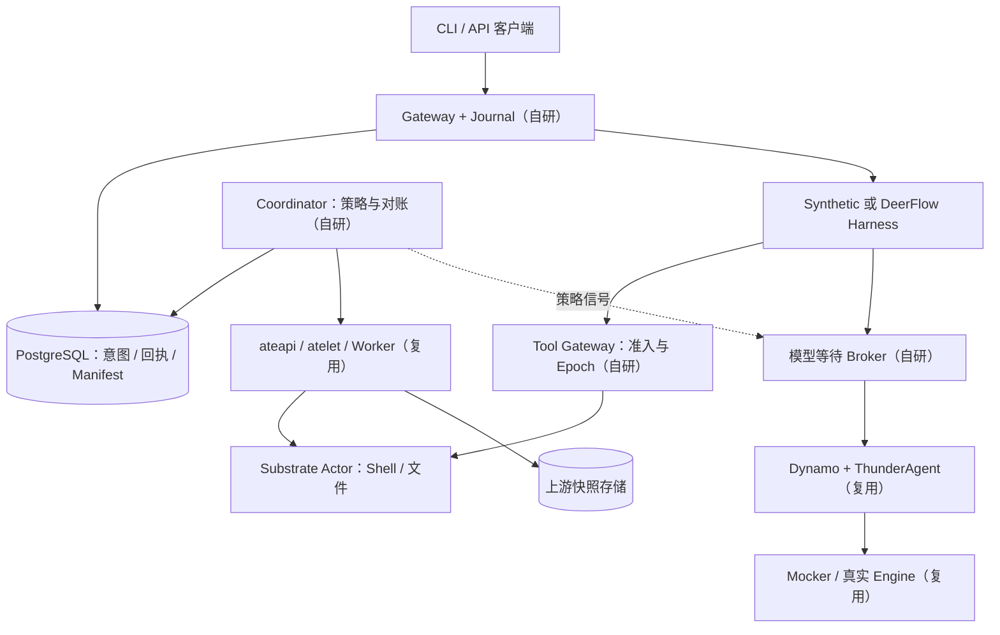
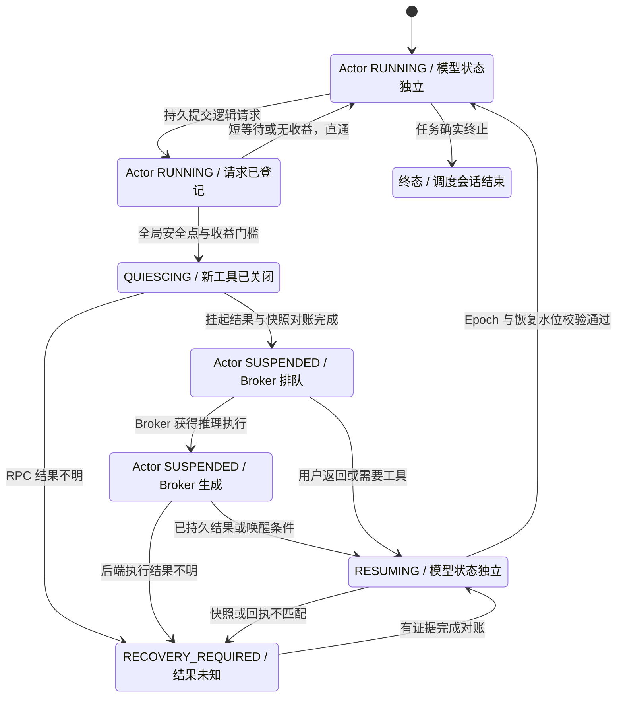
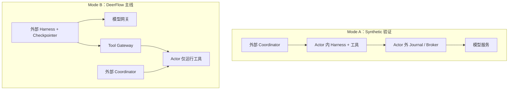
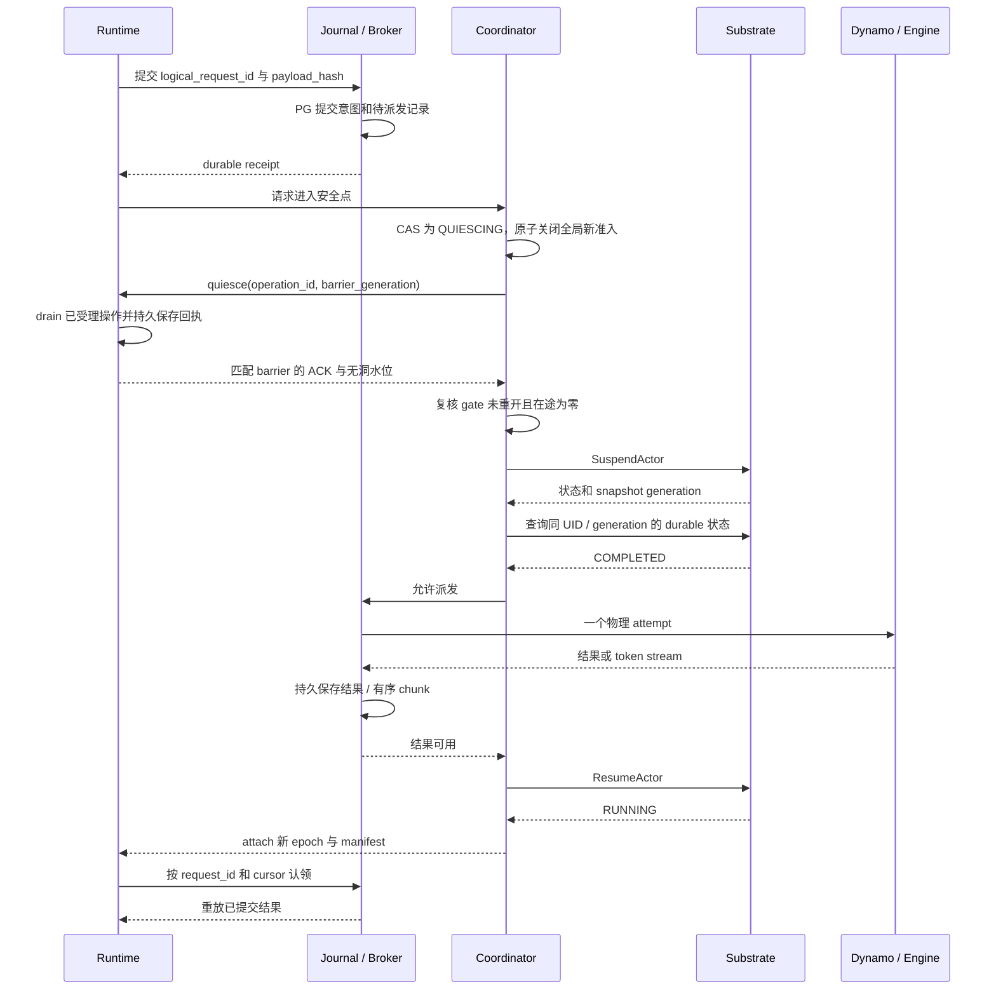
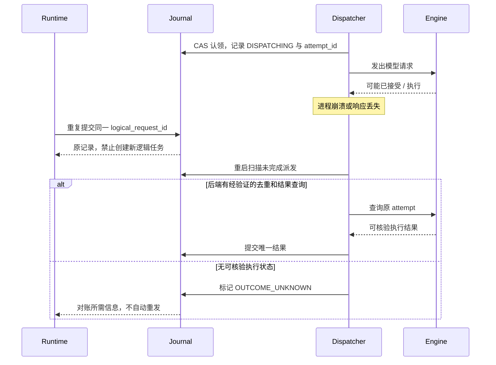
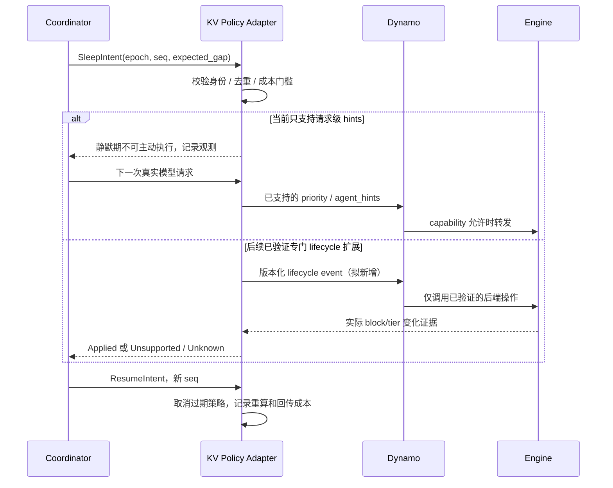

# AgentCloud：上游源码审计、架构裁决与分阶段实施计划

**设计基线日期：2026-11-09。本文使用 D0～D6 表示设计构建顺序。正式交付统一使用 P0 原生正确性与真实 Agent、P1 调度性能、P2 物理 GPU、P3 封版；定义见[实施计划](docs/IMPLEMENTATION_PLAN.md)。当前实现、部署验收和实验结果见[交付状态](docs/STATUS.md)、[实验报告](docs/EXPERIMENTS.md)与[中文简历要点](docs/RESUME_ZH.md)。**

**证据规则：** `[已验证事实]` 表示在本次固定版本源码或官方文档中核对到的行为，不表示已经在本机运行成功；`[合理推断]` 表示由证据推导的设计裁决；`[待验证假设]` 表示需要后续实验验证的能力或收益。设计接口、目录、命令与验收标准不代表已有实现。本文所有性能收益均待测，简历中的 `[X]` 必须在真实实验后替换。

## 1. 项目摘要与核心定位

### 1.1 结论先行

**[合理推断] 建议有条件立项，并收缩定位：AgentCloud 是建立在 Substrate 与 Dynamo 之上的跨层等待协调与恢复验证平台，研究何时把等待移出执行沙箱、何时释放执行容量，以及生命周期信号是否能改善推理调度。** 求职项目的核心应是协议正确性、可重复实验和清楚的收益边界。

**[已验证事实] 原方案需要删除或改写五项前提：**

1. Substrate 可以挂起有在途请求的 Actor，但会取消/关闭相关网络连接；“有同步 HTTP 就不能挂起”不是普遍规则。[S3][S4]
2. 当前源码不能支持“对象存储跨代增量快照”的宣传；microVM 会把按需恢复后的稀疏差量合并为自包含快照。[S5]
3. 当前 Dynamo 主线以原生 Rust ThunderAgent 插件为新部署路径，旧 Python 原型的参数和容量模型不能混用。[D1]
4. 当前线协议没有所提 `trajectory_final`、`kv_hints.evict_trajectory`；`nvext.agent_context` 有明确拒绝测试。暂停、Final 和物理 KV 驱逐是不同操作。[D3][D4][D6]
5. AX、kagent 已实现大量 Workspace、Session、模板和快照恢复能力；kagent 也已有闲置挂起和跨存储恢复边界。[A1][A2][K1][K2]

**[合理推断] 推荐主线：一个可控 Synthetic Runtime + 一个真实 DeerFlow Harness。** Synthetic 支持 Mode A/Mode B 对照；DeerFlow 默认采用外置 Harness，仅将工具放进 Actor。D0 失败时允许删除假设 A 或 B，不以堆叠组件维持原定位。

### 1.2 Goals / Non-Goals

| 范围 | 裁决 |
|---|---|
| Goals | [合理推断] 持久工作目录、受控 Shell/文件工具、单写者生命周期协调、等待期间释放可复用容量、请求与恢复结果对账、端到端追踪、消融与故障注入。 |
| 真实研究问题 | [待验证假设] 在有执行容量竞争、推理等待足够长且快照开销可承受时，协调策略能否优于最佳简单闲置策略，同时保持交互 SLO 和正确性？ |
| 非目标 | [合理推断] 商业 SaaS、计费、多组织权限、复杂 UI、Agent 模板市场、自研容器运行时、重写 KV router、全局多集群调度、首版高可用控制面。 |
| 首版安全边界 | [合理推断] 单开发者环境中的多个逻辑租户；验证身份隔离、配额和受控工具权限。不声称已完成生产多租户安全认证。 |
| 浏览器 | [合理推断] 属于后续能力声明项；首版只验 Shell/文件。浏览器进程可快照不等于远端登录态、WebSocket 和外部服务会话可续接。 |

**[合理推断] 技术栈裁剪：** Go 实现协调器、网关和实验控制；Python 实现 Synthetic/DeerFlow 适配；复用 PostgreSQL、Substrate、Dynamo 和 OpenTelemetry。Kubernetes 只承担上游组件部署及 WorkerPool 配置，不为每个会话创建 CRD。先选一种可运行沙箱后端；Rust 仅在 D0 证明扩展必要且边界明确后引入。单实例首版不额外引入 Redis、Kafka 或自研 Operator。

## 2. 上游源码审计与证据索引

### 2.1 方法、版本与兼容性

**[已验证事实]** 五个仓库均通过 `git clone --depth 1` 获取到 `/tmp/agentcloud-research`，用 `git rev-parse HEAD`、`rg` 和源码读取核对。未运行上游测试、编译、部署或模型调用。固定版本如下：

| 仓库 | 分支及完整 Commit SHA | 本次审计结论 |
|---|---|---|
| [Substrate](https://github.com/agent-substrate/substrate) | `main` · `94e0a26ac90151886a76410568aaac2664a54d90` | [已验证事实] ateapi 管 Actor；支持多 Actor/Worker、快照和请求唤醒。 |
| [Dynamo](https://github.com/ai-dynamo/dynamo) | `main` · `c5680e573b86623df3b6b017a408373aeba93469` | [已验证事实] 原生 Rust ThunderAgent 与旧 Python 原型并存；不能假定发布 wheel 已包含该提交。 |
| [DeerFlow](https://github.com/bytedance/deer-flow) | `main` · `3e59e22b4c341807796459a149df7f10621188ee` | [已验证事实] 审计的是 2.x 主线，项目自报 `2.3.0-dev`，不是历史 v2.0.0 API。 |
| [AX](https://github.com/google/ax) | `main` · `241bc4d0c682a6898da5f718a9ec84fe7c9197f9` | [已验证事实] 当前是 Task/Workspace/Model、PG 与 Substrate 的编排层。 |
| [kagent](https://github.com/kagent-dev/kagent) | `main` · `347acbe550411ee4651ba09ea32f5c4be57f56fe` | [已验证事实] 已有 Substrate Session/Sandbox、自动 quiescence、checkpoint/fork。 |

**[已验证事实] 这些 SHA 不是已通过联调的版本组合。** Substrate 的 `go.mod` 要求 Go 1.27.0、toolchain 1.27.3；AX 使用 Go 1.27.1 和 Substrate `v1.0.0-rc.1`；kagent 使用 Go 1.27.3、Substrate `v1.0.0`，并 `replace` 到 `github.com/kagent-dev/substrate v1.0.0`。Dynamo 固定 Rust toolchain 1.96.1；DeerFlow 要求 Python ≥3.12 并有 `uv.lock`。[V1][V2][V3][V4][V5]

**[合理推断]** D0 产出兼容矩阵，至少固定 API client、server SHA、镜像 digest、沙箱 runtime 版本、Dynamo backend 版本和 tokenizer revision。每次升级只重新验证受影响边界，不默认追踪所有仓库 `main`。

### 2.2 Substrate：控制面、运行链与恢复边界

| 核查项 | 源码结论与接口 |
|---|---|
| 资源所有权 | [已验证事实] `WorkerPool`、`SandboxConfig` 是 K8s CRD；Actor、ActorTemplate、Atespace、Tag、Worker records 和 leases 归 ateapi/PG。ActorTemplate 的业务镜像不等于 WorkerPool 的运行时镜像。[S1][S2] |
| 控制 API | [已验证事实] `Control` 提供 `CreateActor`、`SuspendActor(SuspendActorRequest) → SuspendActorResponse`、`ResumeActor(ResumeActorRequest) → ResumeActorResponse`、`ListWorkers`、`ListWorkerActorAssignments` 等。[S1] |
| K8s 协调边界 | [已验证事实] `ate-controller` 将 WorkerPool 协调为 Worker Deployment 等对象，workersync 将 Pod 状态同步成 ateapi Worker records；Actor 激活时由 ateapi 分配 Worker，不为每次激活走一遍 K8s Pod 调度。[S2][S15] |
| 调用链 | [已验证事实] `atenet-router` 的 Envoy ext_proc 读取 `ate-target-actor`，调用 ResumeActor，获取 assignment 后连接 Worker tunnel；ateapi 负责调度与租约；atelet 准备运行时、传输快照；Worker 的 gVisor/Cloud Hypervisor 执行隔离与恢复。[S2][S6] |
| 内部 RPC | [已验证事实] `Atelet.Run/Checkpoint/Restore/PromoteSnapshot`；`Worker.RunWorkload/CheckpointWorkload/RestoreWorkload/GetWorkloadStats`。这些是内部协议，AgentCloud 使用公开 Control，不冒充 Worker。[S6][S6b] |
| 快照 fidelity | [已验证事实] VOLUMES 保存 DurableDir；ROOTFS 再包含可写 rootfs；MEMORY 再包含进程/RAM。外部服务、任意外挂卷和远端连接不自动进入同一快照。[S7] |
| 两种底层 runtime | [已验证事实] gVisor 通过 `runsc checkpoint` 配合 image/fs-checkpoint 路径保存状态；microVM 通过 Cloud Hypervisor pause/snapshot 保存 VM 状态与内存，宿主另保存可写层/卷；atelet 负责对象存储传输。两者的恢复成本与兼容条件需分别测量。[S14][S5] |
| 持久化 | [已验证事实] Suspend 默认 ASYNCHRONOUS；返回 SUSPENDED 时对象存储可能仍 PENDING。SYNCHRONOUS 只对实际触发 checkpoint 的调用等待持久化；对已 SUSPENDED 的 Actor 直接返回原状态。[S1][S3] |
| 增量快照 | [已验证事实] microVM 的 OnDemand delta 会合并为完整、自包含快照，再按文件上传；可复用稀疏压缩、本地缓存、按需恢复，不能宣传对象存储跨代增量上传已实现。[S5] |
| 恢复降级 | [已验证事实] MEMORY 有 runtime/hardware 兼容条件；无兼容容量时可能降为 ROOTFS 冷启动。Mode A 必须检查实际恢复 fidelity，不能只看 RUNNING。[S7] |
| 多模板与容量 | [已验证事实] 不同模板可共享兼容的 WorkerPool，受 sandbox class、selector、runtime/hardware、镜像可达性、slots/CPU/RAM 等限制。一个 Worker 可承载多个 Actor；调度在 PG worker 行锁下复核容量。[S8] |
| Parking / 预热 | [已验证事实] 已有按需 Resume、singleflight、Request Parking、golden snapshot、runtime asset prewarm、本地快照缓存。`--parked-request-budget` 默认 5 秒，`--parked-request-max` 默认 1024；这些是配置，不是性能结果。Parking 等执行层 placement，不是 GPU 队列，也不是持久任务队列。[S9][S9b][S9c][S7] |
| 自动休眠 | [已验证事实] 自动请求唤醒已存在；一般 idle-suspend 策略仍由上层系统决定。存在 Worker→atelet→ateapi 的请求挂起通道，不等于已有可直接套用的 GPU 感知策略。[S4] |
| 容量与事件 | [已验证事实] Worker `capacity/allocated`、Actor usage、parking 指标和 `ate.actor.state_changed` 事件可观测；未发现公开 WatchActors RPC。事件/日志可能丢失，必须 GetActor 对账；多 ateapi 副本的全 fleet 指标不能直接求和。[S1][S10][S10b] |
| TCP / 在途工具 | [已验证事实] checkpoint 前 `tunnel.Deactivate` 取消 ingress、关闭 egress。活跃 HTTP、SSE、TCP 没有跨 Suspend 透明续传保证；取消连接不证明远端副作用没发生。[S4][S4b][S4c] |

**[已验证事实] 公开请求的关键形状：** `SuspendActorRequest{actor: ObjectRef, options: SuspendOptions{mode}}`；`ResumeActorRequest{actor: ObjectRef}`。这两个请求没有 AgentCloud epoch、expected version 或操作幂等键。[S1]

**[合理推断]** “先 GetActor 检查 UID，再 SuspendActor”仍有 TOCTOU。首版只能采用受限单写者、禁止 Actor 名称复用、未知生命周期操作阻止相反操作；不能宣称外围 DB epoch 已强制 fence 上游 RPC。

### 2.3 Dynamo / ThunderAgent：按当前源码重新定协议

**[已验证事实]** 两条实现均属于 experimental 路径；源码存在不等于已发布的 wheel/镜像受支持。原生路径必须使用包含该 builtin 的构建，不支持的旧构建应在启动时报错，不能静默落回另一套策略。[D1][D1b]

| 核查项 | 审计结论 |
|---|---|
| 原生实现 | [已验证事实] `lib/router-plugins/builtin/src/thunderagent/` 注册 `request_classifier` 和 `worker_selection` 两个角色，运行在 frontend 内。新项目选它；`components/src/dynamo/thunderagent_router/` 是旧 Python 原型。[D1] |
| 状态机 | [已验证事实] `ProgramStatus{Reasoning,Acting}` × `ProgramLifecycle{Active,Paused}` 存在；另有 `marked_for_pause`、worker assignment 和请求 Waiting/Released 状态，不能与 Actor 状态混用。[D2] |
| 身份协议 | [已验证事实] 使用 `X-Dynamo-Session-ID`、`X-Dynamo-Parent-Session-ID`、`X-Dynamo-Session-Final`；frontend 生成内部 AgentContext。外部 `nvext.agent_context` 被拒绝。无 session context 的请求绕过 program admission，不能拿这类流量验证暂停策略。[D3][D3b][D1] |
| 旧字段 | [已验证事实] 在本次 `lib/`、`components/src/dynamo/` 和 agent 文档检索范围内，未找到 `trajectory_final`、`evict_trajectory`、`x-dynamo-trajectory-id` 的当前实现；不得生成这些请求字段。[D3][D6] |
| 暂停逻辑 | [已验证事实] 超阈值时先暂停 Acting program；必要时标记正在 Reasoning 的 program，等生成完成后暂停。正常生成不在中间被抢占；pause 清除逻辑 assignment，不调用物理 KV eviction。[D2][D4] |
| 原生参数 | [已验证事实] YAML `pause_threshold=0.95`、`pause_target=0.80`、`resume_hysteresis=0.10`，正常恢复 ceiling 为 threshold−hysteresis；连字符 CLI `--pause-threshold` 属于 Python 原型。[D2][D2b] |
| 衰减与超时 | [已验证事实] 原生 Acting 正常用量是 token 数×`acting_token_weight` 加 buffer；`T×2^(-idle/tau)` 衰减用于 timeout fallback placement，tau 是半衰期。`resume_timeout_seconds` 到期尝试向 live worker 强制释放，不是拒绝超时，也不是物理缓存权重衰减。[D2] |
| 容量来源 | [已验证事实] 原生按 worker/rank 的 GPU block 数×block size 做逻辑预算，不去重共享 prefix、不计 host cache；Python 原型可计入 HiCache host 容量。不能交叉引用两者实验。[D1][D2] |
| 准入 API | [已验证事实] 内部 `RequestClassifier::classify(&mut self, request: ClassifyRequest, workers: WorkerCandidates<'_>) -> ClassifyFuture`；事件为 Sent/Responding/Completed/Aborted。未发现公开原子 probe/reserve/commit 或持久异步准入通知。[D5][D5b] |
| 取消语义 | [已验证事实] pending Future 的 Drop guard 回滚新建/原有 program 的准入状态。这是进程内取消清理，不是后端执行撤销或持久请求去重。[D4] |
| Final | [已验证事实] 原生 Final 删除 program accounting；Python 对 Final 有不调用 engine 的 short-circuit，原生 classifier 之后仍进入正常 pipeline。[待验证假设] 原生专用 Final 请求是否产生 backend 调用必须 D0 实测；不能承诺零 token 成本。[D4] |
| KV hints | [已验证事实] 当前私有 `KvHint{protocol_version,message_id,actions}` 含 `kv.fetch@1.0` 和 block hashes；hint 不是 pin，也不是按会话驱逐。vLLM/SGLang forwarding 都受 backend capability 限制。[D6][D6b][D6c] |
| 可复用反馈 | [已验证事实] `nvext.agent_hints` 有 priority、strict_priority、osl、speculative_prefill。SGLang 有请求优先级相关缓存策略；Dynamo 官方能力表仍将 vLLM cache eviction priority 标为 Planned。请求 priority 不等于静默期外部改缓存权重。[D7] |
| 状态可见性 | [已验证事实] 原生状态在单 frontend 内，非集群全局；有 DEBUG 状态日志，没有 Python 原型的独立状态端点。内部 session-prefix 索引可追踪 lineage/residency，但不自动成为公开物理 KV 指标。[D1][D8] |
| 无卡路径 | [已验证事实] 已有 `dynamo.mocker`，可使用 file discovery，发布真实 router 所需的 worker、KV events 和容量信息。无需另造 ZMQ/gRPC engine；真实编译和运行成功仍待 D0 验证。[D9] |

**[已验证事实] 文档冲突应进入审计清单。** 同一 SHA 的 SGLang agents 文档仍描述 `nvext.session_control` 等接口，但当前 `NvExt`/adapter 不实现这些字段；adapter 明确不能把普通 session ID 映射成需预先 open 的 `session_params.id`。以实现和测试为准，不采用该旧接口。[D10][D10b]

**[合理推断]** MVP 限定 aggregated serving、单 frontend、soft session affinity。暂不做 disaggregated prefill：该模式可能在 classifier 决策前已启动 remote prefill，不能据此声称“准入前绝无 GPU 工作”。[D5]

### 2.4 DeerFlow：可扩展，但安全点不能凭一个 Hook 推导

**[已验证事实]** `backend/app/` Gateway 管 run/API/stream；`backend/packages/harness/deerflow/` 管 Agent loop；SandboxProvider 管工具环境；Checkpointer 管 graph state，四者状态边界不同。[F1]

| 接口/能力 | 核验结果 |
|---|---|
| Provider 加载 | [已验证事实] `config.sandbox.use` 通过 `resolve_class` 加载外部 `SandboxProvider`，可非侵入增加 Substrate 适配。[F2] |
| 真实签名 | [已验证事实] `acquire(self, thread_id: str \| None=None, *, user_id: str \| None=None) -> str`；`acquire_async(...) -> str`；`get(sandbox_id) -> Sandbox \| None`；`get_scoped(sandbox_id, *, thread_id, user_id)`；`release(sandbox_id) -> None`。`get_scoped` 要求非阻塞内存查找。[F2] |
| 工具接口 | [已验证事实] `execute_command(command, env=None, timeout=None) -> str`、`read_file`、`write_file`、`update_file`、`download_file(max_bytes=...)` 等。没有现成 suspend/resume 抽象；timeout 参数也不证明远端进程已停止。[F3] |
| Hook | [已验证事实] 有 before/after model、wrap model/tool 的同步/异步接缝；extension 提供 MODEL_LOGICAL、MODEL_PHYSICAL、TOOL_RAW、TOOL_VISIBLE、AgentScope.BOTH。[F4] |
| Extension 签名 | [已验证事实] `contribute_middlewares(self, app_store: ExtensionData, ctx: AgentBuildContext) -> Sequence[MiddlewarePlacement]`。逻辑模型调用与物理 attempt 必须分别记录。[F4b] |
| Lease | [已验证事实] 已有 run/子任务/上传等执行 holder 和取消后 drain。AIO ownership 只决定回收责任，不是独占执行权；不能替代跨进程工具 fencing。[F5][F5b] |
| Checkpoint | [已验证事实] 支持 AsyncPostgresSaver；sandbox graph state 主要是 ID。子 agent 创建时显式 `checkpointer=False`，不能承诺所有子 agent 任意节点恢复。[F6][F6b][F6c] |
| 日志与流 | [已验证事实] RunJournal 不记录逐 token 回调；StreamBridge 支持重放但有 TTL、trim 和 StreamGap。这些不等于上游 LLM 生成断线续传。[F7][F7b] |

**[合理推断]** 实现 `SubstrateSandboxProvider + Sandbox + extension` 可行，但全局安全点需要额外的工具/上传 admission gate、在途 drain、后台进程约束。仅有 lead agent 的 before_model 不够。Mode B 先允许外部 Harness 保持 async await；工具 Actor 无活动即可独立休眠。

### 2.5 AX / kagent 与 Build / Reuse / Extend

| 维度 | AX 当前版本 | kagent 当前版本 | AgentCloud 决策 |
|---|---|---|---|
| Workspace/模板 | [已验证事实] PG Task/Workspace/Model；按镜像/环境配置 ActorTemplate，YAML 外观不意味着 CRD。[A1][A2] | [已验证事实] Agent/Harness/AgentTemplate/SandboxTemplate 是 CRD；Session/Sandbox 进 PG。[K1] | [合理推断] Reuse/引用现成资源；仅自建实验身份映射。 |
| Suspend/Resume | [已验证事实] `AX.SuspendTask/ResumeTask`；默认 VOLUMES，恢复新进程树。[A2][A3] | [已验证事实] 自动 Session quiescence；公共 Session API 没有 SuspendSession；独立 Sandbox API 有 SuspendSandbox/ResumeSandbox。[K2][K4][K5] | [合理推断] 不再造通用生命周期平台。 |
| Checkpoint/一致性 | [已验证事实] task 分布式锁，Actor 状态以 Substrate 为准。[A3] | [已验证事实] PG reservation + snapshot/tag + 发布，未知挂起结果不因超时盲重发。[K3][K5] | [合理推断] 复用设计，补跨模型请求/工具边界的实验契约。 |
| 推理跨层集成 | [已验证事实] 本次 `ax/internal` 非测试 Go 检索未找到 Dynamo/ThunderAgent 集成。 | [已验证事实] 本次 `kagent/go/core` 相同检索范围未找到该集成。 | [待验证假设] 外部等待与生命周期信号在强基线之上的收益。未检出不代表研究领域无人做过。 |

| 能力 | Build / Reuse / Extend | 依据与限制 |
|---|---|---|
| Worker 调度、隔离、快照、按需唤醒 | Reuse Substrate | [已验证事实] 上游已有；不可作为自研创新。 |
| KV-aware routing、program pause/resume | Reuse Dynamo native | [已验证事实] 上游已有；不重写相同算法。 |
| Agent loop、checkpointer、客户端 SSE | Reuse DeerFlow | [已验证事实] 上游已有；仅补桥接协议。 |
| 请求等待所有权转移、成本门槛、实验控制 | Build 薄层 | [合理推断] 项目的主要工程与实证贡献。 |
| 工具 gate、checkpoint/snapshot manifest | Extend 适配层 | [合理推断] 将上下游保证连接起来，明确 unknown 状态。 |
| 原生调度事件导出、生命周期 precondition | 条件式 Extend 上游 | [合理推断] 先做最小竞态复现，讨论接口和维护成本后实施。 |
| 会话级物理 KV 驱逐/卸载 | 首版不 Build | [已验证事实] 当前统一控制 API 不支持所假定形状；需要后端专项审计。 |
| 再建 AX/kagent 式完整控制面 | 不做 | [合理推断] 重叠大，不能帮助回答核心研究问题。 |

**[合理推断] 不同时让两个控制器管理同一 Actor。** 首版直接使用 Substrate 的薄实验适配；若以后接入 kagent，只通过其生命周期 owner 扩展，不绕过 quiescence claim 直接挂起它的 Actor。

### 2.6 给 Coding Agent 的核心源码定位

**[已验证事实]** 以下路径均在表 2.1 的对应 SHA 中存在；跳转后应阅读完整函数及测试，不能只复制签名。

| 仓库 | 核心路径 | 关键接口/检查点 |
|---|---|---|
| Substrate | `api/ateapi/v1/ateapi.proto` | Control；SuspendActorRequest/ResumeActorRequest；Snapshot/Tag；Worker capacity。 |
| Substrate | `cmd/ateapi/internal/controlapi/workflow_suspend.go`、`workflow_resume.go`、`workflow_tag.go` | 状态机、durability、恢复 fidelity 降级、Tag 来源与代次。 |
| Substrate | `internal/atunnel/ingress/ingress.go`、`egress/egress.go` | Deactivate 的取消/连接关闭边界。 |
| Substrate | `cmd/ateapi/internal/scheduling/scheduling.go`、`cmd/atenet/internal/router/ingress/parking.go` | `Constraints`、容量选择、ParkingConfig。 |
| Dynamo | `lib/router-plugins/builtin/src/thunderagent/config.rs`、`request_classifier/scheduler.rs` | ThunderAgentConfig、pause_acting、force_timed_out、begin_session_final。 |
| Dynamo | `lib/kv-router/src/plugins/request_classifier.rs` | RequestClassifier、ClassifyFuture、ClassifyEvent。 |
| Dynamo | `lib/llm/src/protocols/agents.rs`、`protocols/common/extensions.rs` | session headers、AgentContext、NvExt 拒绝测试。 |
| Dynamo | `components/src/dynamo/mocker/args.py`、`main.py` | 真 Mocker CLI、config/tokenizer、发现与事件路径。 |
| DeerFlow | `backend/packages/harness/deerflow/sandbox/sandbox_provider.py`、`sandbox.py` | Provider/Sandbox ABC、get_scoped 非阻塞约束。 |
| DeerFlow | `backend/packages/extension-api/deerflow_extension_api/placement.py`、`contracts.py` | MODEL_LOGICAL/PHYSICAL、MiddlewareContributor。 |
| DeerFlow | `backend/packages/harness/deerflow/runtime/checkpointer/async_provider.py`、`subagents/executor.py` | AsyncPostgresSaver 与 subagent checkpointer=False。 |
| AX | `pkg/apis/v1alpha1/ax.proto`、`internal/substrate/client.go`、`internal/server/server.go` | Task/Workspace RPC、VOLUMES 模板、task 分布式锁。 |
| kagent | `proto/kagent/api/v1/sessions.proto`、`sandboxes.proto` | Session API 与 Sandbox API 的不同生命周期边界。 |
| kagent | `go/core/internal/service/session/quiescence.go`、`go/core/internal/substrate/client.go` | claim、UNKNOWN 不盲接管、同步挂起后仍核对 durable generation。 |

## 3. 核心假设批判性验证与系统权衡

### 3.1 假设 A：保留“等待外移”，否决未证实的原子预准入

**[合理推断] 裁决：条件成立，修改名称与前提。** MVP 实现“外部持有推理请求，Actor 在安全点释放执行容量”。原生 Dynamo 没有对外 reserve API，因此不得宣称已经实现严格 Suspend-before-GPU-Admission。

**[合理推断]** Mode A 的正确顺序为：Runtime 持久登记逻辑请求并拿到 receipt → Coordinator 原子关闭整个 Workspace 的新操作准入 → Runtime drain 已受理操作并回传匹配 barrier 的 safe-point ACK → 外部 Coordinator 挂起 Actor → Broker 维护排队/推理连接并保存结果 → 外部恢复 Actor 后按 request ID 认领。Runtime 不在自己的 handler 内等待 Suspend 完成；上游内部请求挂起链已有回调死锁警告。[S4]

**[合理推断] 两种实现必须分别命名和评测：**

| 路线 | 行为 | 代价/保证 |
|---|---|---|
| Broker 代持上游等待 | Journal durable 后 Broker 立即提交 Dynamo；Controller 根据安全点/预计等待决定 Suspend。 | 不需要新上游 API；Actor 挂起前推理可能已开始，不能称原子 pre-admission。 |
| Gateway 先排队再提交 | 请求仍在 AgentCloud 队列时先安全挂起，随后由 Dispatcher 提交 Dynamo。 | 可保证提交顺序，但本地准入只是代理策略；Dynamo 可能再次排队。必须计入双队列开销。 |

**[合理推断] 反例：** Mode B 的 LLM 请求本就在外部，Actor 没有等待该 HTTP 的必要；快速模型、短工具间隔、小内存 Actor、低负载、昂贵 MEMORY 快照都可能使本机制无益。不可只对比“所有 Actor 永远常驻”的弱基线。

**[合理推断] 收益模型：** 设真正释放执行资源的时长为 \(H\)，占用资源为 \(m\) GB 内存和 \(c\) reserved cores，则

\[
\Delta V_A=(p_m m+p_c c)\,\mathbb E[H]+V_{\mathrm{queue\ relief}}
-C_{\mathrm{snapshot}}-C_{\mathrm{restore}}-C_{\mathrm{journal}}
-C_{\mathrm{recompute}}-\lambda\,\mathbb E[\Delta L].
\]

**[合理推断]** 仅当保守估计 \(\Delta V_A>0\)、满足交互延迟预算且执行层存在容量竞争时启动休眠；加入最小驻留/休眠时间、冷却窗口、每 Workspace 切换频率上限和指标失效回退。`预计等待 > Suspend+Resume+Journal+margin` 只是一条串行情况下的保守启发式；真实 \(H\) 和延迟必须从关键路径测量。CPU reservations 降低不自动代表节点账单降低。

### 3.2 假设 B：否决“一休眠就 Evict”，设为条件研究分支

**[合理推断] 裁决：物理 KV 控制不进入默认 MVP。** 当前 pause、Final、Acting decay 主要影响调度账本；物理缓存由后端负责。普通可回收 prefix cache 留着未来可能有用，缓存满也不等于资源被休眠会话不可撤销地占住。

| 候选动作 | 合理触发条件 | 当前裁决 |
|---|---|---|
| Direct eviction | 确认长期不再使用、存在真实容量压力、块可安全释放且共享引用处理正确。 | [待验证假设] 需要 backend 控制原语和完成回执；不能使用不存在的 evict_trajectory。 |
| L2/L3 offload | 下一次复用概率不低、GPU 压力高、主机/存储容量和传输预算允许。 | [已验证事实] SGLang/HiCache 自己管理分层；当前 ThunderAgent 不替它发 offload/restore。[D1b] |
| Retention/admission weight | 生命周期信号比静态工具时间估计更准确，且降低权重不会导致过量准入。 | [合理推断] 可研究逻辑账本扩展，但必须标为逻辑预算；不宣称物理显存已释放。 |
| 下一请求 priority/hint | 请求已存在，backend 明确支持对应 hint。 | [已验证事实] 有现成接缝；静默 Workspace 不发请求时，header 无法发送休眠事件。[D7] |

**[合理推断] 成本模型：** 在观测窗口 \(H\) 中，独占或正确分摊的 KV 体积为 \(B\)，窗口内回访概率为 \(q\)，回访时下层缓存仍可用的概率为 \(r\)：

\[
C_{keep}=p_gBH,
\quad C_{evict}=q(C_{prefill}+\lambda L_{prefill}),
\]
\[
C_{offload}=p_hBH+C_{D2H}
+q\left[r(C_{H2D}+\lambda L_{H2D})+(1-r)(C_{prefill}+\lambda L_{prefill})\right].
\]

**[合理推断]** 比较增量机会成本：没有 GPU 压力时 \(p_g\) 可以接近零；已有共享块不能重复计费；“lower-tier 命中概率”必须进入卸载模型。只有 backfill 真实改善、恢复 TTFT 不超预算，反馈才值得保留。

**[合理推断] 扩展规模不能承诺几十行。** 一个可信 lifecycle event 至少要处理身份、epoch、事件序号、重放/失联、状态过期、取消、并行会话、测试和指标；物理 KV 控制还涉及后端共享块引用及异步完成。优先贡献原生调度决策观测或修正文档，D3 不通过则只交付 KV 归因报告。

### 3.3 假设 C：保留协议一致性，拒绝“快照包治恢复”

**[合理推断] 裁决：Mode B 为真实框架主线，Mode A 为受控实验。** Mode A 的 MEMORY snapshot 不包含外部世界，且可能遇到恢复降级；Mode B 的 graph checkpoint 与 Actor snapshot 不共享事务，必须显式配对。

**[合理推断]** 两阶段“准备—发布”是应用层状态对账协议，不是 PostgreSQL 与对象存储的分布式强事务。允许留下未发布对象，但恢复只能读取已提交 manifest；外部写操作的 UNKNOWN 不能随回滚消失。

### 3.4 假设 D：收益象限与反例

| 资源象限 | 预期机制 | 可证伪预测与退化因素 |
|---|---|---|
| CPU/RAM 紧、GPU 闲 | [合理推断] 普通 idle-suspend 可能有效；GPU 队列几乎没有可利用等待。 | [待验证假设] 跨层策略不应显著优于调优后的 idle 基线；若有提升须排查是否只是更激进的 idle 参数。 |
| GPU 紧、执行层闲 | [合理推断] 可减少 Actor 驻留，通常不提升 GPU 吞吐。 | [待验证假设] 快照/重新 prefill 可能抬高 TTFT、降低 Goodput；只有容量确实可复用或缩容时才谈成本收益。 |
| 两层同时紧 | [合理推断] 最值得验证；释放等待者可让工具任务前进。 | [待验证假设] 快照 CPU/I/O、恢复突发或双队列可能成为新瓶颈；存在非单调收益窗口。 |
| 两层都闲 | [合理推断] 默认直通，保留缓存。 | [待验证假设] 主动休眠通常只增加开销；策略必须接近最佳简单基线。 |

**[待验证假设] 预注册命题：** H-A：在双拥塞长等待区，D 组相对 C 组减少 blocked-residency 且提高交互 Goodput；H-0：低负载/短等待区不超出预设回归容忍度；H-B：若有真实反馈执行器，E 相对 D 改善 Goodput 且不显著增加 re-prefill；H-C：规定故障模型内，不发布错配 manifest，不自动重放 UNKNOWN 副作用。阈值在实验前写入配置，结果不足以支持时保留零结果。

## 4. 整体架构与数据面/控制面

### 4.1 最小架构

**[合理推断] 设计图；标为“自研”的组件均尚未实现。** 首版 Coordinator、Gateway、Dispatcher 合在一个 Go 进程，逻辑分层即可；数据库按所有权分 schema，不直写上游内部表。



**[合理推断]** 数据面只传模型请求、工具请求与结果；控制面处理期望状态、快照、epoch 和对账。OTLP/指标只提供观测信号，不承担事务提交确认。网关必须把 client-provided ID 绑定到认证租户，不能让用户伪造其他租户的 Dynamo Session header。

### 4.2 四元组映射

| 对象 | 生命周期/关系 | 持久身份规则 |
|---|---|---|
| Workspace | [合理推断] 用户拥有的持久文件和环境；可跨多个 Session。 | `tenant_id + workspace_id`；首版一个 Workspace 同时只有一个写入执行者。 |
| Session | [合理推断] 一段对话/工作上下文，绑定 Workspace；可有多个执行 run。 | `session_id`；DeerFlow 映射其 `user_id/thread_id`，不能直接信任 sandbox_id。 |
| Actor | [已验证事实] Substrate 执行实体，身份有 atespace/name/UID；可被替换。 | [合理推断] 保存 `actor_uid + template_uid + epoch`，不是将 Actor name 当永久身份。 |
| Trajectory | [合理推断] 一条串行推理—工具链；子 agent、分支和 fork 各有新 ID。 | 映射为 opaque Dynamo session ID；父链用 parent-session header。它是 AgentCloud 概念，不是当前 Dynamo trajectory header。 |

**[合理推断]** 额外区分 `logical_request_id`、`attempt_id`、`tool_operation_id`、`snapshot_generation`、`checkpoint_id`。同一个 Trajectory 恢复继续原 session ID；真正 fork 使用新 ID。Workspace Suspend 不发送 Final；真正结束由专门终止策略处理，原生 Final 成本先验证。

### 4.3 联合状态机

**[合理推断]** 两层状态独立保存，图中是协调器的组合视图；不把上游暂停解释成 Actor 已休眠或物理 KV 已释放。



**[合理推断]** Broker 代持路线可能在 QUIESCING 时已经推理；图中的“先挂起再生成”仅代表 Gateway 先排队路线。用户返回或 Actor 恢复不代表模型请求已经完成；工具执行仍受 pending request 与回执水位约束。不能从控制器收到的延迟日志反推出未发生过 GPU 执行。

## 5. 关键跨层协议与一致性设计

### 5.1 Runtime Contract 与 Mode A / Mode B

**[合理推断] 以下都是 AgentCloud 拟定接口，不是上游已有 API。**

| 接口草案 | 必须表达的语义 |
|---|---|
| `GET /runtime/v1/capabilities` | 支持的 snapshot fidelity、后台进程策略、可取消工具、流重放、模型调用所在位置；不能省略未知能力。 |
| `GET /healthz` / `GET /readyz` | 存活、沙箱启动就绪与业务写准入分开。wakeupProbe 使用的 readyz 在服务已启动但写 gate 仍关闭时即可返回 200；不能等 attach，否则与 ResumeActor 等 probe 互相等待。控制器巡检用 ateapi，避免意外唤醒。 |
| `POST /runtime/v1/quiesce` | 输入 operation_id、expected_epoch、barrier_generation；drain 已准入操作，返回匹配 barrier 的工具/子任务/文件上传水位；不等待自身 Suspend 完成。 |
| `POST /runtime/v1/attach` | 校验新 epoch、manifest、Actor UID、boot_id 与恢复证明；验证通过前保持写入口关闭。实际恢复 fidelity 的观测接缝要在 D0 验证，不能从 snapshot.fidelity 直接推定。 |
| `POST /v1/model-requests` | 输入稳定 logical_request_id、payload_hash、trajectory、deadline；持久接收后返回 receipt。 |
| `GET /v1/model-requests/{id}` | 查询状态/完整结果；不把“观察”实现成隐式重新派发。 |
| `GET /v1/model-requests/{id}/events?after_seq=N` | 重放已持久化的事件；返回明确的 gap/不完整状态，不伪装上游推理续传。 |
| `POST /v1/tools/{operation_id}` | 所有受控工具携带 tenant/workspace/epoch/payload_hash；相同 ID 不同 payload 拒绝。 |



**[合理推断]** Mode A 首先只支持受控程序在模型边界主动交出等待；不对任意未修改 Harness 宣称透明改造。Mode B 无需为普通模型等待保存外部 Python 栈；要恢复 Harness 自身崩溃时，再依赖 graph checkpoint 和明确的执行恢复边界。

**[已验证事实]** ResumeActorResponse 没有单独的“本次实际恢复 fidelity”字段；workflow 可能将 MEMORY snapshot 以 ROOTFS/VOLUMES 恢复，`snapshot.fidelity` 仍描述快照本身。[S12] **[待验证假设]** D0 用受控 Runtime 的 RAM nonce、boot generation 与上游 wire-fidelity 遥测交叉验收；证据不足时 Mode A 拒绝宣称内存连续恢复。

### 5.2 正常等待外移时序

**[合理推断]** 下面采用严格 Gateway 先排队版本：安全性可在本地协议证明，GPU 容量选择仍只是代理准入。



**[合理推断]** 首个 D2 版本只做非流式完整结果，随后增加有界 chunk spool。持久化成功后才能对消费者 ACK；限制每租户待处理数、请求体、结果体、chunk retention 和总字节数。容量满时停止接收新请求，不能无限缓冲。

**[合理推断]** admission 的 gate 检查与操作登记必须原子完成，关闭 gate 才能与已受理集合形成确定边界；“先读 open 再稍后启动”仍有竞态。Quiesce 使用独立 `barrier_generation`，保留当前 execution epoch 供此前已受理操作提交终态回执；恢复 attach 时才切换 epoch。gate 关闭期间的新操作返回可重试状态，不潜伏在 Actor ingress 触发自动唤醒。

### 5.3 故障恢复：不能承诺任意模型 exactly-once



**[合理推断] Journal 保证分层：**

1. `UNIQUE(tenant_id, logical_request_id)` 与 payload hash 保证入口去重。
2. DB CAS 和 owner epoch 保证一个有效结果提交者；不保证远端只计算一次。
3. DISPATCHING 之前、可证实尚未发送的任务可安全重领；可能已经发送的请求不能只因 lease 到期重发。
4. 已持久 chunk 可重放；部分生成中断应为 INCOMPLETE/UNKNOWN，不能宣称从断开的 GPU 推理继续生成。
5. 配置模型 SDK/Harness retry，记录每个物理 attempt。MODEL_PHYSICAL 外层仍可能包住 SDK 内部重试，必要时观测 HTTP transport。

**[合理推断]** “不丢请求”应解释为已接收意图可找回；“不重复扣费”只有 backend 提供经过验证的执行幂等和查询协议时才能承诺。无该能力时无法同时保证自动重试、绝不重复执行与绝不丢结果。

### 5.4 Mode B 的两阶段状态对账

**[合理推断] 准备阶段：** 关闭整个 Workspace 的新工具、上传和新 run admission；等待所有已接收工具结束且 receipt durable；确认无活跃子 agent、UNKNOWN 写工具和不受控后台进程。另冻结 Harness 的 graph 状态应用：模型结果可继续进入 Broker journal，但在准备/发布期间不得被应用到 graph。选定已持久提交的不可变 checkpoint，确认其已包含全部对应工具结果；`before_model` 回调本身不是 checkpoint 已提交的证据。

**[合理推断]** receipt 水位是“已明确终态且已应用到该 checkpoint”的无洞连续序列或集合摘要，不能用并行工具的最大 ID 代替。首版不允许漏应用的工具结果跨 manifest；如未来支持，必须另存 pending receipts 并定义认领规则。随后请求 Actor snapshot，核对目标 UID/generation 已 durable COMPLETED，独立保留该版本并确认后，才进入发布阶段。

**[合理推断] 发布阶段：** 在 AgentCloud 自己的一个 PG 事务中发布 manifest，至少保存：`workspace_id/workspace_generation`、`session_id/thread_id/checkpoint_ns/checkpoint_id`、`epoch/barrier_generation`、`source_actor_uid/template_uid/source_snapshot_uuid/source_generation`、独立保留对象身份、fidelity、receipt 集合摘要、payload hash 和 `state=COMMITTED`。不修改 LangGraph saver 内部表，不依赖和 ateapi 的跨库事务；整个准备/发布过程保持 gate 与 graph application barrier 有效。

**[待验证假设]** 若 DeerFlow 当前扩展接缝不能可靠暂停 graph 应用并确认 checkpoint 持久完成，首版只在整个 run 结束、无活跃子 agent 时创建 manifest。工具 Actor 的短暂休眠与“可恢复外部 Harness 的完整 manifest”是两个等级，不能混称。恢复旧 Workspace generation 后，其他 Session 运行前也必须重新校验环境代次。

| 崩溃位置 | 恢复裁决 |
|---|---|
| 只有 graph checkpoint | [合理推断] 保留 PREPARING；不将其与任意旧 snapshot 拼接。 |
| snapshot 已完成、PG 发布前 | [合理推断] 验证原代次与 receipt 水位后补提交；外部期间发生变化则保留为孤儿候选。 |
| PG 已 COMMITTED、ACK 丢失 | [合理推断] 相同 operation_id 返回原 manifest；不再做一次快照。 |
| 存在 UNKNOWN 本地或外部写、未确认后台进程 | [合理推断] 阻止 safe-point 成功与 manifest 发布；进入 RECOVERY_REQUIRED，先查结果/进程终态/幂等键或人工处理。 |
| Actor/template/fidelity 不匹配 | [合理推断] 拒绝恢复；只有明确支持应用层重建时才能降级冷启动。 |

**[已验证事实]** 上游 Actor 后续快照会替换前代，Tag 才提供独立保留的快照身份；CreateTag 捕获执行当时的 snapshot，没有 expected generation，最新 PENDING 且本地副本丢失时甚至可选旧 durable snapshot。Tag 自己的 generation 会从 1 开始，不等于源 Actor generation。[S7][S13][K3]

**[合理推断]** 先验证目标源快照 COMPLETED，在生命周期独占且 gate 持续关闭期间创建 Tag，再核对 lineage/来源未变化及 Tag durable；manifest 分别记录源 Actor snapshot 身份与 `tag_uid/tag_snapshot_uuid/tag_generation`，不直接比较两者 generation 相等。Tag 创建结果不明先查询对账；已被 manifest 引用的 Tag 不得盲重建或删除。独立保留必须先于 COMMITTED，拷贝/存储成本计入实验。

### 5.5 Epoch 的有效边界与不变量

**[合理推断] 必须满足以下不变量：**

| 编号 | 不变量 |
|---|---|
| I1 | 每个 Workspace 同时只有一个可提交写结果的 epoch；工具入口、结果落库、恢复 attach 全部检查。 |
| I2 | Quiescing 后不接受新工具；已接收写工具必须明确完成/停止且回执匹配。UNKNOWN 写工具阻止安全点，不能仅靠 HTTP 数为零。隔离在外部 Broker 的 UNKNOWN 模型请求可单独保留，但不能标为业务完成。 |
| I3 | 只有 COMMITTED 且 UID/generation/checkpoint/watermark 一致的 manifest 可恢复。 |
| I4 | 相同逻辑请求、相同 payload 的重复提交返回同一记录；不同 payload 拒绝。 |
| I5 | UNKNOWN 模型/工具副作用不自动重放；取消 ACK 不等于远端未执行。 |
| I6 | Workspace Suspend 不结束 Trajectory；Final 只能表示真实终止，不能作为缓存清理替代品。 |
| I7 | 指标、OTLP、内存通知只是提示；恢复正确性以 durable journal 和上游当前状态对账为准。 |
| I8 | 不同时发相反生命周期操作；未确认的 Suspend 不因控制器 lease 到期被 Resume 越过。 |

**[合理推断] 首版明确限制自动 HA。** 一个旧控制器发出的 Suspend 可能在新控制器 Resume 后才到达上游；公开 API 不验证 AgentCloud epoch，外围锁无法根治。单写者失联后的未决调用进入 RECOVERY_REQUIRED，须确认旧执行器和未决调用已终止或有可靠完成证据，才恢复调度。未来要自动接管，需上游在同一 Actor lease 下核验 expected UID 加版本/激活代次等 precondition；仅加 UID 只能防名称复用。

**[合理推断]** Shell 不得绕过受控网关直接携带外部写凭据；否则 epoch 对这类副作用无效。首版只验证本地文件工具及支持幂等键/查询的受控外部测试服务，不把该保证推广至任意互联网 API。

### 5.6 KV 生命周期反馈时序

**[合理推断]** 第一道是能力探测；没有执行器时只做观测，绝不把策略日志计为物理回收。



**[合理推断]** D3 第一版固定为 Observe → Shadow → Enabled 三步；shadow 不改变路由，不将预测收益算成实测。缺失物理执行证据时只能报告 logical admission 或 request priority 变化。

## 6. 工程目录与分阶段实施路线 D0～D6

### 6.1 目录是后续编码合同

**[合理推断]** 以下路径均为建议结构，本次只创建本计划文档。后续 Coding Agent 每阶段先读固定版本契约、只实现本阶段范围，通过 gate 后再继续。

| 建议路径 | 职责 |
|---|---|
| `cmd/agentcloud/` | 一个 Go 服务进程：API、Coordinator、Dispatcher；不提前拆微服务。 |
| `internal/identity/`、`internal/journal/` | 四元组绑定、请求/工具意图、回执、CAS、unknown 状态。 |
| `internal/lifecycle/`、`internal/reconcile/` | 串行 actuator、安全点、manifest、恢复对账。 |
| `internal/adapters/substrate/` | 公开 Control client、UID/generation/fidelity 校验；不复制上游调度。 |
| `internal/inference/`、`internal/policy/` | 模型网关、Dynamo metadata、等待策略、阈值和迟滞。 |
| `runtime/synthetic/` | 同一负载解释器支持 Mode A/B、固定种子、工具与请求事件。 |
| `adapters/deerflow/` | Provider、Sandbox、extension；不 fork 一整套 Harness。 |
| `bench/workloads/`、`bench/configs/`、`bench/analysis/` | 四类负载、A～E 配置、统计与归因。 |
| `tests/contract/`、`tests/faults/` | 真接口契约、崩溃窗口、迟到请求、对账测试。 |
| `experiments/p0/` | 最小能力探针和 Go/No-Go 报告，不放业务平台代码。 |
| `deploy/local/` | 后续本地环境配置；优先引用上游安装流程，不抄大型 Helm。 |
| `docs/evidence/`、`docs/adr/` | SHA/依赖锁、原始日志索引、裁决记录、失败与零结果。 |

**[合理推断]** D1 起表中 `make ...` 是要求后续实现的项目验收入口，当前不存在；它们不是上游已有命令。D0 下列上游测试名和模块路径已核对，但本次未执行，依赖/权限不足或测试被 skip 都不能记为通过。

### 6.2 D0：先否证关键能力

**[待验证假设] 前置条件：** Linux 开发环境、匹配工具链；测试容器需要 Docker/Podman 与可取镜像；真实 gVisor/microVM 需要上游要求的宿主能力。无 GPU 不等于无需运行时权限、编译依赖和模型 tokenizer 文件。

**[合理推断] 核心任务与产物：**

1. `docs/evidence/upstream-lock.json`：固定 SHA、版本、镜像 digest、工具链和 API signature 摘要。
2. `experiments/p0/network_boundary.*`：一个 Actor 等待受控长 HTTP，外部 Suspend；记录远端是否继续、客户端何时断开、恢复是否重发。
3. `experiments/p0/durable_boundary.*`：验证异步 SUSPENDED/PENDING、同步持久化、已有 SUSPENDED 的特殊边界、MEMORY 恢复与冷启识别。
4. `experiments/p0/dynamo_admission.*`：真实 native Router + Mocker，制造压力，验证 pause/cancel/final/force-resume；不把普通单请求成功当作调度验证。
5. `experiments/p0/breakeven.*`：在同一小型 WorkerPool 中，扫描排队时长、Actor 内存、快照 fidelity；找是否存在强基线之外的正收益窗口。

**[合理推断]** 如果重新克隆，先 fetch/checkout 表 2.1 的精确 SHA；仅 `clone --depth 1` 在未来会获得不同版本。契约采集脚本应在 HEAD 与锁文件不符时停止，不能自动更新锁文件来让测试通过。

**[已验证事实] 可引用的真实上游验证命令：**

```bash
# 本节为后续执行清单；本次没有运行。
cd /tmp/agentcloud-research/substrate
go test ./internal/atunnel/ingress -run '^TestDeactivateCancelsInflightRequest$' -count=1
go test ./internal/atunnel/egress -run '^TestEgressDeactivateClosesIdleH2Connection$' -count=1
go test ./cmd/atenet/internal/router/ingress -run '^TestActorResumer_(Parking|CallerCancelDoesNotAbortFlight)$' -count=1
go test ./cmd/ateapi/internal/controlapi -run '^TestSuspendActorWorkflow_SuspendedReturnsAsIs$' -count=1

cd /tmp/agentcloud-research/dynamo
cargo test -p dynamo-router-policies thunderagent --lib

cd /tmp/agentcloud-research/deer-flow/backend
uv sync --frozen --all-packages --group dev
PYTHONPATH=. uv run --frozen pytest -q -m 'not live and not integration' \
  tests/test_sandbox_provider_lifecycle.py \
  tests/test_extension_placement_guarantees.py \
  tests/test_subagent_checkpointer_isolation.py
```

**[已验证事实]** Substrate ControlAPI 的 store 测试可能使用 PostgreSQL Testcontainer；以上不能替代真实 sandbox 对网络和快照的实验。[S11] Dynamo 原生测试包括 pending cancellation rollback、pressure pause、timeout release、Final 等待在途请求等案例。[D4]

**[合理推断] 无卡真实 Router 最小运行配方：** 先按固定 SHA 的 [Dynamo 源码构建说明][D11] 构建 bindings 并安装 editable components；准备本地 tokenizer/config，不下载模型权重也可使用 Mocker。以下文件内容和命令是后续 D0 操作，不在本次执行。

```yaml
# experiments/p0/thunderagent.yaml
request_classifier:
  type: thunderagent
worker_selection:
  aggregated: thunderagent
```

```bash
# 两个服务终端使用相同 discovery 目录。
# POLICY_PATH 指向上面的实际 YAML；LOCAL_TOKENIZER 指向已准备的 tokenizer/config。
export DYN_FILE_KV=/tmp/agentcloud-dynamo-discovery
export DYN_LOG=info,thunderagent=debug

# 终端 1
python3 -m dynamo.frontend --discovery-backend file --http-port 8000 \
  --router-mode kv --router-policy-config "$POLICY_PATH" \
  --router-session-affinity-mode soft

# 终端 2
python3 -m dynamo.mocker --discovery-backend file \
  --model-path "$LOCAL_TOKENIZER" --model-name agentcloud-mock \
  --num-workers 1 --num-gpu-blocks-override 256 --block-size 16 \
  --max-num-seqs 16 --speedup-ratio 1.0

# 终端 3：只证明通路，不证明已触发 pause
curl -N http://127.0.0.1:8000/v1/chat/completions \
  -H 'Content-Type: application/json' \
  -H 'X-Dynamo-Session-ID: p0-one' \
  -d '{"model":"agentcloud-mock","messages":[{"role":"user","content":"p0"}],"max_tokens":32,"stream":true}'
```

**[已验证事实]** Mocker 自带 file discovery、默认本地 event path 和 KV/capacity 发布；上述容量数字仅是计划中的测试输入，不是性能数据。[D9]

**[待验证假设] Go/No-Go：** 必须能区分“逻辑暂停/物理缓存”“快照本地完成/远端 durable”“取消等待/未执行”；至少一个受控组合出现可回收驻留窗口且正确性不变量成立。D0 不要求先取得 GPU 收益。若所有现实配置都被快照开销抵消，停止 A 的产品化；若 B 缺后端执行器，D3 默认只观测。

**[合理推断] 失败降级：** 编译失败先用真实 Rust scheduler 单测验证状态机；宿主不支持沙箱则只做 Level 1，并标明还没验证 Substrate 恢复。不得用 Docker pause/SIGSTOP 冒充真实 Substrate MEMORY snapshot 的性能。

### 6.3 D1～D6 的明确任务与准入

**[合理推断]** 每一阶段的验证入口必须输出机器可读报告，包含配置、SHA、种子、执行状态、失败与缺失指标。性能门槛是未来验收标准，以下没有任何已测结果。

| 阶段 | 前置条件、核心任务与建议文件 | 最小验收入口（待实现） | Go / No-Go | 失败降级 |
|---|---|---|---|---|
| **D1 最小端到端** | [合理推断] D0 基础接口可用。实现身份映射、一个 Actor、Shell/文件、受控模型调用、持久目录恢复；`internal/adapters/substrate/`、`runtime/synthetic/`、`tests/contract/`。 | `make p1-smoke MODE=external` | [待验证假设] 写文件→挂起→恢复→读回一致；租户串访被拒绝；能识别 cold boot；日志可关联同一 run。 | 只支持 VOLUMES 与应用级重启；不承诺 MEMORY 连续执行。 |
| **D2 等待与准入协调** | [合理推断] D1 完成。先非流式 Journal、唯一结果提交、UNKNOWN；再 safe-point、成本策略、Mode A 等待外移；`internal/journal/`、`internal/lifecycle/`、`internal/inference/`。 | `make p2-smoke MODE=in-actor`；`make fault CASE=dispatch-ack-loss` | [待验证假设] 入口重复提交不产生第二逻辑任务；发出后崩溃不盲重试；C/D 对照中存在净收益窗口。未获收益不继续加复杂预测器。 | Mode B + 普通工具闲置休眠；保留请求可观测性与 unknown 对账。 |
| **D3 KV 生命周期反馈** | [合理推断] 先有请求/缓存归因。实现 capabilities、Observe/Shadow；复用已支持 priority/hints；`internal/policy/kv/`、`docs/adr/kv-feedback.md`。物理控制是独立分支。 | `make p3-shadow`；有后端能力后 `make p3-capability BACKEND=...` | [待验证假设] 必须有真实执行回执/事件，并优于 D 组；逻辑下降不可充当物理回收。 | E 组标 N/A 或 shadow-only，结论明确 B 未通过；不造假的 evict 接口。 |
| **D4 真实 Harness** | [合理推断] D1/D2 契约稳定。用嵌入式 DeerFlowClient；实现 Provider、Sandbox、extension，工具/模型 ID 分层；先主链后子任务；`adapters/deerflow/`。 | `make p4-smoke`；`make p4-concurrency` | [待验证假设] 不改核心 loop；并行工具/上传不能穿过 gate；get_scoped 不做 RPC；run 级 lease 被保留；限定恢复边界通过故障验证。 | 仅整个 run 结束或用户离开后休眠；无活跃子 agent 时恢复。不要为了展示再接第二个真实框架。 |
| **D5 消融与故障** | [合理推断] 选择已通过阶段的特性。实现 A～E、关键 2×2、open-loop 回放、资源积分、故障矩阵；`bench/`、`tests/faults/`。 | `make bench SUITE=core LEVEL=1`；`make faults SUITE=boundary`；具备设备后 `LEVEL=2/3` | [待验证假设] 所有组配置可复现；失败/拒绝不从分母删除；关键差值有独立重复和区间；实际完成的层级写清。 | 发布零结果及协议可靠性报告；不为追求漂亮数字删不利负载。 |
| **D6 求职打包** | [合理推断] 实验及边界可信。README、架构图、操作录屏、原始结果索引、复现指令、ADR、真实 PR 记录；`docs/results.md`、`docs/demo.md`。 | `make repro-check`；`make evidence-audit` | [待验证假设] 每条简历数字可定位到原始 run/config；复现入口无私密凭证；全部占位符已替换或明确删除。 | 仅包装最小可交付版，不声称尚未做的 GPU/HA/物理 KV 能力。 |

**[合理推断]** 阶段间没有“为了完成七阶段必须实现所有候选特性”的义务。D0 证伪 B 后可直接转 D4；D2 无净收益时，D5 应报告为什么上游/简单策略已经足够。

## 7. Benchmark、消融与三级评测

### 7.1 A～E 五主组：诚实说明可辨识范围

**[合理推断] 四个二值开关加交互不能用五组实现完整正交辨识。** 采用五个主组报告条件增量；另用针对性 2×2 排除关键混淆，不能把阶梯收益称为四个完全独立贡献。

| 主组 | S：普通闲置休眠 | T：原生 ThunderAgent | Q：等待外移/压力协调 | K：已实现 KV 反馈 | 主要差值 |
|---|---:|---:|---:|---:|---|
| A | 关 | 关 | 关 | 关 | [合理推断] 同一基础系统、标准 KV routing、Actor 常驻基线。 |
| B | 开 | 关 | 关 | 关 | [合理推断] B−A：在该负载下普通闲置休眠的收益。 |
| C | 开 | 开 | 关 | 关 | [合理推断] C−B：已有 idle 策略下 ThunderAgent 的增量。 |
| D | 开 | 开 | 开 | 关 | [合理推断] D−C：本项目等待协调的条件增量，主价值实验。 |
| E | 开 | 开 | 开 | 开 | [待验证假设] E−D：真实反馈执行器的增量；无执行器则 N/A，不以 mock 操作顶替。 |

**[合理推断] 基线公平性：** 所有组使用相同 Gateway/Journal、认证、持久化级别、模型参数、路由基本配置、输入轨迹和资源上限，计入中间件成本。另测一次直连路径，只用于揭示固定代理成本。B/C 的闲置策略在独立训练负载上调参，至少比较 eager-suspend 与固定 TTL；正式结果用预先选定的最佳简单策略。

**[合理推断]** Mode A 与 Mode B 分开报告。Mode A 的 D−C 主要看 HTTP 等待外移；Mode B 的 D−C 必须是 GPU/执行压力信号优于简单工具空闲策略的增量，不能把两种收益混在一张平均值中。

**[合理推断] 必要补充实验：**

- 加 `T-only`，与 A/B/C 构成 S×T 的 2×2。
- 如果 K 可独立于 Q 工作，加 `C+K`，与 C/D/E 构成固定 S/T 后的 Q×K 2×2。
- 若 K 依赖 T 的私有状态，不运行不成立的 `T=0,K=1`；报告嵌套设计。要做完整四因子主效应/交互研究，另安排可执行组合的因子实验，不能塞进“五组已证明全部独立贡献”的叙述。

### 7.2 四类负载

**[合理推断]** Synthetic 用显式状态脚本描述“输入→模型→工具→间隔→下一轮”，不让 LLM 随机决定压测形状。每个参数都是实验输入，不是实测效果；真实 Harness 再验证任务正确性。

| 负载 | 需要控制的参数 | 主要验证点 |
|---|---|---|
| 交互式办公 | 人类 think time、突发到达、短模型回复、文件操作、返回概率。 | [待验证假设] 冷却/迟滞能否避免用户刚离开就睡、返回又立刻恢复；测客户端 TTFT 与交互 Goodput。 |
| CPU 密集编程 | 编译/测试 CPU、工具阶段内存、日志大小、迭代次数、长 prefix。 | [待验证假设] 释放 GPU 等待 Actor 是否让其他编译任务前进；快照 CPU/I/O 是否反压工具。 |
| I/O 密集研究 | 受控 HTTP 延迟、并发抓取、文件写入、失败重试、较长 tool gap。 | [待验证假设] 区分“外部工具还在运行”与“工具已完成后等模型”，禁止挂起未完成副作用。 |
| 后台批处理 | 大量低优会话、长上下文、deadline、集中结束、交互流量插入。 | [待验证假设] 是否改善前台 Goodput，同时报告后台饥饿/完成时间，不能只把后台无限推迟。 |

**[合理推断] 必须独立控制并报告：**

- `N_workspace`：持久逻辑工作空间总量，包括休眠者。
- `N_actor_resident(t)`：当前驻留 Actor；另报 Worker 数与每 Worker slots/资源。
- `N_llm_inflight(t)`：已发往 router/engine 的请求；分别报 Gateway 排队、classifier 等待、engine 执行。
- `N_active_harness(t)`：外部 Harness 数与内存，避免把成本从 Actor 搬到外部却说已消失。

**[合理推断]** 扫描到达率、Actor 内存/脏页比例、模型上下文/输出长度、prefix 共享比例、tool gap、可用执行容量与 GPU token 容量。固定开环到达轨迹，避免闭环客户端变慢后自动减压造成 coordinated omission。各组运行顺序随机化；冷缓存与稳态缓存分开，模型/镜像/数据与预算保持一致。

### 7.3 指标与计时边界

| 指标 | 精确定义与防误读 |
|---|---|
| Actor blocked-residency | [合理推断] `∫ Σ 1{Actor驻留且仅因模型等待不可前进} dt`，单位 Actor·s。标明等待原因，不把正在执行工具算浪费。 |
| Stranded Worker Time | [合理推断] 同时报 reserved core·s、reserved GB·s、实测 RSS/working-set GB·s。可用总容量归一化为等效 Worker·s，但不得用 Actor 个数直接乘整台 Worker 成本。 |
| Resume p95/p99 | [合理推断] 从外部 Resume 请求进入协调器，到 Runtime attach/ready 且能通过受控工具请求。分解排队、下载、restore、probe、attach；另报纯 Substrate RPC。 |
| Stranded KV Occupancy | [合理推断] `∫Σ unique_block_bytes × stranded_indicator dt / 10^9`，单位 GB·s。必须说明共享归因、是否可回收、是否妨碍活跃工作。无权威 block 数据只能报告 estimated inactive token·s。 |
| Re-prefill 比例 | [合理推断] 已在上一轮计算且本应可复用、此次被重算的 prefix tokens，占此前可复用 prefix tokens 的比例；新增 prompt tokens 不属于重算。 |
| Effective Throughput | [合理推断] 每秒正确完成的工作单元/turn；另报有效输出 token/s、总生成 token/s、重试及重算成本，避免靠更多无效生成抬高吞吐。 |
| 用户感知 TTFT | [合理推断] 客户端发送逻辑交互至收到第一条用户可见模型内容；排除仅表示“已接收”的 ACK。以同一请求端到端时间戳为准。 |
| SLO 达标率 / Goodput | [合理推断] 正确完成且满足预注册交互延迟预算的请求比例/每秒数量；拒绝、超时、失败和未完成都进入统计。 |
| 单位会话成本 | [合理推断] 全系统 CPU/RAM/GPU/存储/网络资源时间与可复现实价模型；仅资源复用时称容量成本，不声称云账单已降低。 |

**[合理推断] TTFT 的串行分解：**

\[
TTFT_{user}=T_{gateway}+T_{wake,critical}+T_{inference,critical}+T_{delivery}.
\]

**[合理推断]** 只有不重叠时才可相加各阶段耗时；恢复与推理并行时按实际关键路径，不能相加各阶段 p95 得到端到端 p95。Mode B 可先对外流 token 而工具 Actor 尚未唤醒，此时沙箱恢复不一定在该轮 TTFT 上。

**[合理推断] KV 指标需四分类：** 正在使用/被 pin 的块、可随时回收的 prefix cache、host/storage tier 的块、仅调度账本中的逻辑 tokens。GPU allocator 预分配使 `nvidia-smi` 数值不一定随 eviction 下降。共享块按唯一物理块计总量，按明示规则归因；只要仍服务活跃会话，就不能全部算给休眠者。

**[合理推断] 统计要求：** 采用独立重复 run、配对负载种子、按 run/会话聚类的置信区间；不可把同一会话上千轮当成上千个独立样本。样本不足时不强调 p99。同时给出 offered load、成功延迟分布、全量失败/超时率和未完成工作，原始事件不可只保留汇总表。

### 7.4 三级环境与外推边界

| 层级 | 环境和冻结项 | 可以证明 / 不能证明 |
|---|---|---|
| **Level 1** | [合理推断] CPU + 真实 native Router + 上游 Mocker；执行侧可先受控模拟。冻结 GPU blocks、block size、bytes/token、prefix 共享、逐出规则、prefill/decode 参数、host tier、带宽、种子。 | 可验证协议、真实 router 状态和仿真模型中的趋势；不能证明 GPU 性能、真实沙箱恢复成本或模型任务成功率。 |
| **Level 2** | [合理推断] 真实 Substrate，固定一种 runtime 和 WorkerPool；受控推理后端，优先同一真实 Router+Mocker。 | 可测网络断开、真实快照/恢复和执行容量；推理仍是模拟，不称真实 GPU 结论。 |
| **Level 3** | [合理推断] 后续有明确预算与授权时，真实 Dynamo + 一个固定 vLLM 或 SGLang GPU backend；采 KV events、backend 指标、GPU 遥测、trace。 | 才能给真实 GPU Goodput、重算与容量结论。先用一个模型/一种后端；另一后端是独立兼容性验证。 |

**[合理推断] Mock KV 模型必须写清：** 单 worker 容量 \(B_{gpu}=N_{blocks}\times block\_size\times bytes\_per\_token\)，按每 rank/TP 布局说明，避免重复计容量。不可回收在用块与可回收 prefix 分开；丢失 prefix 必须施加 prefill 惩罚。若不用 Mocker 原生模型而写最简数学模型，明示例如：

\[
L_{prefill}=a+bN_{uncached}+cN_{uncached}^2,\qquad
L_{transfer}=B/BW+L_0.
\]

**[合理推断]** 系数未经真实设备校准时只用于敏感性扫描；不能把假定很高的 prefill 惩罚再拿来证明缓存策略优越。HiCache/offload 模拟参数与机制必须独立冻结；Level 3 用独立校准数据拟合，不能用最终比较集调出赢家。

### 7.5 故障注入矩阵

**[待验证假设]** 至少覆盖：Journal 提交前后、模型发送前后、部分 stream 后、safe-point ACK 前后、snapshot 完成但 manifest 未发布、恢复过程中 controller 崩溃、重复/迟到事件、旧 epoch 写入、Actor 同名替换、快照 PENDING/失败、MEMORY→ROOTFS 降级、工具超时仍运行、用户返回与 Suspend 竞态、DeerFlow 子 agent/上传并发。

**[合理推断]** 每个窗口都写期望状态和允许的副作用次数；不要只断言“最终有响应”。重放在途工具、把 UNKNOWN 自动改成成功、恢复到不匹配的文件/对话状态，应直接阻止进入下一阶段。

## 8. 技术风险矩阵与保底 MVP

| 严重度 | 风险 | 验证方式 | 规避 / 降级 |
|---|---|---|---|
| D0 | [已验证事实] 假定的 API 缺失或 native/prototype 混用。 | 固定 SHA，签名/反序列化测试，能力探测。 | 用当前 headers 与真实 Mocker；没有 pre-admission 就外部代持。 |
| D0 | [合理推断] 未知模型/工具结果被盲重试，产生重复副作用。 | 在发送后/持久回执前 kill Dispatcher。 | UNKNOWN 不自动重发；后端幂等/查询不支持则人工对账。 |
| D0 | [已验证事实] Suspend 断开 TCP；公开 lifecycle RPC 无外部 epoch 前置条件。 | 延迟旧 Suspend、制造新旧控制器交错。 | 单 actuator、禁止相反操作越过 UNKNOWN；不承诺自动 HA。 |
| D0 | [合理推断] Checkpoint 与 snapshot 状态撕裂。 | 每个准备/发布窗口崩溃，核对工具水位。 | 仅恢复 COMMITTED manifest；独立保留快照，错配拒绝。 |
| D1 | [待验证假设] Suspend/Resume 开销倒挂。 | 扫 queue gap、工作集、dirty pages、存储速率。 | 自适应阈值/迟滞；无正收益区就删 A。 |
| D1 | [已验证事实] MEMORY 可能降级，子 agent 无完整 checkpoint。 | 强制不兼容 runtime；活跃 subagent 时请求 quiesce。 | 首版 VOLUMES+应用恢复；仅全局安全点；Mode A 严格验 fidelity。 |
| D1 | [合理推断] 两层调度振荡、恢复风暴、双队列。 | 突发/容量下降/信号延迟实验。 | 单向小步策略、cooldown、恢复并发上限；失效信号只回退本地 idle 策略。 |
| D1 | [合理推断] KV 归因错误或可回收缓存被称为浪费。 | 校核 unique blocks、refs、backend events 与逻辑账本。 | 指标不足降级 token·s；不宣传物理 GPU 释放。 |
| D1 | [待验证假设] 本地机器缺少 runtime 权限、内存或编译条件。 | D0 capability matrix，记录 failed/skip。 | 先 Level 1；Level 2 明确未完成，不假冒部署成功。 |
| D2 | [合理推断] 与 AX/kagent/DeerFlow 重复过多，展示只剩集成。 | 每项代码对应新增协议/实验，比较强基线。 | 删 UI/通用平台；贡献最小上游修复和真实负结果。 |

### 保底方案

**[合理推断] 若 A 或 B 被证伪，交付“持久 Agent Workspace 的执行恢复与资源等待分析平台”：** 真实 Substrate + DeerFlow Provider，受控工具 gate，明确安全点，checkpoint/snapshot 对账，入口幂等与 UNKNOWN 处理，真实 Dynamo Router 的无卡集成，以及可重复故障/资源报告。

**[合理推断]** 其求职价值来自 Go 并发与取消、事务边界、远程副作用不确定性、K8s/runtime 集成和性能归因；价值成立不需要虚构 GPU 提升。若最佳简单 idle 策略已得到几乎全部收益，应将“为什么不需要更复杂控制器”写成 ADR，并保留正确性和观测成果。

## 9. 求职成果与上游贡献

### 9.1 应展示的工程证据

| 能力方向 | 可展示的代码/实验 |
|---|---|
| Go / 分布式系统 | [合理推断] 有界并发、context 取消、事务外 RPC、CAS 认领、unknown outcome、旧结果拒绝、可重复竞态测试。 |
| K8s / 沙箱 | [合理推断] WorkerPool 与 Actor 资源归因、fidelity 检查、按需唤醒/持久快照对账、网络断连验证。 |
| MLSys | [合理推断] Native classifier 接缝、逻辑与物理 KV 区分、prefix 重算成本、基于 Goodput 的控制策略和消融。 |
| 系统判断 | [合理推断] 能指出哪些假设被源码推翻、哪些结果不能外推、哪些机制应删除。 |

### 9.2 潜在上游 PR

**[合理推断]** 先有复现和维护者认可，再写补丁；本次不创建或发送 PR。

1. **Dynamo 文档/契约修复：** 清理过期 `nvext.session_control` 等描述，增加 native 与 Python 行为差异测试/文档。
2. **Dynamo 观测：** 原生准入等待/暂停决策的稳定计时或事件接缝；确保不在 classifier 锁内执行慢回调，不引入隐性全局状态。
3. **Substrate 条件式生命周期 RPC：** 基于旧 Suspend 晚到的最小复现讨论 UID+版本/激活代次 precondition；这是协议变更，不预估行数。
4. **Substrate 恢复契约：** 改善 strict fidelity/降级原因的可见性，先核验现有能力和兼容承诺。
5. **DeerFlow Provider 或契约测试：** 在真实 Substrate 适配稳定后贡献；不把局部 middleware 称为完整全局 safe point。

### 9.3 三个交付梯度

| 梯度 | 最小内容 | 可以怎样描述 |
|---|---|---|
| 最小可交付版 | [合理推断] D0/D1、真实工具沙箱、恢复对账、基础 fault cases、Level 1；尚无 Level 2 时明确标注。 | 验证执行与恢复契约，不能写真实 GPU 优化。 |
| 推荐求职正式版 | [合理推断] D2/D4/D5，真实 Substrate，DeerFlow 主链适配，强基线、四类负载、故障矩阵；有条件加入一次受控 Level 3。 | 以资源时间/Goodput 实测和恢复正确性为主，B 不通过也可交付。 |
| 研究扩展版 | [合理推断] 真实 backend lifecycle feedback、共享 KV 归因、更多后端、因子实验、上游 precondition 和自动接管。 | 只有得到真实证据后才谈跨层调度泛化；不作为个人项目起步范围。 |

### 9.4 中文简历描述草案

**[待验证假设] 以下是完成后填写的模板，当前不能作为已实现经历直接投递；没有完成的条目应删除。**

**AgentCloud｜持久 Agent 工作空间与执行—推理协同平台**  
个人独立开发｜Go / Python / Kubernetes / Agent Substrate / NVIDIA Dynamo / PostgreSQL / OpenTelemetry

- **持久工作空间与恢复协议：** 基于 Substrate 复用 Actor 隔离、快照和按需唤醒，适配外置 DeerFlow 工具沙箱；以工具准入闸门、执行代次和 checkpoint/snapshot manifest 对齐对话、文件与工具回执，在 `[N]` 类故障窗口中验证恢复边界及未知副作用处理。
- **推理等待与执行容量协调：** 针对模型排队期间执行沙箱的受阻驻留，设计持久请求登记与外部等待代持，结合等待成本和恢复开销选择安全点休眠；在 `[明确环境与负载]` 下，相对调优后的 `[具体基线]` 将受阻内存资源时间降低 `[X]%`，交互 Goodput 提高 `[X]%`，端到端 TTFT p95 为 `[X]ms`。
- **跨层评测与归因：** 贯通 Workspace、Actor 与 Dynamo Session 的追踪标识，构建四类负载及 A～E 消融，区分调度逻辑工作集与物理 KV residency；以 `[Level 1/2/3]` 实验揭示休眠、重算和缓存保留的收益边界，并贡献 `[实际 PR 链接与状态]`。

**[合理推断]** 不写“毫秒级唤醒”“10×复用”“零重复计费”“显存下降 `[X]%`”，除非分别有对应的真实测量、分母、backend 能力和故障模型。可将负结果换成“识别并移除无收益策略”，但不能伪装成性能提升。

### 9.5 面试追问 Top 10

| 追问 | 应回答的关键点与证据 |
|---|---|
| 1. 为什么不直接用 AX/kagent？ | [合理推断] 普通 Workspace/Session 管理直接复用；本项目验证等待外移、跨层反馈的额外价值，能指出明确重叠与自己代码边界。 |
| 2. Actor 等模型时为什么不能直接 Suspend？ | [已验证事实] 能，但网络被取消；问题是等待所有权与未知执行结果，不是“TCP 阻塞让虚拟机不能快照”。[S4] |
| 3. Journal 为什么不能保证不重复扣费？ | [合理推断] 远端已接受、本地未记录之间存在不可判定窗口；入口幂等与远端执行幂等不是同一件事。 |
| 4. Epoch 能阻止迟到的上游 Suspend 吗？ | [已验证事实] 当前公开 RPC 没有外部 epoch 条件。[合理推断] 只能管受控入口/提交，自动接管需要额外上游协议。 |
| 5. PAUSED 为什么不等于释放 GPU KV？ | [已验证事实] 原生 pause 只变 program 生命周期和 assignment；物理 block 由 engine 管理。[D4] |
| 6. KV cache 满了为什么未必浪费？ | [合理推断] 可回收 prefix cache 会在压力下被复用；需要证明活跃任务受阻、共享引用和重算代价。 |
| 7. Mode B 为什么还值得做跨层研究？ | [合理推断] 等待连接已经外置，剩余价值是选择何时释放工具 Actor；必须打败 eager/TTL 强基线。 |
| 8. 两份快照怎么原子提交？ | [合理推断] 没有跨存储强事务；先准备并核验，后发布 manifest。孤儿对象可回收，错配对象绝不恢复。 |
| 9. 五组怎么证明四项独立贡献？ | [合理推断] 不能无条件证明；五主组报告条件增量，关键交互另补 2×2。 |
| 10. Mock 结果能证明 GPU 收益吗？ | [合理推断] 只能证明模型内行为；真实 GPU 结果需要 Level 3、物理 KV 指标、独立校准和端到端 Goodput。 |

## 10. 最终决策与下一步 Action Items

### 应该做什么

**[合理推断]** 先实现和验证一个小的跨层实验系统：固定上游 → 能力探针 → 安全点/等待代持 → 强基线对照 → DeerFlow 适配 → 故障与性能报告。保留 Go、真实 Substrate 和真实 native Router 这三条工程主线；把物理 KV 反馈作为有条件研究扩展。

### 绝对不要做什么

**[合理推断]** 不重建 AX/kagent 式通用控制面；不混用不同版本 API；不把 Actor Suspend 发成 Dynamo Final；不把逻辑 token accounting 当物理显存；不承诺对象存储增量上传、任意 TCP 续传或任意模型 exactly-once；不为凑技术栈加入 Rust/Redis/Operator；不在未过 D0 时开付费资源；不拿 Mock 收益写真实 GPU 简历指标。

### D0 第一天先写哪几行

**[合理推断]** 后续执行者先写只读契约采集脚本，核心是下面几行；今天不写业务功能。源码存在只是第一步，后续必须运行第 6 节的真实测试与最小 PoC。

```bash
git -C /tmp/agentcloud-research/substrate rev-parse HEAD
git -C /tmp/agentcloud-research/dynamo rev-parse HEAD
rg -n 'message SuspendActorRequest|message ResumeActorRequest|DURABILITY_MODE_' \
  /tmp/agentcloud-research/substrate/api/ateapi/v1/ateapi.proto
rg -n 'pause_acting|begin_session_final|force_timed_out' \
  /tmp/agentcloud-research/dynamo/lib/router-plugins/builtin/src/thunderagent/request_classifier/scheduler.rs
rg -n 'nvext_agent_context_is_rejected' \
  /tmp/agentcloud-research/dynamo/lib/llm/src/protocols/common/extensions.rs
```

**[合理推断] 随后只做三个小验证：**

1. **连接语义：** Actor 内可控长 HTTP，Suspend 前后记录两端结果；区分客户端取消、服务端继续、重复请求和 UNKNOWN。
2. **真实无卡准入：** native Router + Mocker，长 prefix 多 session 触发 pause；取消一个等待请求，验证 accounting 回滚，检查 Final 的实际 backend 调用。
3. **最小盈亏曲线：** 同容量、同负载、同持久性，比较最佳简单策略与等待协调，扫描 tool gap/队列时长/Actor 工作集；同时核对任务结果与资源时间。

### 最能一锤定音的实验

**[待验证假设]** 在真实 Substrate 上制造“双拥塞、长模型等待与交互请求插入”，固定模型侧负载和执行容量；比较 C 与 D，并增加外置 Harness + 最佳 eager/TTL 策略。画出“等待间隔/工作集大小 → 交互 Goodput 差值、blocked-memory GB·s、恢复开销”的盈亏曲线，同时证明重复/未知副作用没有被掩盖。

**[合理推断]** 如果 D 只赢常驻弱基线，却赢不了外置 Harness 的简单策略，删除“核心跨层调度创新”叙述；如果 C 已达到同等 Goodput，则交付恢复协议、适配和负结果。若 D 在明确资源区间内稳定胜出且不越过正确性/SLO 预算，这才是值得进入求职正式版的项目证据。

**设计审计基线覆盖五个上游固定版本的静态源码与协议。正式运行的完整分母、性能区间和源代码 SHA 由[统一证据索引](docs/evidence/validation-index.json)记录。**

### 固定版本证据链接

以下链接对应第 2 章审计索引；源码结论只针对列出的 SHA。未克隆审计 vLLM/SGLang 引擎内部实现，因此后端能力仅按 Dynamo adapter/官方兼容说明表述；物理缓存控制仍需 D0/D3 专项验证。

[S1]: https://github.com/agent-substrate/substrate/blob/94e0a26ac90151886a76410568aaac2664a54d90/api/ateapi/v1/ateapi.proto
[S2]: https://github.com/agent-substrate/substrate/blob/94e0a26ac90151886a76410568aaac2664a54d90/docs/concepts/architecture.md
[S3]: https://github.com/agent-substrate/substrate/blob/94e0a26ac90151886a76410568aaac2664a54d90/cmd/ateapi/internal/controlapi/workflow_suspend.go
[S4]: https://github.com/agent-substrate/substrate/blob/94e0a26ac90151886a76410568aaac2664a54d90/internal/ateworker/suspend/suspend.go
[S4b]: https://github.com/agent-substrate/substrate/blob/94e0a26ac90151886a76410568aaac2664a54d90/internal/atunnel/ingress/ingress.go#L498-L529
[S4c]: https://github.com/agent-substrate/substrate/blob/94e0a26ac90151886a76410568aaac2664a54d90/internal/atunnel/egress/egress.go#L252-L280
[S5]: https://github.com/agent-substrate/substrate/blob/94e0a26ac90151886a76410568aaac2664a54d90/cmd/ateworker-microvm/checkpoint.go#L299-L324
[S6]: https://github.com/agent-substrate/substrate/blob/94e0a26ac90151886a76410568aaac2664a54d90/internal/proto/ateletpb/atelet.proto
[S6b]: https://github.com/agent-substrate/substrate/blob/94e0a26ac90151886a76410568aaac2664a54d90/internal/proto/ateworkerpb/ateworker.proto
[S7]: https://github.com/agent-substrate/substrate/blob/94e0a26ac90151886a76410568aaac2664a54d90/docs/reference/api-guide.md
[S8]: https://github.com/agent-substrate/substrate/blob/94e0a26ac90151886a76410568aaac2664a54d90/cmd/ateapi/internal/scheduling/scheduling.go
[S9]: https://github.com/agent-substrate/substrate/blob/94e0a26ac90151886a76410568aaac2664a54d90/cmd/atenet/internal/router/ingress/parking.go
[S9b]: https://github.com/agent-substrate/substrate/blob/94e0a26ac90151886a76410568aaac2664a54d90/cmd/atelet/runtime_prewarm.go
[S9c]: https://github.com/agent-substrate/substrate/blob/94e0a26ac90151886a76410568aaac2664a54d90/cmd/atenet/internal/router/cmd.go#L105-L110
[S10]: https://github.com/agent-substrate/substrate/blob/94e0a26ac90151886a76410568aaac2664a54d90/docs/guides/observability.md
[S10b]: https://github.com/agent-substrate/substrate/blob/94e0a26ac90151886a76410568aaac2664a54d90/docs/metrics/registry/metrics.yaml
[S11]: https://github.com/agent-substrate/substrate/blob/94e0a26ac90151886a76410568aaac2664a54d90/cmd/ateapi/internal/controlapi/workflow_suspend_test.go
[S12]: https://github.com/agent-substrate/substrate/blob/94e0a26ac90151886a76410568aaac2664a54d90/cmd/ateapi/internal/controlapi/workflow_resume.go#L773-L798
[S13]: https://github.com/agent-substrate/substrate/blob/94e0a26ac90151886a76410568aaac2664a54d90/cmd/ateapi/internal/controlapi/workflow_tag.go
[S14]: https://github.com/agent-substrate/substrate/blob/94e0a26ac90151886a76410568aaac2664a54d90/cmd/ateworker-gvisor/runsc.go#L173-L194
[S15]: https://github.com/agent-substrate/substrate/blob/94e0a26ac90151886a76410568aaac2664a54d90/cmd/atecontroller/internal/workersync/syncer.go
[D1]: https://github.com/ai-dynamo/dynamo/blob/c5680e573b86623df3b6b017a408373aeba93469/docs/fern/pages/use-cases/agents/thunderagent-program-scheduler.md
[D1b]: https://github.com/ai-dynamo/dynamo/blob/c5680e573b86623df3b6b017a408373aeba93469/components/src/dynamo/thunderagent_router/README.md
[D2]: https://github.com/ai-dynamo/dynamo/blob/c5680e573b86623df3b6b017a408373aeba93469/lib/router-plugins/builtin/src/thunderagent/request_classifier/scheduler.rs
[D2b]: https://github.com/ai-dynamo/dynamo/blob/c5680e573b86623df3b6b017a408373aeba93469/lib/router-plugins/builtin/src/thunderagent/config.rs
[D3]: https://github.com/ai-dynamo/dynamo/blob/c5680e573b86623df3b6b017a408373aeba93469/lib/llm/src/protocols/common/extensions.rs
[D3b]: https://github.com/ai-dynamo/dynamo/blob/c5680e573b86623df3b6b017a408373aeba93469/lib/llm/src/protocols/agents.rs
[D4]: https://github.com/ai-dynamo/dynamo/blob/c5680e573b86623df3b6b017a408373aeba93469/lib/router-plugins/builtin/src/thunderagent/request_classifier/mod.rs
[D5]: https://github.com/ai-dynamo/dynamo/blob/c5680e573b86623df3b6b017a408373aeba93469/docs/fern/pages/developer-guide/knowledge-base/modular-components/router/custom-admission-control.md
[D5b]: https://github.com/ai-dynamo/dynamo/blob/c5680e573b86623df3b6b017a408373aeba93469/lib/kv-router/src/plugins/request_classifier.rs
[D6]: https://github.com/ai-dynamo/dynamo/blob/c5680e573b86623df3b6b017a408373aeba93469/lib/kv-router/src/kv_hints.rs
[D6b]: https://github.com/ai-dynamo/dynamo/blob/c5680e573b86623df3b6b017a408373aeba93469/components/src/dynamo/vllm/kv_hints.py
[D6c]: https://github.com/ai-dynamo/dynamo/blob/c5680e573b86623df3b6b017a408373aeba93469/components/src/dynamo/sglang/kv_hints.py
[D7]: https://github.com/ai-dynamo/dynamo/blob/c5680e573b86623df3b6b017a408373aeba93469/docs/fern/pages/use-cases/agents/priority-scheduling.mdx
[D8]: https://github.com/ai-dynamo/dynamo/blob/c5680e573b86623df3b6b017a408373aeba93469/lib/kv-router/src/session_prefix_index.rs
[D9]: https://github.com/ai-dynamo/dynamo/blob/c5680e573b86623df3b6b017a408373aeba93469/docs/fern/pages/cli/operations/simulation-with-dynosim/mocker-live-simulation.mdx
[D10]: https://github.com/ai-dynamo/dynamo/blob/c5680e573b86623df3b6b017a408373aeba93469/components/src/dynamo/sglang/agent_session.py
[D10b]: https://github.com/ai-dynamo/dynamo/blob/c5680e573b86623df3b6b017a408373aeba93469/docs/fern/pages/developer-guide/knowledge-base/modular-components/backends/sglang/agents-on-sglang.md
[D11]: https://github.com/ai-dynamo/dynamo/blob/c5680e573b86623df3b6b017a408373aeba93469/docs/fern/pages/developer-guide/advanced-customizations/building-from-source.md
[F1]: https://github.com/bytedance/deer-flow/blob/3e59e22b4c341807796459a149df7f10621188ee/docs/ARCHITECTURE.md
[F2]: https://github.com/bytedance/deer-flow/blob/3e59e22b4c341807796459a149df7f10621188ee/backend/packages/harness/deerflow/sandbox/sandbox_provider.py
[F3]: https://github.com/bytedance/deer-flow/blob/3e59e22b4c341807796459a149df7f10621188ee/backend/packages/harness/deerflow/sandbox/sandbox.py
[F4]: https://github.com/bytedance/deer-flow/blob/3e59e22b4c341807796459a149df7f10621188ee/backend/packages/extension-api/deerflow_extension_api/placement.py
[F4b]: https://github.com/bytedance/deer-flow/blob/3e59e22b4c341807796459a149df7f10621188ee/backend/packages/extension-api/deerflow_extension_api/contracts.py
[F5]: https://github.com/bytedance/deer-flow/blob/3e59e22b4c341807796459a149df7f10621188ee/backend/packages/harness/deerflow/sandbox/lease.py
[F5b]: https://github.com/bytedance/deer-flow/blob/3e59e22b4c341807796459a149df7f10621188ee/backend/packages/harness/deerflow/community/aio_sandbox/ownership/base.py
[F6]: https://github.com/bytedance/deer-flow/blob/3e59e22b4c341807796459a149df7f10621188ee/backend/packages/harness/deerflow/subagents/executor.py#L1279-L1287
[F6b]: https://github.com/bytedance/deer-flow/blob/3e59e22b4c341807796459a149df7f10621188ee/backend/packages/harness/deerflow/runtime/checkpointer/async_provider.py
[F6c]: https://github.com/bytedance/deer-flow/blob/3e59e22b4c341807796459a149df7f10621188ee/backend/packages/harness/deerflow/agents/thread_state.py
[F7]: https://github.com/bytedance/deer-flow/blob/3e59e22b4c341807796459a149df7f10621188ee/backend/packages/harness/deerflow/runtime/journal.py
[F7b]: https://github.com/bytedance/deer-flow/blob/3e59e22b4c341807796459a149df7f10621188ee/backend/packages/harness/deerflow/runtime/stream_bridge/redis.py
[A1]: https://github.com/google/ax/blob/241bc4d0c682a6898da5f718a9ec84fe7c9197f9/DESIGN.md
[A2]: https://github.com/google/ax/blob/241bc4d0c682a6898da5f718a9ec84fe7c9197f9/internal/substrate/client.go
[A3]: https://github.com/google/ax/blob/241bc4d0c682a6898da5f718a9ec84fe7c9197f9/internal/server/server.go
[K1]: https://github.com/kagent-dev/kagent/blob/347acbe550411ee4651ba09ea32f5c4be57f56fe/docs/architecture/README.md
[K2]: https://github.com/kagent-dev/kagent/blob/347acbe550411ee4651ba09ea32f5c4be57f56fe/proto/kagent/api/v1/sessions.proto
[K3]: https://github.com/kagent-dev/kagent/blob/347acbe550411ee4651ba09ea32f5c4be57f56fe/docs/architecture/persistence-checkpoints-and-forks.md
[K4]: https://github.com/kagent-dev/kagent/blob/347acbe550411ee4651ba09ea32f5c4be57f56fe/proto/kagent/api/v1/sandboxes.proto
[K5]: https://github.com/kagent-dev/kagent/blob/347acbe550411ee4651ba09ea32f5c4be57f56fe/go/core/internal/service/session/quiescence.go
[V1]: https://github.com/agent-substrate/substrate/blob/94e0a26ac90151886a76410568aaac2664a54d90/go.mod
[V2]: https://github.com/google/ax/blob/241bc4d0c682a6898da5f718a9ec84fe7c9197f9/go.mod
[V3]: https://github.com/kagent-dev/kagent/blob/347acbe550411ee4651ba09ea32f5c4be57f56fe/go/go.mod
[V4]: https://github.com/ai-dynamo/dynamo/blob/c5680e573b86623df3b6b017a408373aeba93469/rust-toolchain.toml
[V5]: https://github.com/bytedance/deer-flow/blob/3e59e22b4c341807796459a149df7f10621188ee/backend/pyproject.toml

