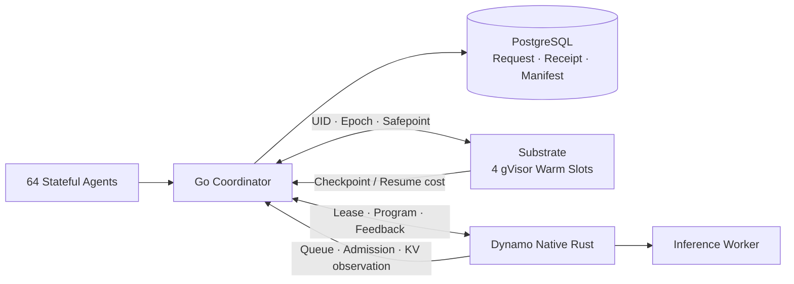

# AgentCloud

**64 个有状态 Agent 共享 4 个 gVisor Warm 槽位，实现 16× 沙箱超卖。** AgentCloud 在模型等待期间回收沙箱，在交互返回时恢复内存状态，并把工具副作用、恢复成本和首次准入尾延迟纳入同一条可对账的执行链路。

Go 协调器通过 PostgreSQL 保存请求、回执和恢复 manifest；Substrate 执行带 UID／epoch 围栏的 MEMORY 快照；Dynamo 原生 Rust 扩展连接 Program 准入、执行反馈和会话回收。上游交付包含 **38 个 Substrate 文件＋16 个 Dynamo 文件、2＋3 组补丁**，完整文件与补丁均可还原到相同 Git tree。

**在线 KV 联合策略：**`agentcloud-v2-joint` 读取官方 KVIndexer 的当前前缀驻留与首次损失统计，将 SUSPEND 和 KEEP 的预期重算成本差额计入生命周期切换成本；`cache_reselect` 将前缀命中、prefill／decode 负载和原子容量预留共同用于 Worker 选择。Hard affinity 保持目标，Off／Soft 提供候选空间。观测过期、事件缺口或支持不足时回退到基础成本；未知等待保留两秒释放期限。[机制、动作条件与实验身份](docs/JOINT_KV_SCHEDULING.md) · [原生缓存路由合同](integrations/dynamo/CACHE_ROUTING.md)

当前 [CI 43161047688](docs/evidence/ci-run-43161047688.json)记录 **162 个 Go 顶层测试通过、零跳过，含 11 个真实 PostgreSQL 测试**；独立 DeerFlow 为 **20/20、零跳过**，CI tooling 为 236 项。最新本地契约为 152 个 Go 顶层、246 个 tooling 通过，runtime 为 58 通过／四个模块跳过。联合冒烟 [43161092995](https://github.com/lilong555/agentcloud/actions/runs/43161092995)正在执行五策略，配对结果与全量性能待验收；[43157107777](docs/evidence/joint-kv/43157107777/summary.json) 与 [43157987378](docs/evidence/joint-kv/43157987378/summary.json)保留历史失败状态。[测试身份与失败原文](docs/EXPERIMENTS.md#在线-kv-与沙箱生命周期联合策略)



[最终 Checklist 与 Top 12](docs/FINAL_RELEASE_CHECKLIST.md) · [三分钟答辩与源码](docs/INTERVIEW_DEFENSE.md) · [验收状态](docs/STATUS.md) · [证据与源码索引](docs/evidence/validation-index.json) · [上游贡献](docs/UPSTREAM_PRS.md)

| P2 GPU 与 Token 成本速览 | 已验证结果 | 证据范围 |
| --- | --- | --- |
| 跨 Suspend 的会话身份 | `X-Dynamo-Session-ID` 跨 Actor epoch 保持稳定，inference lease 旋转 | 原生身份契约；跨 Suspend 的物理 GPU 命中率为 `not_collected_cross_suspend_resume_gpu` |
| vLLM Prefix Cache 与重算 | 三次热请求各命中 **240/256＝93.75%**，合计避免 **720 Re-prefill Token**；驱逐后三次各重算 256 token | 独立单 Worker、真实 GPU、官方 KVIndexer 对账 |
| CUDA KV 驻留与重建 | **30/30** 组；KV 驻留 **576～2,304 MiB**，全部重算 **0.179～0.746 s**；计入重建后，64 会话耗时 **−22.5%**，反转位于 **48～64** 两个实测点之间 | RTX 4070 Laptop、OPT-125M、3 GiB allocator 预算 |
| ThunderAgent `acting` 配额 | **708 → 0 → 708**；挂起释放 708 个逻辑 Token 配额 | 原生 CPU Mocker 的 Program 准入预算 |

[P2 原始证据](docs/GPU_VALIDATION.md) · [带采集状态的公开指标汇总](docs/evidence/release-metrics.json)

**跨生命周期 CPU 联合验证：**真实 gVisor MEMORY＋双官方 Dynamo Mocker 完成 **54/54 Trial**，验证跨 Epoch 的 Session 保持、Lease 轮换、旧凭证 401 和 **257 → 0 → 257** 逻辑预算。恢复后保留缓存时模拟命中 **240/256 Token**，确认驱逐后命中 **0/256**；亲和 Off／Hard 两组结果一致。[完整报告与原始回执](docs/LIFECYCLE_KV_VALIDATION.md) · [Actions 42991535195](https://github.com/lilong555/agentcloud/actions/runs/42991535195)

## 确定性状态与真实恢复

Inference Lease、Model Attempt ID、Actor UID／epoch、工具安全点与 durable manifest 分别约束推理身份、物理发送、执行代次、副作用和快照来源。重复 ID／payload 读取持久回执，冲突身份拒收；结果未知时保存 `OUTCOME_UNKNOWN`、关闭工具 gate，并依赖目标服务的幂等键或结果查询完成对账。

| 验收 | 可复核结果 |
| --- | --- |
| 16 类实机故障 | **16/16 通过**，覆盖 MEMORY 恢复、并发幂等、陈旧身份拒收、PENDING 快照及 UNKNOWN 隔离；[源码 `20113d5` 的 P0 证据](docs/evidence/p0-20113d5.json) |
| Go＋Rust 原生链路 | **1,336 项原生测试通过**；PostgreSQL 在 SELECT／UPDATE 执行后丢响应，各重复 3 次通过；[原生记录](docs/evidence/native-run-42769316617.json) |
| 长期容量回收 | `max_sessions=2` 下完成 **64 轮、128 请求**；终态绑定 0、墓碑 2；旧 lease 64/64 返回 401、旧 generation 64/64 返回 409 |
| 真实 Coding Agent | Azure CPA `gpt-6-luna` 完成 **8 轮模型、10 次工具、2 个文件修复、8 次 MEMORY 恢复**；[任务与清理](docs/evidence/real-model/realmodel-5b80fdc027c8/acceptance.json) |

安全点排空具有 30 秒期限。明确的 `504 DRAIN_TIMEOUT` 经原 operation／epoch／barrier 与可信 Actor UID 取消回执核验后，将挂起标记为 `ABORTED`，保持 RUNNING、重开工具准入，并持久记录冷却和超时计数。`OUTCOME_UNKNOWN` 返回原操作 ID 与 `inspect_workspace_read_only` 提示，Harness 保存对应 tool 消息和恢复状态；写操作保持关闭。[边界协议与专门测试](docs/API.md#安全点超时与未知工具结果)

## 用轨迹解释调度收益

对旧 cost-aware 的逐条回执与 Worker 采样复算，发现 research 未知等待的 **45/48 次挂起晚于需求返回完成**，N32 工具区间占额外预留资源的 **63.6%**，同时识别出反馈开关和 Program 寿命的配置混杂。`agentcloud-v2` 维护连续、持久的等待 episode，未知等待固定两秒期限，已知等待比较 KEEP 与实际恢复成本；TTL2、旧 cost-aware、v2 和 TTL2-Shadow 使用同 Runner、同种子、统一 E／FINAL 协议配对。

**CPU Mocker＋真实 Substrate MEMORY：**冻结调度器 `a7e324a` 的正式 Gate 2 使用 N32／N64、每规模五个留出种子 7301～7305、五种策略，完成 **50/50 trial、14,400/14,400 请求**，全部清理通过。下表为逐种子 v2 减基线的均值与配对 95% bootstrap 区间：

| 规模／基线 | 总 Actor 预留差 GB·s，95% CI | 交互 TTFT P95 差 s，95% CI |
| --- | ---: | ---: |
| N32／旧 cost-aware | −29.171 [−36.100, −23.359] | −23.226 [−35.439, −11.014] |
| N64／旧 cost-aware | −41.974 [−68.390, −19.294] | −20.163 [−40.670, +0.344] |
| N32／TTL2 | −8.129 [−11.764, −4.572] | +0.126 [−9.610, +10.047] |
| N64／TTL2 | −3.746 [−12.191, +4.699] | +18.836 [+9.087, +27.482] |

两种规模相对 TTL15 和 Observed 均达到资源与交互 P95 联合改善判据。相对旧 cost-aware，N32 联合改善成立，N64 资源减少有区间支持、P95 区间跨零。相对 TTL2，N32 资源减少、P95 区间跨零；N64 资源区间跨零、P95 增加有区间支持。


三种子边界确认显示，64 MiB／3 s 下平均减少 240.667 次恢复、节省 67.904 GB·s，交互 P95 增加 313.307 s；v2 首轮容量排队占累计 TTFT 的 98.733%。128 MiB／3 s 的三个 TTL2 trial 均触发 6 GiB 磁盘保护；v2 一个种子完整执行，两个种子因前序清理失败而未投递。边界共 **13/18 trial、6,105/6,912 请求**，九组集群清理通过。

发现阶段 Gate 1 完成 **24/24 trial、6,912/6,912 请求**，TTL2-Shadow 单独量化观测计算开销；历史 60 组规模矩阵、正式留出与边界确认分别保留源码、完整分母及原始失败。

[轨迹归因](docs/SCHEDULER_DIAGNOSIS.md) · [正式配对数据](docs/evidence/gate2-a7e324a-summary.json) · [Gate 1 与 Shadow](docs/V2_EVALUATION.md#gate-1-实测) · [工作集边界与停止条件](docs/V2_EVALUATION.md#三种子边界确认)

## 完整成本：预留资源、恢复与快照存储

快照数量按已提交恢复点的 Tag UID 去重，并分别记录初始化与运行阶段。下表来自同一冻结源码 `a7e324a` 的原始收据，包含初始恢复点：

| 负载 | v2／TTL2 总 Actor GB·s | v2／TTL2 快照 Tag 数 | 完成情况 |
| --- | ---: | ---: | --- |
| Gate 2 N32，五种子均值 | 212.070／220.199 | 144／144 | 双方全部完成 |
| Gate 2 N64，五种子均值 | 420.748／424.494 | 288／288 | 双方全部完成 |
| N64，64 MiB／3 s，三种子均值 | 680.986／748.890 | 207.333／448 | 双方全部完成；v2 P95 增加 313.307 s |
| N64，128 MiB／3 s，种子 7401 | 见逐 trial 资源积分 | 199／434 | v2 完成 384/384；TTL2 完成 370/384 后触发磁盘保护 |

高工作集下，频繁挂起增加恢复点创建与存储保留压力。128 MiB 的三个 TTL2 trial 各留下 434／435／436 个 Tag，并触发 6 GiB 磁盘余量保护。按尾部完整快照样本外推，每 trial 累计逻辑快照量约 **69.1～71.5 GiB**；物理写入与峰值占用明确标为 `uncollected_in_ci_runner (see 128MiB boundary report)`。v2 的快照次数优势与首轮准入尾延迟共同构成适用边界。[完整成本与原始分母](docs/STORAGE_COSTS.md)

生产生命周期默认每个 Workspace 保留最近 **K=2 个已验证 COMMITTED 恢复点**，保护当前 manifest 和未决操作；旧 Tag 与过期孤儿通过持久删除意图、身份围栏及有界退避回收。公开轨迹回放中，四策略各 33 个 Workspace 最终均保留 66 个恢复点，累计回收 98 个旧 Tag，删除待办为零。[实机 GC 对账](docs/evidence/public-traces/runs/42858419910/snapshot-gc-reconciliation.json)记录累计创建量、保留量及删除墓碑；历史实验保持其原始保留策略。

## 真实 GPU：收益反转与官方 KV 事件

**真实 CUDA 压力曲线：**RTX 4070 Laptop 8 GiB、OPT-125M、3 GiB allocator 预算，完成 **30/30 组测量**。16／24／32／48／64 个闲置会话下，释放 KV 并计入全部重建后的总耗时变化为 **+44.5%／+58.1%／+70.6%／+26.5%／−22.5%**。高压力下释放 KV 扩大推理 batch，覆盖重建成本；反转位于当前 **48～64 会话**两个离散测点之间。


**真实 vLLM 官方事件链路：**`vLLM → ZMQ → relay → KVIndexer → 默认 CACHE Selector` 完成 26 个连续事件 batch、26 个 Stored、287 个 Removed，relay 丢失为 0。三轮热缓存／驱逐对照共六请求，实际命中 **240／0 token**、新增 Prefill **16／256 token**；新增 token 预测 MAE 从完整上下文预算的 **120** 降至事件观测的 **0**。Prefill 中位数为 **8.992／9.213 ms**，差约 **0.221 ms**。该项交付是官方事件集成与物理缓存对账，Actor 生命周期使用已验收的队列和恢复成本策略。

[GPU 曲线、完整分母与原始数据](docs/GPU_VALIDATION.md) · [官方 KV 事件复现](experiments/dynamo/kv_events_README.md)

### Token 与 KV 成本对账

| 证据层 | 观测结果 | 对应作用 |
| --- | --- | --- |
| 原生会话身份 | 跨 Actor epoch 保持 `X-Dynamo-Session-ID`，旋转 inference lease | 为恢复后的前缀亲和性保留稳定身份 |
| 单 Worker vLLM 热缓存 | 256 输入命中 240：**93.75%**；三请求合计避免 **720 个 Re-prefill Token** | 官方 KV 事件与实际 Prefill 交叉核验 |
| 驱逐后同输入 | 命中 0，重算 256；Prefill 中位数 9.213 ms | 度量缓存消失后的实际工作量 |
| ThunderAgent acting 配额 | **708 → 0 → 708**，SUSPENDED 回收 708 个逻辑 Token 配额 | 原生 CPU Mocker 的准入预算释放与恢复 |

真实 GPU 命中数据来自独立缓存事件实验；跨 Suspend/Resume 的物理命中率消融标为 `not_collected_cross_suspend_resume_gpu`。30 组 CUDA 曲线同时记录 KV 驻留 **576～2,304 MiB** 与重算 **0.179～0.746 s**，支持显存驻留和返回代价的分层核算。[统一 Token 成本 JSON](docs/evidence/gpu/token-cost-summary.json)

## 公开真实轨迹与样本分布

TraceLab v0.0.2 全来源包括 **8,058 会话、52 个贡献者**。预算内完整审核 303 会话，33 个质量合格窗口全部进入探索性回放；其中七个窗口具有多个模型轮次，共 48 个模型阶段、32 次同步工具调用，来自八个贡献者。

| 人口与切分 | 贡献者／窗口 |
| --- | --- |
| 全来源 calibration／development／holdout | 31／7／14 个贡献者 |
| 全部质量合格窗口 | 8 个贡献者、33 个窗口 |
| 其中 holdout | 2 个贡献者、7 个窗口 |

模型跨度的中位数为 **5.550 s**，P95 为 **90.298 s**；这些窗口保留完整因果依赖，覆盖模型等待。回放使用公开相对时钟、受控工具和真实 MEMORY 生命周期，Observed／TTL15／TTL2／v2 共用相同输入、四槽容量与同一 Runner。来源时间和未来端点由 driver 持有，调度器读取实际已发生的请求、工具与资源观察。

[实机回放与完整样本说明](docs/PUBLIC_TRACE_IMPORT.md) · [33 窗口准入清单](docs/evidence/public-traces/tracelab-v0.0.2-admitted/manifest.json) · [描述统计](docs/evidence/public-traces/tracelab-v0.0.2-descriptive.json) · [独立回放 Actions](.github/workflows/public-trace-replay.yml)

### 真实公开轨迹实机回放结果

源码 `8a3e15f` 在同一 GitHub Runner 上按 Observed／TTL15／v2／TTL2 顺序串行执行，完成 **4/4 trial、192/192 模型请求、132/132 窗口**，**230/230 次 MEMORY 恢复**均通过 nonce／PID／heap／AST 连续性校验。每策略 33 次 FINAL、结束时原生绑定为零，四组清理及集群销毁全部通过。

| 策略 | 总 Actor GB·s，含初始化 | 工作阶段 GB·s | 快照总数／运行阶段 | TTFT P50／P95／P99（s） | MEMORY 恢复 |
| --- | ---: | ---: | ---: | ---: | ---: |
| Observed | 390.702 | 264.982 | 78／45 | 92.806／266.162／312.268 | 45/45 |
| TTL15 | 336.470 | 211.835 | 80／47 | 74.507／205.995／268.035 | 47/47 |
| TTL2 | 324.375 | 194.834 | 105／72 | 68.276／161.819／209.382 | 72/72 |
| agentcloud-v2 | 328.848 | 197.658 | 99／66 | 68.005／204.529／264.213 | 66/66 |

本次同 Runner 单次配对中，v2 相对 TTL2 的总 Actor 预留资源增加 1.4%，TTFT P95 增加 26.4%；快照创建次数为 99／105。结果描述这 33 个已审核窗口和本次运行配置，独立样本单位为贡献者 family。

执行环境为 PostgreSQL、真实 Substrate／gVisor MEMORY 与原生 Dynamo CPU Mocker；四租户、两个 Worker、四槽位、16 MiB RAM 工作集。每策略包含 33 个初始化快照。模型时钟由公开源驱动，工具使用受控映射，Token 使用固定执行口径；初始化资源单列，TTFT 包含首次容量排队。

总 Actor 积分包含初始化；按同 Runner UTC 时钟和 300 ms 采样间隔上限复算，Observed／TTL15／TTL2／v2 的总覆盖保守下界约为 **99.58%／99.64%／97.57%／97.70%**。初始化起点界限与采样缺口单独保留。[资源积分复核](docs/evidence/public-traces/runs/42858419910/resource-coverage-reconciliation.json)

[原始汇总 JSON](docs/evidence/public-traces/live-replay.json) · [运行与归档](docs/evidence/public-trace-run-42858419910.json)

## 一键运行与复核

Linux x86_64 环境需要 Python 3.10+、Git、Make 和 C 编译器。工具链脚本下载 Go 并校验官方 SHA256：

```bash
make bootstrap
make demo
```

`make demo` 自动构建、选择本机端口、生成临时凭据，完成真实 HTTP 的写文件、重复回执、安全点、挂起、模型结果持久化、恢复认领和文件校验，随后清理服务与临时目录。该演示使用确定性模型、受信任的本机进程及 VOLUMES 文件恢复，结果写入 `docs/evidence/service-local-demo.json`。

| 复现内容 | 入口 |
| --- | --- |
| 契约、竞态与构建检查 | `make check` |
| 锁定上游与源码还原 | `make upstream`，随后 `make verify-delivery` |
| 证据引用和归档完整性 | `make evidence-audit` |
| 原生 Rust Frontend＋官方 CPU Mocker | [Dynamo 构建与运行](experiments/dynamo/README.md)；`make native-verify` |
| Kind／gVisor MEMORY 与真实 Agent | [Substrate 部署](deploy/substrate/)，[DeerFlow 接入](adapters/deerflow/)；`make live-suite` |
| 同 Runner 配对、故障与 GPU | [v2 实验入口](docs/V2_EVALUATION.md#复现)、[实验报告](docs/EXPERIMENTS.md)、[GPU 复现](docs/GPU_VALIDATION.md) |

各实验记录源码 SHA、配置、种子、完整请求分母和资源清理。规模与故障运行使用独立 Actions；CPU Mocker 的执行路径与真实 GPU 数据按实验类型分别归档。

## 阅读入口

[系统架构](docs/ARCHITECTURE.md) · [服务 API 与故障语义](docs/API.md) · [自主调度](docs/SCHEDULING.md) · [Coding Runtime](runtime/coding/) · [Actor 内运行循环](runtime/in_actor.py)

[公开 Coding Agent 轨迹审查](docs/PUBLIC_TRACE_REVIEW.md)与 [TraceLab 导入审核](docs/PUBLIC_TRACE_IMPORT.md)提供外部工作负载的数据入口，记录许可、来源摘要、时间语义、后台进程终态与质量准入。`replay_ready` 标识输入资格，实际性能与恢复成功率由集群运行报告记录。

根项目采用 Apache-2.0；上游许可证与来源见 [NOTICE](NOTICE) 和 [licenses](licenses/)。完整源码、精确基线、内容哈希和补丁序列见 [integrations](integrations/)。
