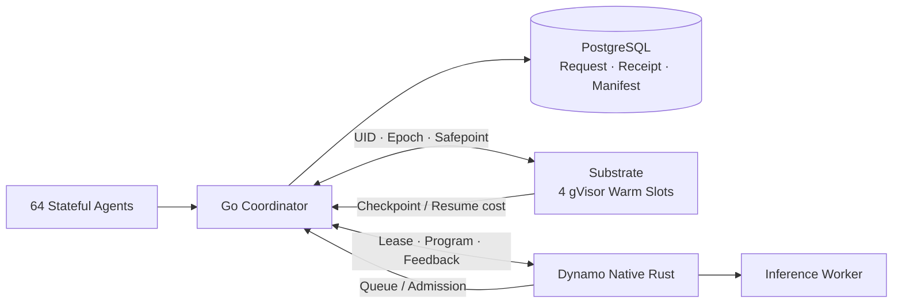
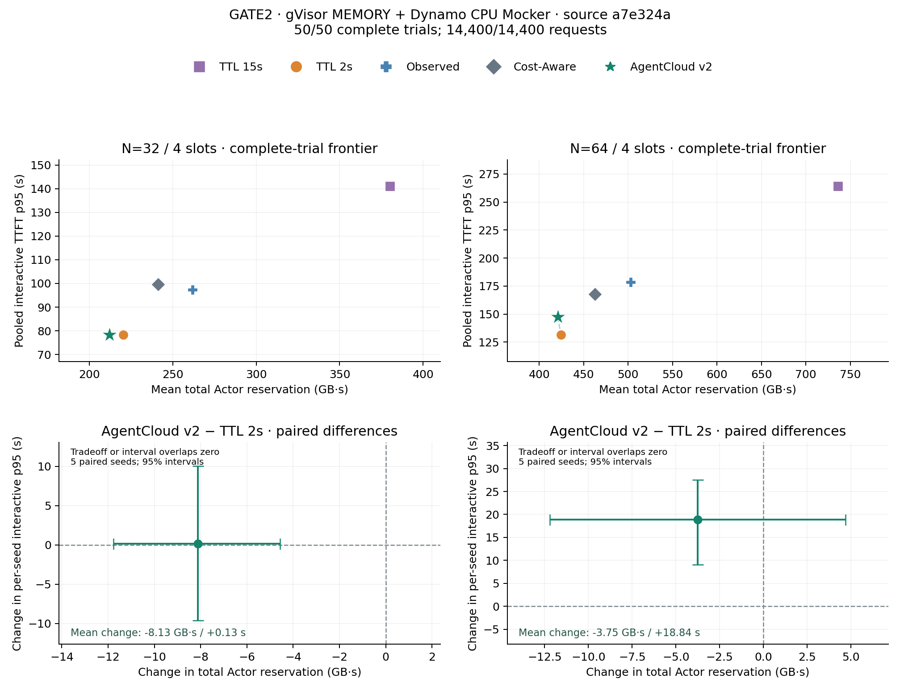
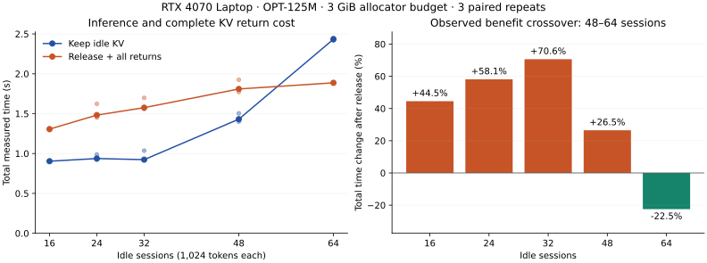

# AgentCloud

**64 个有状态 Agent 共享 4 个 gVisor Warm 槽位，实现 16× 沙箱超卖。** AgentCloud 在模型等待期间回收沙箱，在交互返回时恢复内存状态，并把工具副作用、恢复成本和首次准入尾延迟纳入同一条可对账的执行链路。

Go 协调器通过 PostgreSQL 保存请求、回执和恢复 manifest；Substrate 执行带 UID／epoch 围栏的 MEMORY 快照；Dynamo 原生 Rust 扩展连接 Program 准入、执行反馈和会话回收。上游交付包含 **38 个 Substrate 文件＋13 个 Dynamo 文件、2＋3 组补丁**，完整文件与补丁均可还原到相同 Git tree。



[三分钟答辩与源码](docs/INTERVIEW_DEFENSE.md) · [验收状态](docs/STATUS.md) · [证据与源码索引](docs/evidence/validation-index.json) · [上游贡献](docs/UPSTREAM_PRS.md)

## 确定性状态与真实恢复

Inference Lease、Model Attempt ID、Actor UID／epoch、工具安全点与 durable manifest 分别约束推理身份、物理发送、执行代次、副作用和快照来源。重复 ID／payload 读取持久回执，冲突身份拒收；结果未知时保存 `OUTCOME_UNKNOWN`、关闭工具 gate，并依赖目标服务的幂等键或结果查询完成对账。

| 验收 | 可复核结果 |
| --- | --- |
| 16 类实机故障 | **16/16 通过**，覆盖 MEMORY 恢复、并发幂等、陈旧身份拒收、PENDING 快照及 UNKNOWN 隔离；[源码 `20113d5` 的 P0 证据](docs/evidence/p0-20113d5.json) |
| Go＋Rust 原生链路 | **1,336 项原生测试通过**；PostgreSQL 在 SELECT／UPDATE 执行后丢响应，各重复 3 次通过；[原生记录](docs/evidence/native-run-42769316617.json) |
| 长期容量回收 | `max_sessions=2` 下完成 **64 轮、128 请求**；终态绑定 0、墓碑 2；旧 lease 64/64 返回 401、旧 generation 64/64 返回 409 |
| 真实 Coding Agent | Azure CPA `gpt-6-luna` 完成 **8 轮模型、10 次工具、2 个文件修复、8 次 MEMORY 恢复**；[任务与清理](docs/evidence/real-model/realmodel-5b80fdc027c8/acceptance.json) |

## 用轨迹解释调度收益

对旧 cost-aware 的逐条回执与 Worker 采样复算，发现 research 未知等待的 **45/48 次挂起晚于需求返回完成**，N32 工具区间占额外预留资源的 **63.6%**，同时识别出反馈开关和 Program 寿命的配置混杂。`agentcloud-v2` 维护连续、持久的等待 episode，未知等待固定两秒期限，已知等待比较 KEEP 与实际恢复成本；TTL2、旧 cost-aware、v2 和 TTL2-Shadow 使用同 Runner、同种子、统一 E／FINAL 协议配对。

**CPU Mocker＋真实 Substrate MEMORY：**冻结调度器 `a7e324a` 的正式 Gate 2 使用 N32／N64、每规模五个留出种子 7301～7305、五种策略，完成 **50/50 trial、14,400/14,400 请求**，全部清理通过。下表为逐种子 v2 减基线的均值与配对 95% bootstrap 区间：

| 规模／基线 | 总 Actor 预留差 GB·s，95% CI | 交互 TTFT P95 差 s，95% CI |
| --- | ---: | ---: |
| N32／旧 cost-aware | −29.171 [−36.100, −23.359] | −23.226 [−35.439, −11.014] |
| N64／旧 cost-aware | −41.974 [−68.390, −19.294] | −20.163 [−40.670, +0.344] |
| N32／TTL2 | −8.129 [−11.764, −4.572] | +0.126 [−9.610, +10.047] |
| N64／TTL2 | −3.746 [−12.191, +4.699] | +18.836 [+9.087, +27.482] |

两种规模相对 TTL15 和 Observed 均达到资源与交互 P95 联合改善判据。相对旧 cost-aware，N32 联合改善成立，N64 资源减少有区间支持、P95 区间跨零。相对 TTL2，N32 资源减少、P95 区间跨零；N64 资源区间跨零、P95 增加有区间支持。



三种子边界确认显示，64 MiB／3 s 下平均减少 240.667 次恢复、节省 67.904 GB·s，交互 P95 增加 313.307 s；v2 首轮容量排队占累计 TTFT 的 98.733%。128 MiB／3 s 的三个 TTL2 trial 均触发 6 GiB 磁盘保护；v2 一个种子完整执行，两个种子因前序清理失败而未投递。边界共 **13/18 trial、6,105/6,912 请求**，九组集群清理通过。

发现阶段 Gate 1 完成 **24/24 trial、6,912/6,912 请求**，TTL2-Shadow 单独量化观测计算开销；历史 60 组规模矩阵、正式留出与边界确认分别保留源码、完整分母及原始失败。

[轨迹归因](docs/SCHEDULER_DIAGNOSIS.md) · [正式配对数据](docs/evidence/gate2-a7e324a-summary.json) · [Gate 1 与 Shadow](docs/V2_EVALUATION.md#gate-1-实测) · [工作集边界与停止条件](docs/V2_EVALUATION.md#三种子边界确认)

## 真实 GPU：收益反转与官方 KV 事件

**真实 CUDA 压力曲线：**RTX 4070 Laptop 8 GiB、OPT-125M、3 GiB allocator 预算，完成 **30/30 组测量**。16／24／32／48／64 个闲置会话下，释放 KV 并计入全部重建后的总耗时变化为 **+44.5%／+58.1%／+70.6%／+26.5%／−22.5%**。高压力下释放 KV 扩大推理 batch，覆盖重建成本；反转位于当前 **48～64 会话**两个离散测点之间。



**真实 vLLM 官方事件链路：**`vLLM → ZMQ → relay → KVIndexer → 默认 CACHE Selector` 完成 26 个连续事件 batch、26 个 Stored、287 个 Removed，relay 丢失为 0。三轮热缓存／驱逐对照共六请求，实际命中 **240／0 token**、新增 Prefill **16／256 token**；新增 token 预测 MAE 从完整上下文预算的 **120** 降至事件观测的 **0**。Prefill 中位数为 **8.992／9.213 ms**，差约 **0.221 ms**。该项交付是官方事件集成与物理缓存对账，Actor 生命周期使用已验收的队列和恢复成本策略。

[GPU 曲线、完整分母与原始数据](docs/GPU_VALIDATION.md) · [官方 KV 事件复现](experiments/dynamo/kv_events_README.md)

## 一键运行与复核

Linux x86_64 环境需要 Python 3.10+、Git、Make 和 C 编译器。工具链脚本下载 Go 并校验官方 SHA256：

```bash
make bootstrap
make demo
```

`make demo` 自动构建、选择本机端口、生成临时凭据，完成真实 HTTP 的写文件、重复回执、安全点、挂起、模型结果持久化、恢复认领和文件校验，随后清理服务与临时目录。该演示使用确定性模型、受信任的本机进程及 VOLUMES 文件恢复，结果写入 `docs/evidence/service-local-demo.json`。

| 复现内容 | 入口 |
| --- | --- |
| 契约、竞态与构建检查 | `make check` |
| 锁定上游与源码还原 | `make upstream`，随后 `make verify-delivery` |
| 证据引用和归档完整性 | `make evidence-audit` |
| 原生 Rust Frontend＋官方 CPU Mocker | [Dynamo 构建与运行](experiments/dynamo/README.md)；`make native-verify` |
| Kind／gVisor MEMORY 与真实 Agent | [Substrate 部署](deploy/substrate/)，[DeerFlow 接入](adapters/deerflow/)；`make live-suite` |
| 同 Runner 配对、故障与 GPU | [v2 实验入口](docs/V2_EVALUATION.md#复现)、[实验报告](docs/EXPERIMENTS.md)、[GPU 复现](docs/GPU_VALIDATION.md) |

各实验记录源码 SHA、配置、种子、完整请求分母和资源清理。规模与故障运行使用独立 Actions；CPU Mocker 的执行路径与真实 GPU 数据按实验类型分别归档。

## 阅读入口

[系统架构](docs/ARCHITECTURE.md) · [服务 API 与故障语义](docs/API.md) · [自主调度](docs/SCHEDULING.md) · [Coding Runtime](runtime/coding/) · [Actor 内运行循环](runtime/in_actor.py)

[公开 Coding Agent 轨迹审查](docs/PUBLIC_TRACE_REVIEW.md)与 [TraceLab 导入审核](docs/PUBLIC_TRACE_IMPORT.md)提供外部工作负载的数据入口，记录许可、来源摘要、时间语义、后台进程终态与留出准入。真实性能回放以审核产物中的 `replay_ready` 为准。

根项目采用 Apache-2.0；上游许可证与来源见 [NOTICE](NOTICE) 和 [licenses](licenses/)。完整源码、精确基线、内容哈希和补丁序列见 [integrations](integrations/)。
