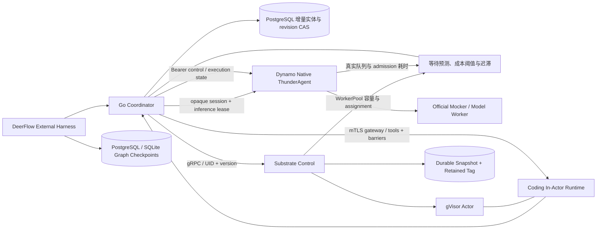
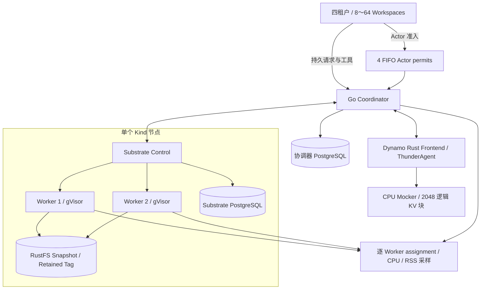

# AgentCloud 架构

AgentCloud 将执行生命周期与推理准入状态连接到同一身份和持久事件链。Go 协调器负责增量实体事务、工具准入、持久请求和自主生命周期调度；Dynamo 原生 Rust 扩展负责执行预算、暂停程序重新评估与绑定回收；Substrate 扩展负责 Actor fencing、指定快照持久化和实际恢复回执。

## 实测拓扑

每个规模 trial 使用独立 GitHub hosted runner，4 vCPU、约 16 GiB 内存。一个 Kind 节点运行两个 Substrate Worker，四个 FIFO Actor permits 限制同时占用的沙箱；四租户持有 8～64 个连续六轮交互的 Workspace。协调器日志与 Substrate 元数据各自持久化，Dynamo 原生 Frontend 连接 CPU Mocker 的 2,048 块逻辑 KV 容量。

[规模矩阵](evidence/scale-summary.json)保存首轮 60 组及两个补充重跑，[条件成本矩阵](evidence/cost-matrix-1bd80b2-summary.json)记录另外 36 组对照，[故障矩阵](evidence/faults-32e3d6e-summary.json)验证 16 个窗口，[阶段测量](evidence/control-plane-summary.json)记录持久化、准入和恢复开销。当前容量证据覆盖同节点两个 Worker 的多租户竞争，跨节点扩展使用独立配置验收。[CUDA 实测](GPU_VALIDATION.md)提供本地物理 KV、竞争吞吐和重建成本。

## 控制面事务

PostgreSQL 按 sessions、requests、tools、lifecycle、scheduling、events 和 observations 保存实体。提交只序列化变更实体，以单个事务更新 revision 和相关行。数据库 I/O 期间释放协调器互斥锁，提交闸门维护读可见性；提交失败后保留 durable revision 并要求重启对账。事件与测量按有界序列保留。

一个数据库由 advisory lock 保证单写者所有权。执行反馈按会话加锁，网络请求在全局状态锁外执行。跨进程恢复从完整持久实体重建状态，逻辑请求与工具 ID 保持稳定。

## 安全点与恢复

一次安全点包括关闭工具准入、drain、无洞回执水位、指定快照 durable、独立保留 Tag 和持久 manifest。Substrate 在同一 Actor lease 下验证 expected UID/version；Tag 创建在同一 lease 下验证源快照。恢复回执记录实际 fidelity、是否冷启和实际恢复的快照身份。

In-Actor Runtime 使用 MEMORY 恢复保留进程状态，并从协调器认领挂起前登记的模型结果。真实 Coding Agent 以模型工具调用修改多文件仓库、运行原有测试，内存中的 AST、上下文对象与 nonce 随快照连续。External Harness 保持图状态在 Actor 外，以 PostgreSQL 或 SQLite 的不可变 checkpoint ID 将图状态与工具快照对齐；并发子任务和上传全部结束后生成两阶段 manifest。

## 运行路径

`local-process` 供开发和协议验收：工作目录使用受限文件句柄，文件快照带内容摘要，恢复标记为 VOLUMES。本地 shell 使用宿主进程权限，适用于受信任任务。

`substrate` 通过真实 gRPC 和 mTLS ingress 操作 Actor。API 使用服务 CA 与可轮换 bearer token；ingress 使用可轮换客户端证书。Runtime 启动时工具 gate 关闭，进程 readiness 与执行 attach 分开，避免恢复过程互相等待。

Dynamo CPU 路径使用真实 Frontend、原生 ThunderAgent 与官方 Mocker。Mocker 提供受控推理时延和逻辑容量，用于验证调度与对照实验。GPU 推理后端沿用相同推理接口，硬件结论由对应测量产生。

## 故障处理

模型请求先持久化 dispatch intent，再发送一次物理请求。已发送但结果未知的请求进入 OUTCOME_UNKNOWN；控制器重启保留原 ID，等待对账。工具与生命周期使用相同的保守终态语义。

反馈采用序号和 TTL。协调器串行推进持久序号；失联后原生调度器恢复默认预算。推理身份由独立认证控制端登记，普通模型输入由协调器校验，可信执行状态通过控制通道传递。

Dynamo 的 FINAL 推理事件结束原生程序，认证 finalize 操作随后回收绑定、反馈状态和 inference lease。新绑定分配随机 generation、opaque routing session 与 lease；最近墓碑容量受 `max_sessions` 限制，墓碑淘汰后旧 generation 仍失效。Frontend 重启后的新模型尝试可显式取得新身份，协调器保留已完成与未知请求的原始回执。

## 可观测性

协调器导出 Prometheus 指标和 OpenTelemetry span；租户诊断接口与 `agentcloud status`、`agentcloud trace <workspace-id>` 输出状态机、epoch 历史、manifest 和关键路径。请求中的 trace context 贯穿 Substrate gRPC 与 Dynamo 控制／推理调用，原生 admission 用模型 attempt ID 对账。

资源测量使用真实 Worker assignment 内存按时间积分，闲置窗口取模型等待与实际 think 窗口的并集，并扣除活跃工具区间。独立实验探针逐 Worker 采样，记录覆盖率、间隔、转变不确定度以及协调器 CPU／RSS。

原始设计与源码依据见 [设计计划](../AGENTCLOUD_PLAN.md)，服务字段见 [API](API.md)，证据索引见 [交付状态](STATUS.md)。
