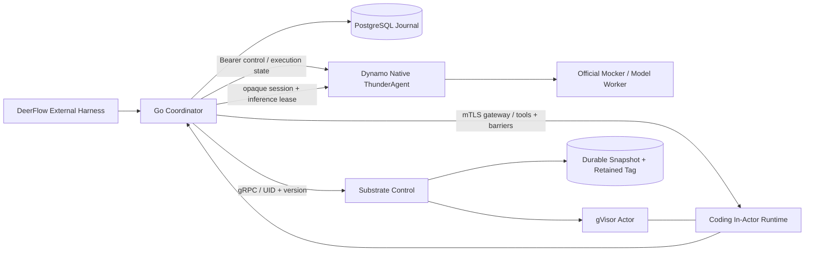

# AgentCloud 架构

AgentCloud 将执行生命周期与推理准入状态连接到同一身份和持久事件链。Go 协调器负责单写者状态、工具准入、持久请求和 manifest；Dynamo 原生 Rust 扩展负责预算与暂停程序重新评估；Substrate 扩展负责 Actor fencing、指定快照持久化和实际恢复回执。

## 安全点与恢复

一次安全点包括关闭工具准入、drain、无洞回执水位、指定快照 durable、独立保留 Tag 和持久 manifest。Substrate 在同一 Actor lease 下验证 expected UID/version；Tag 创建在同一 lease 下验证源快照。恢复回执记录实际 fidelity、是否冷启和实际恢复的快照身份。

In-Actor Runtime 使用 MEMORY 恢复保留进程状态，并从协调器认领挂起前登记的模型结果。External Harness 保持图状态在 Actor 外，以 checkpoint ID 将图状态与工具快照对齐。进程连接可重建，工具副作用通过稳定 ID 与持久回执关联。

## 运行路径

`local-process` 供开发和协议验收：工作目录使用受限文件句柄，文件快照带内容摘要，恢复标记为 VOLUMES。本地 shell 使用宿主进程权限，适用于受信任任务。

`substrate` 通过真实 gRPC 和 mTLS ingress 操作 Actor。API 使用服务 CA 与可轮换 bearer token；ingress 使用可轮换客户端证书。Runtime 启动时工具 gate 关闭，进程 readiness 与执行 attach 分开，避免恢复过程互相等待。

Dynamo CPU 路径使用真实 Frontend、原生 ThunderAgent 与官方 Mocker。Mocker 提供受控推理时延和逻辑容量，用于验证调度与对照实验。GPU 推理后端沿用相同推理接口，硬件结论由对应测量产生。

## 故障处理

模型请求先持久化 dispatch intent，再发送一次物理请求。已发送但结果未知的请求进入 OUTCOME_UNKNOWN；控制器重启保留原 ID，等待对账。工具与生命周期使用相同的保守终态语义。

反馈采用序号和 TTL。协调器串行推进持久序号；失联后原生调度器恢复默认预算。推理身份由独立认证控制端登记，普通模型输入由协调器校验，可信执行状态通过控制通道传递。

原始设计与源码依据见 [设计计划](../AGENTCLOUD_PLAN.md)，服务字段见 [API](API.md)，证据索引见 [交付状态](STATUS.md)。
