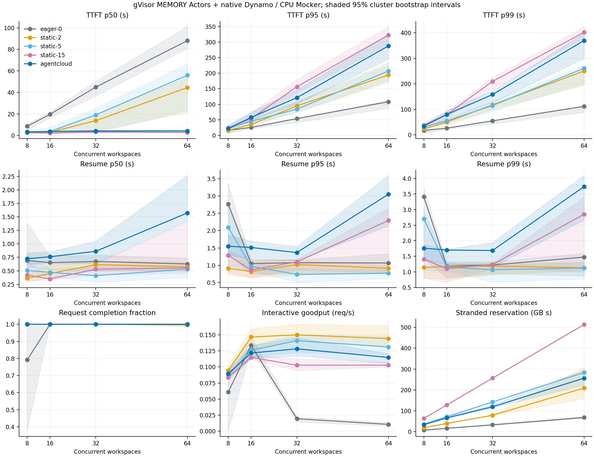
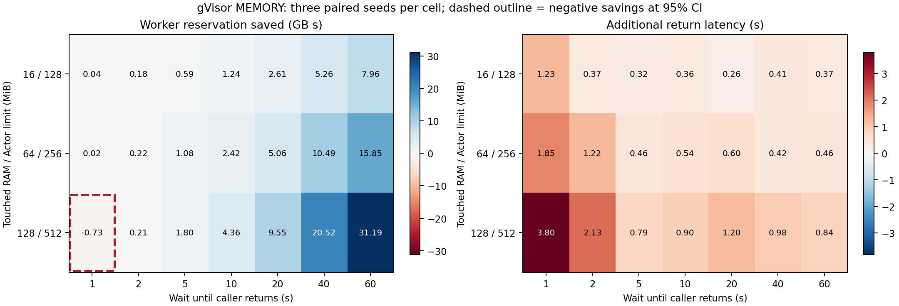
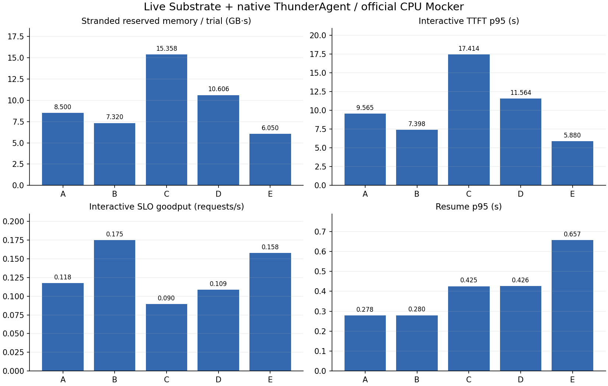

# 实验与验证

真实模型、规模调度、故障恢复与资源热力图分别保存原始证据。Azure CPA 的真实 `gpt-6-luna` 已完成两类 Agent 功能任务；规模与故障矩阵由独立 GitHub Actions 执行，当前运行结果由 [STATUS](STATUS.md)索引。

## 在线 KV 与沙箱生命周期联合策略

`agentcloud-v2-joint` 在基础快照／恢复成本上增加 `E[C_KV|SUSPEND]−E[C_KV|KEEP]`。两动作共享 GPU 政策、当前驻留和历史损失分布，历史恢复关键路径形成额外缓存暴露；共同驱逐风险与已经缺失的前缀重建成本相消。条件回访分布来自过去的完成／删失事件，未知等待保留两秒释放期限，额外 KEEP 采用有限期限。[jointKVCostLocked:86](../internal/control/kv_cost.go#L86)、[EstimateKV:164](../internal/policy/kv_cost.go#L164)与 [v2DecisionLocked:124](../internal/control/scheduler_v2.go#L124)为决策入口。

原生 `cache_reselect` 由 ThunderAgent 分类器和选择器共同开启；[select_cache_worker:606](../integrations/dynamo/files/lib/router-plugins/builtin/src/thunderagent/request_classifier/scheduler.rs#L606)依据缓存、prefill／decode 负载和可用容量预留目标，`Sent` 提交实际 Worker，取消回滚未提交迁移。Hard affinity 保持目标，Off／Soft 使用原生候选空间。观测两秒过期、事件缺口、身份错配、低支持或校准范围外输入均记录回退原因。[路由合同与具名测试映射](../integrations/dynamo/CACHE_ROUTING.md)定义更新身份、容量计费和缓存观察字段。

| 验证对象 | 当前事实与原始身份 |
| --- | --- |
| 当前本地契约 | [JSON](evidence/local-contract.json)记录源码摘要 `2937d38aec9b6b08a6db051dd8ae344df82a4e5f4f5baf450d8a03b4886dffeb`、152 个 Go 顶层测试通过，六条验证命令退出码均为 0。[Go 日志](evidence/logs/local-20261112T053618610274Z/race-tests.stdout.log)保留 10 个 PostgreSQL 顶层测试和两个子项的数据库缺配跳过；[tooling](evidence/logs/local-20261112T053618610274Z/tooling-tests.stderr.log)为 246 项全部通过，[runtime](evidence/logs/local-20261112T053618610274Z/runtime-tests.stderr.log)为 62 项中 58 通过、四个模块跳过。 |
| 当前源码 CI | 源码 `55120d52e1be0fef3ab443af66f81baa046cc320`、源码摘要 `2937d38aec9b6b08a6db051dd8ae344df82a4e5f4f5baf450d8a03b4886dffeb`；[43161047688 摘要](evidence/ci-run-43161047688.json)及 [contracts job 130992040365](https://github.com/lilong555/agentcloud/actions/runs/43161047688/job/130992040365)记录 162 个 Go 顶层通过／零跳过、11 个真实 PostgreSQL 测试、236 项 tooling 通过、runtime 58 通过／四个模块跳过；独立 [deerflow-contracts job 130992040002](https://github.com/lilong555/agentcloud/actions/runs/43161047688/job/130992040002)为 20/20／零跳过、实际 PostgreSQL 执行。[API 与原始日志归档](evidence/live-runs/43161047688/api/archive.json)及两个 artifact 摘要保存校验身份。 |
| 已归档 Go CI | 源码 `293e19f97ee06df90c7b5e9cdd44b8cdb2c742a6` 的 [43155952398／contracts job 130975803254](https://github.com/lilong555/agentcloud/actions/runs/43155952398/job/130975803254)记录 161 项顶层测试通过，PostgreSQL 契约实际执行；该 CI 与当前本地验证各自保留源码身份。 |
| 原生 wheel | [43012181604](https://github.com/lilong555/agentcloud/actions/runs/43012181604)，78 passed、2 ignored；缓存选择、迁移预留、取消和 `Sent` 提交的测试名见 [test-map.json](../integrations/dynamo/test-map.json)。 |
| 成本参考 | [provenance.json](evidence/joint-kv-calibration/provenance.json)锁定 `aisimulate-core` 包／源码 SHA 与 `polynomial_prefill_time:206`，类型为 `mocker_simulation`；真实 CPU 编排 TTFT 和模拟引擎 Prefill 分列。 |
| 真实请求结构 | [joint-workload.json](evidence/agent-traces/joint-workload.json)冻结 432 条轨迹、150 个任务组；[SOURCE_AUDIT](evidence/agent-traces/SOURCE_AUDIT.json)与 [VALIDATION](evidence/agent-traces/VALIDATION.json)记录来源、摘要与确定性选择。每任务选择一个 attempt，60.88% 非末轮等待为缺测模型 3s，时间代表性按该构造报告。 |
| 当前联合冒烟 43161092995 | [Actions](https://github.com/lilong555/agentcloud/actions/runs/43161092995)已通过四组原生路由步骤与 Kind／gVisor 准备，五策略正在运行；配对结果、清理和原始产物待验收。 |
| 联合冒烟 43157107777 | [Actions](https://github.com/lilong555/agentcloud/actions/runs/43157107777)为 `failure`；计划源码 `19c5f98659794f03237791a1443e38215aadbb2c`。工作流输入校验报告 `live-scale.yml:40` 的 `Unexpected value '1'`，联合 job 未创建，源码与 trial 未执行；五个计划 trial、120 个计划请求保留，完成请求为 0。[摘要](evidence/joint-kv/43157107777/summary.json)／[原始注解](evidence/joint-kv/43157107777/launch-1/diagnostics/workflow-annotations.json)。 |
| 联合冒烟 43157987378 | [Actions](https://github.com/lilong555/agentcloud/actions/runs/43157987378)为 `failure`；日志确认执行源码 `848a3f232347475e850053b2fe92679d47f7c2e4`。首个 `static-15` trial 报 `session failure`，其余四策略报前序清理失败；公开证据 staging 随后出现相对路径 `ValueError`，请求级／路由 artifact 缺失。五个计划 trial、120 个计划请求保留，完成与失败请求计数为 `null`，原生路由步骤为 success、逐请求验收待原始产物。[摘要](evidence/joint-kv/43157987378/summary.json)／[执行观察](evidence/joint-kv/43157987378/launch-1/diagnostics/job-log-observations.json)／[job 原始日志](evidence/joint-kv/43157987378/launch-1/diagnostics/job-130982580550.log.gz)。 |

全量联合性能仍待验收。完整配对包含 TTL2、TTL15、v2、v2-cache、v2-joint，分别隔离缓存重选和 KV 成本增量；N=32／64、五种子、动态调用数及失败分母由冻结计划确定。主要比较为 joint 对 cache 的交互 P95，同时保留资源积分、轨迹完成时间、恢复次数、命中／重算、最坏种子与来源分层。机制和执行入口见 [JOINT_KV_SCHEDULING](JOINT_KV_SCHEDULING.md)。以下历史 Gate 1／2、TraceLab 和 GPU 结果保持各自源码与运行身份。

## 三项性能边界与归因

**Gate 2，N64／16 MiB：驻留复用与首次准入公平性。** 64 会话竞争 4 个 Warm 槽位，超额订阅为 16:1。v2 相对 TTL2 的 Actor 预留差为 −3.746 GB·s，95% 区间 [−12.191, +4.699] 跨零；交互 P95 增加 18.836 s，区间 [+9.087, +27.482]。Runner 的 [FairSlots.acquire](../bench/scale.py#L156)先授予槽位，[resume](../bench/scale.py#L385)随后登记 ReturnDemand；[HoldingRate](../internal/control/scheduler_v2.go#L201)使用已经登记的返回需求，首次排队压力尚未完整进入 KEEP 成本。已有会话驻留复用延长后到会话的首次等待。Gate 2 中双方平均恢复次数均为 224，v2 累计恢复耗时另增加 116.221 s；资源均值下降、恢复代价和前置公平性共同解释实测取舍。少恢复的直接证据来自 64 MiB／3 s 边界，该坐标 v2 首轮排队占累计 TTFT 的 98.733%。[正式数据](evidence/gate2-a7e324a-summary.json) · [边界逐轮分解](evidence/boundary-confirm-a7e324a-summary.json)

**TTL2，128 MiB／3 s：快照频率与磁盘容量约束。** TTL2 在 16 MiB 的低恢复成本负载中是强基线；128 MiB 下三个 trial 各产生 434／435／436 个 Tag，包含各 64 个初始化恢复点，随后触发 6 GiB 磁盘余量保护。完整尾部样本约为 163～168 MiB/快照，逐 trial 以 Tag 数乘样本范围外推，累计逻辑快照量约 **69.1～71.5 GiB**，体现频繁快照形成的逻辑写入放大。物理写入、压缩峰值及写放大比值的采集状态为 `uncollected_in_ci_runner (see 128MiB boundary report)`。v2 的成本迟滞减少高成本快照频率，K=2 GC 控制恢复点保留量；已发生的累计写入继续单独计量。三个边界坐标合计 **13/18 trial**；其中 128 MiB 坐标为 **1/6** 完整通过、三个 TTL2 失败、两个 v2 被前序清理阻断。[失败账本](evidence/boundary-confirm-storage-a7e324a.json) · [逻辑估算与物理采集状态](STORAGE_COSTS.md)

**公开 TraceLab：单轮窗口占 79%，二轮复用机会有限。** 33 个合格窗口中，**26 个仅含一次模型调用，26/33＝78.8%（约 79%）**，其余七个为多轮。v2 的短暂 KEEP 面向连续交互，单轮结束的窗口没有第二轮可复用，因此更容易体现驻留和首次准入成本。四策略全部完成 192/192 请求；v2／TTL2 累计 Tag 为 99／105，总 Actor 预留增加 1.4%，交互 P95 增加 26.4%。这组结果覆盖八个贡献者 family、同 Runner 单次配对；源码路径与样本结构支持上述机制解释，单因素因果贡献保持为未采集状态。[样本分布与原文](evidence/public-traces/runs/42858419910/live-replay.json) · [公开汇总](evidence/release-metrics.json)

## 真实模型 Agent

| 任务 | 实际执行 | 恢复与正确性 |
| --- | --- | --- |
| Coding | 8 轮推理、10 次工具调用，模型修改 `shop/pricing.py` 与 `shop/cart.py` | 原有 4 项测试保持原样并通过，8 次自主 MEMORY 恢复，AST／上下文对象与 nonce 连续，观察器 Actor GET 为零 |
| DeerFlow | 两个并发子任务、文件上传、70 个 PostgreSQL 图检查点 | 两阶段 manifest、独立 Tag 核验、新进程恢复与实际 MEMORY 恢复 |

[真实模型汇总](evidence/deep-agents-summary.json)链接两项完整结果和 11 次已归档尝试，包含六个通过与五个失败的完整运行。Coding 使用源码 `20113d5` 的[独立 Actions 验收](https://github.com/lilong555/agentcloud/actions/runs/42769409786)，模型、工具、终态发布与资源清理均通过；历史组合验收保留各子项及整体状态。DeerFlow 的成功来自单独完成的验收。研究资料为受控 HTTP 来源，模型通过真实 CPA 推理选择和执行工具。

## 统一配对的成本调度与 Shadow

`52af93d` 的 Gate 1 使用四租户、两 Worker、四槽位与 N=32/64；7101～7103 的每个完整策略组在同一 Runner 随机串行运行。TTL2、旧 cost-aware、v2、TTL2-Shadow 统一使用 E 组、开启执行反馈、Program 跨轮，仅终态 FINAL。主判据为总 Actor 预留 GB·s 与交互 P95 的配对区间同时不劣。

首轮 **23/24 trial、6,717/6,912 请求**完成。N32 的 v2 相对旧 cost-aware 平均节省 **21.614 GB·s、27.066 秒交互 P95**，两项配对 95% 区间均改善；相对 TTL2 分别节省 8.660 GB·s、4.988 秒，区间跨零。N64/7101 的 v2 在第四个串行策略期间遇到一小时 CI 访问令牌过期，该 trial 的 195 个失败／未投递请求完整保留。[Gate 1 数据](evidence/gate1-summary.json) · [有效期轨迹与安全状态](evidence/gate1-credential-expiry.json)

`a7e324a` 的完整 Shadow 对照中，协调器平均 CPU 在 N32 从 0.1080 增到 0.1441 核，N64 从 0.1371 增到 0.1803 核；Shadow 相对 TTL2 的总资源配对均值分别增加 12.080／26.499 GB·s。端到端资源和时延差异及其置信区间分别保存。[当前 Shadow 数据](evidence/gate1-a7e324a-shadow-summary.json) · [完整机制、协议与验证](V2_EVALUATION.md)

边界坐标为 16/64/128 MiB × 1/3/6 秒等待。每个坐标按自身源码和 Runner 保留完整请求分母、资源积分、P95、恢复次数及逐轮容量等待；工作集初始化与运行时限故障保留独立验证记录。[边界汇总](evidence/v2-boundary-summary.json)

N64/7101 的完整四策略独立验证完成 **1,536/1,536 请求、3/4 trial**，访问有效期与清理通过。v2 最终释放与自主挂起预留竞争，Runner 的失败记录与最终已提交 MEMORY 状态一同归档。[独立统计](evidence/gate1-revalidation-summary.json) · [竞态回执与时间](evidence/gate1-lifecycle-race.json)

`a7e324a` 的独立 Gate 1 cohort 在 [42800756685](https://github.com/lilong555/agentcloud/actions/runs/42800756685) 完成 **24/24 trial、6,912/6,912 请求**，清理全部通过。以下为三个种子中 v2 减基线的配对均值与 95% bootstrap 区间：

| 规模／基线 | 总 Actor 预留差 GB·s | 交互 P95 差 s |
| --- | ---: | ---: |
| N32／旧 cost-aware | −24.871 [−31.002, −21.006] | −34.756 [−45.966, −26.088] |
| N32／TTL2 | −1.724 [−6.038, +5.685] | +8.897 [+2.553, +13.776] |
| N64／旧 cost-aware | −57.959 [−89.810, −28.796] | −53.641 [−126.680, −5.379] |
| N64／TTL2 | −6.683 [−15.116, +9.062] | +5.253 [−8.286, +15.149] |

两种规模对旧成本策略均达到联合改善判据；TTL2 对照保留资源与延迟取舍。[完整统计](evidence/gate1-a7e324a-summary.json) · [帕累托图与配对区间](evidence/gate1-a7e324a-frontier.png)

[Gate 2](https://github.com/lilong555/agentcloud/actions/runs/42815241918) 使用相同冻结源码、N32／N64、7301～7305 和五个策略，完成 **50/50 trial、14,400/14,400 请求**，全部清理通过。逐种子配对结果如下：

| 规模／基线 | 总 Actor 预留差 GB·s，95% CI | 交互 TTFT P95 差 s，95% CI |
| --- | ---: | ---: |
| N32／旧 cost-aware | −29.171 [−36.100, −23.359] | −23.226 [−35.439, −11.014] |
| N64／旧 cost-aware | −41.974 [−68.390, −19.294] | −20.163 [−40.670, +0.344] |
| N32／TTL2 | −8.129 [−11.764, −4.572] | +0.126 [−9.610, +10.047] |
| N64／TTL2 | −3.746 [−12.191, +4.699] | +18.836 [+9.087, +27.482] |

两种规模相对 TTL15 和 Observed 均达到资源与交互 P95 联合改善判据。相对旧 cost-aware，N32 联合改善成立，N64 资源减少有区间支持、P95 区间跨零。相对 TTL2，N32 资源减少、P95 区间跨零；N64 资源区间跨零、P95 增加有区间支持。

[全部五策略、逐种子差值及完整计划](evidence/gate2-a7e324a-summary.json) · [资源与尾延迟图](evidence/gate2-a7e324a-frontier.png) · [全部运行与清理](evidence/gate2-run-42815241918.json)

[边界确认](https://github.com/lilong555/agentcloud/actions/runs/42815326346) 的九个 Runner 全部结束，完成 **13/18 trial、6,105/6,912 请求**，九组 Kind 清理均通过。16 MiB／1 s 的两项配对区间均跨零；64 MiB／3 s 平均减少 240.667 次恢复、67.904 GB·s，总资源改善伴随 +313.307 s 交互 P95，首轮容量排队占 v2 累计 TTFT 的 98.733%。128 MiB／3 s 的三个 TTL2 trial 分别完成 370／371／372 个请求后触发 6 GiB 磁盘保护；v2 在 7401 完成 384/384，7402／7403 因前序协议清理失败保留为未投递。Actor、Tag、进程、数据库及集群均已销毁。[完整分母](evidence/boundary-confirm-a7e324a-summary.json) · [存储故障原始证据](evidence/boundary-confirm-storage-a7e324a.json) · [正式边界与区间](V2_EVALUATION.md#三种子边界确认)

### 驻留、快照与持久化成本

[完整存储核算](evidence/snapshot-storage-a7e324a.json)按 COMMITTED manifest 的 retained Tag UID 去重，与实际清理回执逐项核验。快照数含初始恢复点；均值采用已执行且可观测的 trial，未投递 trial 的存储指标标为 `not_executed_after_cleanup_failure`，计划请求分母完整保留。

| 负载与样本 | v2／TTL2 Actor GB·s | v2／TTL2 快照 Tag 数 | `snapshot_write_bytes` | `peak_storage_bytes` |
| --- | ---: | ---: | --- | --- |
| Gate 2 N32，五个完整种子对 | 212.070／220.199 | 144／144 | 未采集（U） | 未采集（U） |
| Gate 2 N64，五个完整种子对 | 420.748／424.494 | 288／288 | 未采集（U） | 未采集（U） |
| N64，16 MiB／1 s，三个完整种子对 | 461.271／442.879 | 128.667／131 | 未采集（U） | 未采集（U） |
| N64，64 MiB／3 s，三个完整种子对 | 680.986／748.890 | 207.333／448 | 未采集（U） | 未采集（U） |
| N64，128 MiB／3 s，7401 实际执行 | 逐 trial 保留 | 199／434 | 未采集（U） | 未采集（U） |

Gate 2 中 v2 与 TTL2 的快照次数相同。64 MiB／3 s 的 v2 复用减少平均 240.667 个快照，资源节省与首次准入尾延迟同时报告。128 MiB 的 TTL2 三个 trial 创建 434／435／436 个 Tag，各含 64 个初始恢复点，运行阶段分别创建 370／371／372 个；7401 的 v2 创建 199 个 Tag，其中 135 个位于初始化之后。该种子的 v2 完成 384/384 请求，TTL2 完成 370/384，另外两种子的 v2 保留未投递状态。

atelet 有界日志尾部记录的完整快照逻辑大小约 163～168 MiB，指标 `snapshot_logical_upload_bytes_observed` 附来源和覆盖。表中 U 表示 `uncollected_in_ci_runner (see 128MiB boundary report)`：完整物理写入量、压缩占用峰值和物理写放大比值未采集；约 70 GiB 的累计逻辑估算另列于存储报告。当前恢复点轮转治理与冻结实验的保留行为分别归档。[指标定义与 Tag GC](STORAGE_COSTS.md)


## 公开真实轨迹的数据规格

[五源审查](PUBLIC_TRACE_REVIEW.md)推荐 TraceLab v0.0.2 作为工具／用户等待与后台进程的最小数据源，FreeInference 作为 gateway 模型等待的独立确认。[离线导入器](PUBLIC_TRACE_IMPORT.md)提供固定摘要的全量扫描、完整会话筛选、贡献者 family 留出、安全等待覆盖和策略观察截断。独立 Actions 输出全部原始分母与 `replay_ready` 准入结论，已有性能数据采用本页各自注明的实际执行负载。[机器可读来源](evidence/public-trace-review.json)

固定 `f733444` 的云端全量审核与发布分母匹配：8,058 会话、665,453 轮、743,819 工具、52 贡献者；贡献者按 calibration／development／holdout 分为 31／7／14。303 个深入审核会话中，48 个时序合格、33 个完整窗口合格。这 33 个窗口来自八个贡献者，包含七个多模型轮窗口，共 48 模型轮、32 工具与 195 源对象；七个 holdout 窗口来自两个贡献者。

当前[质量准入清单](evidence/public-traces/tracelab-v0.0.2-admitted/manifest.json)对全部合格 split 开放 Observed／TTL15／TTL2／v2 配对回放，`replay_ready=true`、`replay_executed=false`。样本规模描述独立性与推断范围，执行由来源摘要、因果时序、依赖闭合与安全质量决定。原始 `f733444` audit 的停止标记保留其历史身份。策略通过当前时钟的观察投影接收已发生事件；源未来时间、完整模型耗时及 Token 总量由 driver 持有，受控 Actor 工具映射与实际生命周期回执由执行报告保存。

[探索性描述统计](evidence/public-traces/tracelab-v0.0.2-descriptive.json)给出窗口时长中位数 6.756 s、P95 96.082 s，48 个模型 span 的中位数 5.550 s、P95 90.298 s。合格窗口的用户候选等待为零；全部被选会话和合格窗口的安全候选覆盖率分别为 1.2184% 和 99.7523%，使用各自分母。公开轨迹实机结果按实际执行记录报告。[完整质量与筛选](PUBLIC_TRACE_IMPORT.md) · [当前与历史原文](evidence/public-traces/index.json)

### 真实公开轨迹实机回放结果

源码 `8a3e15f` 在同一 GitHub Runner 上按 Observed／TTL15／v2／TTL2 顺序串行执行，完成 **4/4 trial、192/192 模型请求、132/132 窗口**，**230/230 次 MEMORY 恢复**均通过 nonce／PID／heap／AST 连续性校验。每策略 33 次 FINAL、结束时原生绑定为零，四组清理及集群销毁全部通过。

| 策略 | 总 Actor GB·s，含初始化 | 工作阶段 GB·s | 快照总数／运行阶段 | TTFT P50／P95／P99（s） | MEMORY 恢复 |
| --- | ---: | ---: | ---: | ---: | ---: |
| Observed | 390.702 | 264.982 | 78／45 | 92.806／266.162／312.268 | 45/45 |
| TTL15 | 336.470 | 211.835 | 80／47 | 74.507／205.995／268.035 | 47/47 |
| TTL2 | 324.375 | 194.834 | 105／72 | 68.276／161.819／209.382 | 72/72 |
| agentcloud-v2 | 328.848 | 197.658 | 99／66 | 68.005／204.529／264.213 | 66/66 |

本次同 Runner 单次配对中，v2 相对 TTL2 的总 Actor 预留资源增加 1.4%，TTFT P95 增加 26.4%；快照创建次数为 99／105。结果描述这 33 个已审核窗口和本次运行配置，独立样本单位为贡献者 family。

执行环境为 PostgreSQL、真实 Substrate／gVisor MEMORY 与原生 Dynamo CPU Mocker；四租户、两个 Worker、四槽位、16 MiB RAM 工作集。每策略包含 33 个初始化快照。模型时钟由公开源驱动，工具使用受控映射，Token 使用固定执行口径；初始化资源单列，TTFT 包含首次容量排队。

总 Actor 积分包含初始化；按同 Runner UTC 时钟和 300 ms 采样间隔上限复算，Observed／TTL15／TTL2／v2 的总覆盖保守下界约为 **99.58%／99.64%／97.57%／97.70%**。初始化起点界限与采样缺口单独保留。[资源积分复核](evidence/public-traces/runs/42858419910/resource-coverage-reconciliation.json)

[原始汇总 JSON](evidence/public-traces/live-replay.json) · [逐文件摘要与固定输入](evidence/public-traces/runs/42858419910/artifact.json) · [运行状态](evidence/public-trace-run-42858419910.json)

## RTX 4070 真实 CUDA 与官方 KV 事件

独立 OPT-125M CUDA 压力曲线完成 **30/30 组测量**：16/24/32/48/64 会话，KEEP 与释放各三次。64 会话总耗时下降 **22.5%**，16 会话增加 **44.5%**，实测反转范围为 **48～64 会话**。原生 vLLM 的独立单 Worker 验收接通官方 KVEvent、KVIndexer 与默认 Selector；26 个事件 batch 连续、Stored/Removed 到达且 relay 零丢失。三轮热缓存／驱逐后请求分别新增计算 16／256 token，六次前缀驻留预测全部与实际计算量一致。[GPU 完整环境、原文与复现](GPU_VALIDATION.md)

### Prefix 命中与避免的重算 Token

[Token／KV 成本汇总](evidence/gpu/token-cost-summary.json)独立列出物理 Prefix 命中、KV 驻留与重算耗时、原生逻辑 acting 配额。三轮真实 vLLM 热缓存／驱逐对照的输入均为 256 Token：

| 观测 | 热缓存 | 驱逐后 |
| --- | ---: | ---: |
| 实际命中 Token／请求 | 240 | 0 |
| 实际 Prefix 命中率 | 93.75% | 0% |
| 新增 Prefill Token／请求 | 16 | 256 |
| 三请求避免的 Re-prefill Token | 720 | 0 |
| Prefill 中位数 ms | 8.992 | 9.213 |

`X-Dynamo-Session-ID` 保持同一活跃绑定跨 Actor epoch 的会话身份，Inference Lease 随执行代次轮转。上述 GPU 数据来自单 Worker 的热缓存与驱逐对账；跨 Actor Suspend／Resume 的物理 GPU 命中率消融状态为 `not_collected_cross_suspend_resume_gpu`。原生 CPU Mocker 的一个 Program 在 SUSPENDED 时将 acting 配额从 708 降至 0，恢复后为 708，实际释放 708 个逻辑配额 Token；该量与物理命中 Token 分别计量。

### KV 驻留与重算延迟的反转

RTX 4070 Laptop 8 GiB、OPT-125M、3 GiB allocator 预算，每个闲置会话保留 1,024 Token KV。以下每点包含 KEEP／释放各三次，释放总耗时已经计入释放开销与全部重建：

| 闲置会话 | KV 驻留 MiB | 重算耗时 s | 释放并重建后的总耗时变化 |
| ---: | ---: | ---: | ---: |
| 16 | 576 | 0.179 | +44.5% |
| 24 | 864 | 0.291 | +58.1% |
| 32 | 1,152 | 0.389 | +70.6% |
| 48 | 1,728 | 0.606 | +26.5% |
| 64 | 2,304 | 0.746 | −22.5% |

64 会话下释放 KV 扩大竞争推理 batch，吞吐收益覆盖重建成本；48 会话仍保留正的总耗时差。当前离散测点将反转定位于 48～64 会话，完整驻留、释放和重建明细保留在同一[成本证据](evidence/gpu/token-cost-summary.json)。

## 历史多租户规模与静态 TTL 对照

[正式运行](https://github.com/lilong555/agentcloud/actions/runs/42694974426/attempts/1)冻结源码 `dc9081f42359b53bd50d2ca7c90fc09723980024`，完成全部 60 组计划，首轮 58/60 组通过，10,765/10,800 请求完成。AgentCloud 的 12/12 组、2,160/2,160 请求通过。N=8／TTL0／7101 在 PostgreSQL 读取超时后留下 30 个失败或未投递请求；N=64／TTL2／7102 的运行时 HTTP 503 留下 5 个。原始失败、清理结果和重跑均保存在独立证据中，主统计固定选择最早尝试。[两组定向重跑](evidence/scale-run-42694974426-attempt-2.json)分别完成 48/48、384/384 请求，清理通过；全部 62 次实际 trial 共完成 11,197/11,232 请求。主统计继续保留首轮的 35 个失败或未投递请求。

[固定配置](../bench/configs/scale-live.json)包含四租户、两 Worker、四个 FIFO Actor permits、N=8/16/32/64，以及六轮 1K、2K、4K、8K、12K、16K 上下文。每个 Actor 配置 256 MiB，实际 Worker 预留包含运行时开销。Dynamo 使用原生 Rust Frontend、ThunderAgent 和官方 CPU Mocker，逻辑缓存容量为 2,048 个块；GPU 硬件执行字段为 `false`。三个配对种子为 7101、7102、7103，五种策略共享工作内容、种子和容量规则。

四类实际 Actor 工作负载为交互推理、编译／代码操作、受控 HTTP 研究和 fsync 批处理。请求到达采用固定 think 间隔的闭环 Workspace 轨迹。端到端 TTFT 从任务到达开始，包含 FIFO 容量等待、恢复、工具和首 token；Goodput 统计 30 秒 SLO 内完成的交互请求除以整个 trial 的墙钟时长。Stranded 为逐 Worker assignment 实测闲置预留积分，GB 使用十进制 10⁹ 字节。

| N | 策略 | 完成／计划 | Stranded GB·s | Goodput 请求／秒 | 交互 TTFT p95 秒 |
| ---: | --- | ---: | ---: | ---: | ---: |
| 8 | TTL 0s | 114/144 | 7.081 | 0.0609 | 16.129 |
| 8 | TTL 2s | 144/144 | 18.861 | 0.0946 | 4.988 |
| 8 | TTL 5s | 144/144 | 35.496 | 0.0870 | 6.994 |
| 8 | TTL 15s | 144/144 | 63.531 | 0.0837 | 3.708 |
| 8 | AgentCloud | 144/144 | 33.448 | 0.0897 | 8.620 |
| 16 | TTL 0s | 288/288 | 15.865 | 0.1338 | 25.903 |
| 16 | TTL 2s | 288/288 | 39.160 | 0.1468 | 29.531 |
| 16 | TTL 5s | 288/288 | 71.515 | 0.1260 | 26.289 |
| 16 | TTL 15s | 288/288 | 127.480 | 0.1149 | 34.817 |
| 16 | AgentCloud | 288/288 | 65.806 | 0.1218 | 40.431 |
| 32 | TTL 0s | 576/576 | 32.541 | 0.0193 | 54.533 |
| 32 | TTL 2s | 576/576 | 78.549 | 0.1501 | 72.142 |
| 32 | TTL 5s | 576/576 | 142.104 | 0.1411 | 68.045 |
| 32 | TTL 15s | 576/576 | 256.509 | 0.1028 | 112.066 |
| 32 | AgentCloud | 576/576 | 119.230 | 0.1283 | 103.613 |
| 64 | TTL 0s | 1152/1152 | 67.829 | 0.0105 | 109.834 |
| 64 | TTL 2s | 1147/1152 | 209.081 | 0.1443 | 165.023 |
| 64 | TTL 5s | 1152/1152 | 283.639 | 0.1312 | 167.554 |
| 64 | TTL 15s | 1152/1152 | 513.473 | 0.1029 | 280.397 |
| 64 | AgentCloud | 1152/1152 | 256.325 | 0.1149 | 237.983 |

表中资源与 Goodput 为三次 trial 的平均值，交互 p95 来自该组全部已完成交互请求。失败或未投递请求保留在完成率分母。部分执行组的性能值用于失败审计，联合比较采用完整配对。TTL2 在这组负载下具有较低资源占用和较高 Goodput；N=64 的 TTL2 首轮失败使该组完整配对验收不足。AgentCloud 相比 TTL15 的联合收益在 N=32、N=64 成立：Stranded 分别下降 53.52%、50.08%，Goodput 分别提高 24.81%、11.68%，合并样本的交互 p95 分别下降 7.54%、15.13%。较短 TTL 和 Eager 的结果展示了资源、频繁恢复与交互 SLO 之间的取舍。

联合收益采用预声明判据：三个完整种子对中，Stranded 配对差异的 95% 区间上界小于零，Goodput 下界至少为零，交互 p95 上界至多为零。下表先在每个 trial 内计算 p95，再对种子差异取平均；它与上表合并请求后的分位数各自保留统计定义。

| N | AgentCloud − TTL15：Stranded GB·s [95% CI] | Goodput 请求／秒 [95% CI] | 交互 p95 秒 [95% CI] |
| ---: | ---: | ---: | ---: |
| 32 | -137.279 [-142.041, -127.770] | 0.0255 [0.0162, 0.0328] | -11.274 [-16.084, -3.117] |
| 64 | -257.148 [-288.698, -219.290] | 0.0120 [0.0055, 0.0195] | -39.148 [-85.014, -0.466] |



[JSON 与逐次审计](evidence/scale-summary.json) · [CSV](evidence/scale-summary.csv) · [SVG](evidence/scale-metrics.svg) · [PDF](evidence/scale-metrics.pdf) · [60 组首轮作业与 ZIP 摘要](evidence/scale-run-42694974426-attempt-1.json)

定向重验结果单独保存，主表继续使用原首轮记录。

| 补充重跑 | 完成／计划 | Stranded GB·s | Goodput 请求／秒 | 交互 p95 秒 |
| --- | ---: | ---: | ---: | ---: |
| N=8，eager-0，种子 7101 | 48/48 | 7.916 | 0.0926 | 12.971 |
| N=64，static-2，种子 7102 | 384/384 | 162.444 | 0.1528 | 140.043 |

## 时延分位数与控制面开销

以下为 AgentCloud 的完整端到端 TTFT。区间使用 2,000 次 seed trial／完整 Workspace 轨迹分层 bootstrap，配对比较以独立种子为单位。三组种子的区间描述当前冻结环境中的波动；跨硬件与新工作负载使用独立测量。

| N | 全部请求 TTFT p50 [95% CI] 秒 | p95 [95% CI] 秒 | p99 [95% CI] 秒 |
| ---: | ---: | ---: | ---: |
| 8 | 3.234 [2.944, 3.553] | 21.916 [19.214, 31.885] | 34.646 [27.036, 38.533] |
| 16 | 3.694 [2.652, 4.281] | 57.663 [48.502, 75.350] | 80.032 [62.727, 95.089] |
| 32 | 4.143 [2.576, 4.874] | 121.179 [100.431, 146.016] | 158.364 [126.572, 171.966] |
| 64 | 4.194 [2.917, 5.522] | 287.864 [246.031, 323.476] | 369.934 [299.809, 399.196] |

| N | MEMORY 恢复 p50 [95% CI] 秒 | p95 [95% CI] 秒 | p99 [95% CI] 秒 |
| ---: | ---: | ---: | ---: |
| 8 | 0.723 [0.627, 0.832] | 1.550 [1.295, 1.881] | 1.759 [1.370, 1.881] |
| 16 | 0.760 [0.630, 0.855] | 1.513 [1.163, 1.698] | 1.700 [1.253, 1.726] |
| 32 | 0.861 [0.637, 1.050] | 1.366 [1.141, 1.543] | 1.685 [1.156, 1.942] |
| 64 | 1.574 [1.416, 2.270] | 3.053 [2.130, 3.597] | 3.740 [2.662, 4.101] |

N=64 的四槽位饱和配置下，交互 TTFT p95 为 237.983 秒；生产容量规划需要结合目标 SLO 配置 Worker 槽位和租户并发。该容量扫描同时暴露了等待排队与恢复开销随密度增长的变化。

| N | 协调器平均 CPU 核 | 峰值 RSS MiB | PostgreSQL 提交 p95／p99 ms | 原生 PAUSED 事件 |
| ---: | ---: | ---: | ---: | ---: |
| 8 | 0.084 | 34.71 | 4.374 / 6.337 | 3 |
| 16 | 0.123 | 41.77 | 4.556 / 6.915 | 97 |
| 32 | 0.151 | 58.27 | 6.209 / 11.772 | 331 |
| 64 | 0.173 | 71.71 | 19.037 / 97.197 | 932 |

CPU 来自 Linux `/proc`，包括协调器内的调度、持久化、HTTP 与状态反馈，按 trial 取均值；RSS 为三次运行中实际采样峰值。N=64 协调器平均使用 0.173 核、峰值 71.71 MiB，提交 p95/p99 为 19.037/97.197 ms。Dynamo 的 PAUSED 事件在 N=8/16/32/64 分别为 3/97/331/932，显示原生等待与暂停路径确实受到压力。

[控制面 JSON](evidence/control-plane-summary.json)与[阶段 CSV](evidence/control-plane-summary.csv)分解 `gateway_queue_ms`、`dynamo_admission_wait_ms`、`substrate_suspend_ms`、`durability_wait_ms`、`substrate_resume_ms` 和 `resume_ready_ms`。数据来自有界诊断历史，包含启动观测；每个协调器最多保留 16,384 条测量，样本数逐项列出。端到端分位数直接取逐请求记录，各阶段分位数独立计算。

## 等待与内存的收益边界

[实测热力图](evidence/heatmap-summary.json)完成 9/9 trial、126/126 窗口，全部完成清理。三个随机触达工作集 16/64/128 MiB 分别对应 Actor 内存上限 128/256/512 MiB；等待扫描为 1/2/5/10/20/40/60 秒，每格含三个 KEEP／SUSPEND 配对种子。资源收益为 KEEP 的实测 Worker 预留积分减去挂起、等待及恢复窗口的积分，返回延迟单列。

| 触达 RAM／Actor 上限 MiB | 等待秒 | 预留节省 GB·s [95% CI] | 增加返回延迟秒 |
| --- | ---: | ---: | ---: |
| 16 / 128 | 10 | 1.245 [1.232, 1.268] | 0.362 |
| 64 / 256 | 10 | 2.418 [2.391, 2.456] | 0.541 |
| 128 / 512 | 1 | -0.734 [-1.135, -0.417] | 3.804 |
| 128 / 512 | 2 | 0.206 [0.056, 0.478] | 2.131 |
| 128 / 512 | 10 | 4.355 [4.275, 4.488] | 0.897 |
| 128 / 512 | 60 | 31.190 [31.125, 31.318] | 0.843 |

128 MiB 工作集、1 秒等待时，真实挂起／恢复增加资源成本；更长等待逐步抵消这笔成本。2 秒等待已有正预留收益，同时增加 2.131 秒返回延迟。成本调度需要同时使用剩余等待、实测恢复成本和业务延迟预算。



[SVG](evidence/suspend-break-even.svg) · [PDF](evidence/suspend-break-even.pdf) · [全部配对值与区间](evidence/heatmap-summary.json)

## 实机故障与复现

故障汇总保存全部 16 项计划分母，覆盖容量饱和与持久等待、返回／挂起竞争、旧 epoch、指定快照身份、PENDING 持久化、ROOTFS 降级、未知模型结果、Frontend 重启、lease 回收、重复提交、租户隔离和数据库故障。每项选择指定源码下最早安排的运行；准备失败、未执行项、资源清理失败和重跑均进入审计。[实机验收](https://github.com/lilong555/agentcloud/actions/runs/42769440336)基于源码 `20113d512f4363d4424822329007a3749d2dd268`，16/16 项全部通过，四个分片均完成清理。

| 故障窗口 | 结果 | 注入与验证耗时秒 |
| --- | --- | ---: |
| 挂起途中返回需求与 MEMORY 恢复 | 通过 | 14.51 |
| 旧执行 epoch 工具拒收 | 通过 | 17.28 |
| Substrate UID/version 拦截迟到挂起 | 通过 | 15.05 |
| PENDING 快照与 Tag/Manifest 安全性 | 通过 | 44.74 |
| MEMORY 降级 ROOTFS 拦截 | 通过 | 17.27 |
| 发送后崩溃与 OUTCOME_UNKNOWN 防重放 | 通过 | 13.64 |
| Frontend 重启与持久模型回执 | 通过 | 13.64 |
| 回收后的 lease/generation 拒收 | 通过 | 10.03 |
| 并发重复模型请求共享物理尝试 | 通过 | 10.69 |
| 模型请求 ID 的 payload 冲突 | 通过 | 13.30 |
| 并发重复工具保持单次副作用 | 通过 | 12.71 |
| 工具 ID 的 payload 冲突 | 通过 | 10.66 |
| 跨租户会话、请求与追踪隔离 | 通过 | 10.69 |
| 保留 Tag 替换后的恢复拦截 | 通过 | 15.72 |
| 数据库提交失败与副作用隔离 | 通过 | 12.91 |
| 容量拒绝、持久等待、重启与同操作 MEMORY 恢复 | 通过 | 29.93 |

PENDING 案例在关闭对象存储后发起真实协调器检查点：原生快照保持相同 UUID/generation 和 MEMORY fidelity，Tag 在短期限提升请求前后均不存在。检查点 HTTP 期限到达后，原 Manifest 保持原值，gate 保持 CLOSED，生命周期回执转为 OUTCOME_UNKNOWN。测试使用独立读取上下文核验这些状态，再恢复对象存储。

[故障 JSON](evidence/faults-20113d5-summary.json) · [CSV](evidence/faults-20113d5-summary.csv) · [32e3d6e 历史验收](evidence/faults-32e3d6e-summary.json) · [15 项历史验收](evidence/faults-summary.json) · [全部历史故障运行](evidence/faults-regression-history.json)。历史源码中的 PENDING 断言及运行时准备失败继续保留在原始产物中。

```bash
gh workflow run live-scale.yml -f scope=matrix -f native_run_id=42769316617
gh workflow run live-acceptance.yml -f suite=all -f native_run_id=42769316617
python3 -m bench.analysis.scale --source-commit dc9081f42359b53bd50d2ca7c90fc09723980024
python3 -m bench.analysis.control_plane --source-commit dc9081f42359b53bd50d2ca7c90fc09723980024
python3 -m bench.analysis.heatmap --source-commit dc9081f42359b53bd50d2ca7c90fc09723980024
python3 -m bench.analysis.faults --source-commit 20113d512f4363d4424822329007a3749d2dd268 --output docs/evidence/faults-20113d5-summary.json
```

每台 hosted runner 独立运行 Kind/gVisor、PostgreSQL 和 Dynamo，使用源码摘要一致的已验证原生 wheel。产物仅打包当前 run/attempt，主报告保持原文，日志和轨迹使用确定性 gzip；归档索引保留 ZIP 摘要及压缩前后的 SHA256。`make evidence-audit` 校验这些内容与清理结果。正式矩阵、烟雾测试和重跑分别保存身份与来源。

## 已归档的五组混合负载

真实 Substrate 与原生 ThunderAgent / 官方 Mocker 完成 A～E 五组混合负载，3 个配对种子共 15 组：120/120 业务模型请求完成，60 个交互请求进入 SLO 分母，45/45 响应丢失故障恢复成功。另有 30 个收尾 Final 请求用于释放推理程序。

## 真实混合负载

两条真实会话竞争一个 Worker 可分配槽位。Actor 配置 768 MiB，Worker 可分配 1472 MiB；资源不足时，外部驱动根据 Substrate 实际 Worker assignment 等待可用容量，再创建 Actor。TTFT 从固定到达时刻起计算，包含这段资源准入等待。五组使用相同排队规则、种子与工作内容，组内顺序由随机种子 9031 固定。

| 分组 | 推理程序与生命周期 |
| --- | --- |
| A | 每请求 Final；Actor 驻留至工作阶段结束 |
| B | 每请求 Final；闲置 TTL 200 ms 后休眠 |
| C | 保留跨轮 ACTING 预算；闲置 TTL 休眠 |
| D | C + 模型等待成本协调 |
| E | D + 真实执行状态反馈 |

所有组保留推理期间的原生 ThunderAgent 准入与可信 inference lease。A/B 通过原生 Final 消除跨轮 ACTING 保留。C/D/E 的收尾 Final 均核验 `program_present=false`。CPU 编译、Actor 内受控 HTTP 资料读取、文件 fsync 批处理与交互推理共同构成每组轨迹；后台模型实际生成 192 个 token，其他 7 个业务请求各生成 8 个 token，数量由 Mocker usage 核验。

| 组 | 平均 Stranded GB·s / 组次 | 全部请求 TTFT p50 / p95（秒） | Resume p50 / p95（秒） | 平均 Worker 排队（秒） |
| --- | ---: | ---: | ---: | ---: |
| A | 8.500 | 0.172 / 9.244 | 0.267 / 0.278 | 8.031 |
| B | 7.320 | 0.200 / 7.304 | 0.256 / 0.280 | 6.185 |
| C | 15.358 | 0.196 / 17.363 | 0.265 / 0.425 | 6.204 |
| D | 10.606 | 0.231 / 11.558 | 0.281 / 0.426 | 0.377 |
| E | 6.050 | 0.285 / 5.805 | 0.538 / 0.657 | 0.537 |

| 组 | 交互 TTFT p95（秒） | 8 秒 SLO 达标 | 交互 Goodput（请求/秒） | 故障恢复 |
| --- | ---: | ---: | ---: | ---: |
| A | 9.565 | 9/12 | 0.118 | 9/9 |
| B | 7.398 | 12/12 | 0.175 | 9/9 |
| C | 17.414 | 9/12 | 0.090 | 9/9 |
| D | 11.564 | 9/12 | 0.109 | 9/9 |
| E | 5.880 | 12/12 | 0.158 | 9/9 |

在本次三种子短轨迹中，E 相比闲置基线 B 的平均 Stranded 降低 17.4%，交互 TTFT p95 降低 20.5%；B 的 Goodput 为 0.175 请求/秒，E 为 0.158 请求/秒，E 的恢复开销更高。三次运行的 Actor 总保留内存积分为 E 48.312 GB·s、B 43.162 GB·s；等待资源减少与总资源成本分别保留。C/D 的 ACTING 预算保留增加了推理等待，执行状态反馈使 E 的预算与实际休眠状态对应。这些数值描述 WSL2 单 Worker、官方 CPU Mocker 与固定负载配置下的观测。



Stranded 使用每 100 ms 读取的 `ActorAssignment.resources.memoryBytes`，包含 runtime overhead；积分区间为模型等待与显式 think 窗口同实际 assignment 的交集，再减去真实工具执行区间的并集。单纯启动、恢复和清理的无工具占用单列。报告同时保留总资源积分、采样间隔、可见状态转变的不确定度估计、尾部覆盖与 Worker 总分配交叉核验。单位 GB 采用十进制 10⁹ 字节，配置 MiB 采用 2²⁰ 字节。

端到端 TTFT 取客户端首次读到已持久化非空生成片段的时间，查询间隔为 25 ms；服务端 `first_token_at` 和查询观测延迟分别保留。Resume 使用实际 API 墙钟耗时。故障覆盖工具、Suspend、Resume 已提交响应的连接中断，恢复必须返回相同回执并保持正确 epoch。每组计划 3 次注入，实际 3 次、跳过 0 次。故障恢复率的范围为这三类响应丢失。

[完整 JSON](evidence/bench-substrate.json) · [原始资源、HTTP 与 token 事件](evidence/bench-substrate-events.jsonl) · [协调器事件](evidence/bench-substrate-coordinator-events.jsonl) · [汇总 CSV](evidence/bench-substrate-summary.csv) · [逐请求 CSV](evidence/bench-substrate-requests.csv) · [SVG 图表](evidence/bench-substrate-metrics.svg) · [独立代码审查](evidence/live-bench-review.json)

复现前按 [Substrate 部署说明](../deploy/substrate/README.md)准备环境，协调器使用 `--enable-experiment-controls`。`make live-bench` 执行五组实验，`make live-suite` 顺序执行两类真实 Agent 与混合负载。完整参数由 [固定配置](../bench/configs/substrate-mixed-live.json)提供，种子默认 7101、7102、7103。脚本在每组前后检查磁盘余量，并在结束时挂起 Actor。图表通过 matplotlib 生成；缺少依赖时，入口使用 uv 准备固定版本。

诊断运行保留在 `bench-substrate-failed-*` JSON 与日志中，包括时间戳解析、词表覆盖、容量准入和事件归档问题；正式汇总使用同一冻结实现的 15 组运行。官方 Mocker 输出 ID 1000～1999，4096 词表覆盖该范围，见 [词表兼容性证据](evidence/mocker-tokenizer-compatibility.json)。

## 原生 Router 配对测量

运行 `python3 -m bench.native`，启动锁定的 Dynamo Frontend、原生 ThunderAgent 与官方 Mocker。四类画像各使用 5 个配对种子，对照默认策略与执行反馈，随机顺序共 40 组、80 个业务请求全部完成。执行状态由基准驱动脚本生成，原始记录见 [bench-native.json](evidence/bench-native.json)。

| 画像 | 基线平均 ACTING 逻辑预算 | 反馈后平均逻辑预算 |
| --- | ---: | ---: |
| 研究 / PARKED | 613.4 | 61.0 |
| 编程 / HEAVY_TOOL | 613.4 | 152.8 |
| 交互 / RUNNING_FAST | 613.4 | 613.4 |
| 批处理 / SUSPENDED | 613.4 | 0.0 |

四类画像的竞争请求时延差异，其 95% 配对置信区间均覆盖零。该受控 CPU 配置验证了预算应用和请求正确完成；显著吞吐收益需通过对应饱和负载与硬件测量评估。物理 GPU/KV 指标在此实验中为空。

原生功能验收还覆盖 TTL 恢复默认预算、真实暂停、流取消、final 释放、跨租户拒绝和 inference lease 校验，见 [dynamo-native-mocker.json](evidence/dynamo-native-mocker.json)。

## 四画像与消融

`python3 -m bench.run` 使用研究、编程、交互与批处理轨迹，分开报告 `in-actor` 与 `external` 模式。每种组合使用 5 个独立测试种子；A～E 与两个补充消融共 280 组。TTL 参数在独立训练种子上选择，并在测试前冻结。

| 分组 | 功能 |
| --- | --- |
| A | 驻留基线 |
| B | 闲置休眠 |
| C | 闲置休眠 + 逻辑准入 |
| D | C + 等待协调 |
| E | D + 执行状态反馈 |
| T-only | 独立逻辑准入 |
| C+logical-feedback | C + 执行状态反馈 |

结果包括 Goodput、失败率、交互 SLO、准入等待、Actor 资源积分、外置 Harness 资源积分和恢复时延。输入/输出规模、到达轨迹和成本参数由 [基准配置](../bench/configs/core.json)固定，逐运行记录见 [bench-core.json](evidence/bench-core.json)，可视化见 [独立 HTML 报告](../bench/reports/core.html)。这些结果描述配置中的离散事件模型。

## 服务与恢复验证

[service-native-dynamo.json](evidence/service-native-dynamo.json)通过真实 HTTP 协调器连接原生 Dynamo，验证稳定工具 ID、关闭的安全点、挂起期间模型完成、新 epoch 认领和文件恢复。执行后端与实际 fidelity 随报告保存。

[agents-deerflow.json](evidence/agents-deerflow.json)保存锁定 DeerFlowClient 的真实扩展、并行 HTTP 研究工具和图检查点运行；模型为明确标注的受控后端。[agents-coding.json](evidence/agents-coding.json)保存两种协议模式的编程与文件恢复验证。[agents-in-actor-local.json](evidence/agents-in-actor-local.json)验证 Actor 内应用循环在进程重启后继续使用原逻辑请求 ID。

Substrate PostgreSQL 生命周期测试、实际 gVisor 部署与恢复结果由 [状态索引](STATUS.md)汇总，逐项记录 snapshot UUID/generation、保留 Tag、UID/version fencing 和实际恢复 fidelity。

## 真实 MEMORY 验收

[In-Actor 运行记录](evidence/agents-in-actor-substrate.json)使用真实 gVisor ptrace Actor、原生 Dynamo Mocker 和 PostgreSQL 协调器。RAM nonce、boot ID 与 PID 在挂起恢复前后一致，`application_restart=false`，epoch 从 1 升至 2，原逻辑请求认领后编程测试输出 `coding-task-ok 55`。

[外置服务验收](evidence/service-substrate.json)在同一真实后端完成写入、checkpoint、独立保留、挂起、恢复和文件读取，最终将 Actor 挂起释放 Worker。[保留 Tag 回执](evidence/substrate-retained-tag.json)独立核验了副本的来源与 COMPLETED 状态。

## 独立框架契约

[锁定 DeerFlow 环境的 20 项契约](evidence/deerflow-contracts-final.json)全部通过，跳过 0 项，包含真实上游 ABC、工具重试身份、并发子任务与上传、SQLite／PostgreSQL durable interrupt、新连接恢复和检查点篡改拒绝。模型与工具传输使用受控夹具。临时 PostgreSQL 数据库已删除，运行峰值 RSS 约 215 MiB。普通 CI 为这组测试配置独立 Python 3.12 与 PostgreSQL 任务，并将跳过用例判为失败。真实 CPA 模型、gVisor MEMORY 与两阶段 manifest 的功能证据见本页开头。
