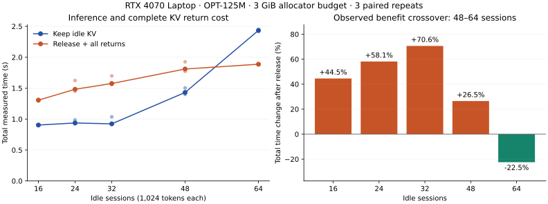

# 真实 GPU 缓存与重算成本验证

[统一证据索引](evidence/validation-index.json)将本页 CUDA 压力曲线、官方 KV 事件和 CPU Mocker 调度矩阵按各自执行类型、源码与原始摘要关联。

`bench.cuda_kv` 使用本地预训练 OPT-125M 权重和实际 CUDA 前向推理，测量闲置会话的 KV 驻留、释放、重建与竞争请求吞吐。权重读取采用 `weights_only=True`，模型从本地目录加载。默认 revision 为 `27dcfa74d334bc871f3234de431e71c6eeba5dd6`，报告记录权重、配置和执行脚本的 SHA-256。

RTX 4070 Laptop 8 GiB、WSL2、驱动 591.74、PyTorch 2.9.1 / CUDA 12.8 完成 **30/30 组真实 CUDA 测量**：五个压力点，每点 KEEP/释放各三次。64 个闲置会话时，计入全部重建的总耗时降低 **22.5%**；16 个会话时增加 **44.5%**。24/32/48 会话的补测将当前收益反转范围缩到 **48～64 个会话之间**。

[16/64 会话原文](evidence/gpu/cuda-kv-d3b0566/result.json)固定于 `d3b0566`，[24/32/48 会话原文](evidence/gpu/cuda-kv-middle-b91c716/result.json)固定于 `b91c716`；两份脚本的差异是 WSL `nvidia-smi` 路径探测，模型、显存预算、输入与执行协议一致。[汇总 JSON](evidence/gpu/cuda-kv-pressure-curve.json)、[CSV](evidence/gpu/cuda-kv-pressure-curve.csv)保存各点三组配对样本、原文 SHA-256 和完整分母。



| 闲置会话 | 实际 KV 张量 | KEEP / 释放后的 batch | KEEP / 释放后的 token/s | KEEP / 释放并重建的总秒数 | 总时间变化 |
| --- | --- | --- | --- | --- | --- |
| 16 | 576 MiB | 16 / 16 | 1,132.93 / 1,114.05 | 0.904 / 1.306 | +44.5% |
| 24 | 864 MiB | 16 / 16 | 1,092.35 / 1,104.47 | 0.937 / 1.482 | +58.1% |
| 32 | 1,152 MiB | 16 / 16 | 1,108.85 / 1,097.98 | 0.923 / 1.576 | +70.6% |
| 48 | 1,728 MiB | 8 / 16 | 715.64 / 1,105.62 | 1.431 / 1.810 | +26.5% |
| 64 | 2,304 MiB | 4 / 16 | 420.71 / 1,133.15 | 2.434 / 1.887 | −22.5% |

表中时间和吞吐为三次测量的中位数，百分比使用两种策略中位数之比。高压力下，释放缓存扩大了可同时运行的 batch；低压力下，两种策略具有相同准入能力，释放与重建增加总时间。48 会话点已把 batch 从 8 扩到 16，全部会话重建中位耗时 0.606 秒仍超过竞争阶段节省；64 会话点的 4→16 并发提升覆盖了 0.746 秒重建成本。batch 按二次幂离散变化，因此当前结果给出两个实测坐标之间的反转范围。

16/64 会话时设备空闲显存增加中位数分别为 560/2,340 MiB；allocator 分块、对齐和缓冲区共同影响归还量。表中 KV 张量值取原始 `idle_kv_storage_bytes`，原文同时保留张量、已分配、预留和设备空闲四类读数。

实验固定 3 GiB PyTorch 进程显存预算。每个会话具有 1,024 token 的真实 KV；竞争负载为 32 个请求，每请求生成 32 token。准入从 batch 16 开始，使用完整 prefill/decode 探测能够放入预算的最大二次幂 batch。每组执行三次，交替 KEEP 与释放顺序。CUDA allocator 的预算拒绝作为准入结果记录。

| 观测 | 采集方式 |
| --- | --- |
| KV 物理张量 | 按 CUDA storage 地址去重后累计字节 |
| 已分配显存 | `torch.cuda.memory_allocated()` |
| allocator 预留 | `torch.cuda.memory_reserved()` |
| 设备空闲显存 | `torch.cuda.mem_get_info()`，包含桌面等其他进程的变化 |
| 竞争推理 | 完整模型 prefill、逐 token decode、实际完成耗时与输出摘要 |
| 返回成本 | 重新 prefill 全部释放会话，核验原会话的后续 token 一致 |
| 资源释放 | 删除 KV、归还 allocator 空闲块、删除模型，随后退出进程 |

报告同时保存竞争阶段吞吐和“竞争阶段 + KV 重建 + 释放开销”的时间。释放收益取决于显存压力、可增加的并发量以及闲置会话的返回频率。三次本地试验用于描述这台设备上的配对变化，原始离散样本与中位数一起呈现。曲线汇总核验每对相同输入、相同输出摘要以及恢复后 continuation 一致。

首次 12 组运行的进程组峰值 RSS 为 1.43 GiB、耗时 48.87 秒；中间 18 组为 1.37 GiB、67.78 秒。[首次退出检查](evidence/gpu/cuda-kv-d3b0566/cleanup.json)与[中间点退出检查](evidence/gpu/cuda-kv-middle-b91c716/cleanup.json)均记录零 CUDA 计算进程。中间点另有两次主机余量保护中断：[3/18 条记录](evidence/gpu/cuda-kv-middle-20113d5-interrupted/termination.json)和[0/18 条记录](evidence/gpu/cuda-kv-middle-b91c716-interrupted/termination.json)，保留各自原文与停止原因。曲线使用完整配对运行。

```bash
OMP_NUM_THREADS=1 MKL_NUM_THREADS=1 OPENBLAS_NUM_THREADS=1 \
python3 scripts/resource_guard.py \
  --log artifacts/gpu-local/kv.log \
  --max-rss-mib 1800 --min-available-mib 2304 --min-free-gib 12 \
  --timeout 600 -- \
  python3 -m bench.cuda_kv --idle-counts 16 24 32 48 64 --output artifacts/gpu-local/kv.json

python3 -m bench.analysis.cuda_kv \
  docs/evidence/gpu/cuda-kv-d3b0566/result.json \
  docs/evidence/gpu/cuda-kv-middle-b91c716/result.json
```

脚本持续核验主机和显卡余量：主机保留至少 2,304 MiB 可用内存与 12 GiB 磁盘，显卡保留至少 1,536 MiB 空闲显存；参数校验将单进程显存预算限制在 4 GiB 以内。外层保护器对整个进程组执行内存、日志和运行时限检查。运行使用现有依赖和模型缓存，退出时释放本次 CUDA 上下文。

## Token 重算与原生预算

[统一成本汇总](evidence/gpu/token-cost-summary.json)将 CUDA 压力、实际 Prefix 命中和原生逻辑配额按来源摘要连接。30 组测量的会话上下文均为 1,024 token，下表给出每个压力点的中位成本：

| 闲置会话 | KV 驻留 MiB | 全部会话 KV 重算 s | KEEP／释放并重建总耗时 s | 总耗时变化 |
| ---: | ---: | ---: | ---: | ---: |
| 16 | 576 | 0.179 | 0.904／1.306 | +44.5% |
| 24 | 864 | 0.291 | 0.937／1.482 | +58.1% |
| 32 | 1,152 | 0.389 | 0.923／1.576 | +70.6% |
| 48 | 1,728 | 0.606 | 1.431／1.810 | +26.5% |
| 64 | 2,304 | 0.746 | 2.434／1.887 | −22.5% |

原生 ThunderAgent 在同一绑定跨 Actor epoch 时保持 `X-Dynamo-Session-ID`，并旋转 inference lease。稳定路由身份为前缀亲和性提供连续键；原生测试验证身份连续和旧 lease 失效。真实 GPU 的热缓存命中由下节独立事件实验测得，跨 Suspend/Resume 的物理命中率消融标为 `not_collected_cross_suspend_resume_gpu`；数值接口中的空值附有同名采集状态说明。[公开指标](evidence/release-metrics.json)使用明确状态字段展示该项。

[原生 CPU Mocker 回执](evidence/dynamo-native-mocker.json)记录 acting 逻辑配额 **708 → 0 → 708**：SUSPENDED 释放 708 个配额 Token，RESUMING 恢复预算。它度量 Program 准入可用量；CUDA 张量、vLLM block 与物理 Prefill 使用各自观测。

[跨 MEMORY 生命周期的 CPU 联合验证](LIFECYCLE_KV_VALIDATION.md)完成 **54/54 Trial**：真实 Substrate/gVisor 恢复、双官方 Mocker、身份连续与旧 Lease 401 共同验收，逻辑预算为 **257 → 0 → 257**，保留缓存时模拟命中 **240/256 Token**。该批证据记录 `actor_lifecycle_integration=true`、`gpu_execution=false`，模型请求来自外部驱动；本节 GPU 实验保留各自原始运行口径。

## 官方 Dynamo KV 事件与真实 vLLM

源码 `6512813` 在同一台 RTX 4070 Laptop 上完成官方事件链路与三轮 Prefill 对账。环境为 vLLM 0.33.0、PyTorch 2.14.0+cu130、Dynamo runtime 1.7.0；Dynamo 源码固定为 `c5680e573b86623df3b6b017a408373aeba93469`。本节使用真实分页 KV 引擎，前述 30 组压力曲线使用独立 Transformers CUDA 后端。

```text
固定 token_ids → Dynamo completions → 官方默认 Selector → vLLM CUDA
                                      ↑                    │
                    官方内置 KVIndexer ← 原生 relay ← ZMQ KVEvent
                                                           ├→ 官方独立 KVIndexer
                                                           └→ 序号／时间只读观察器
```

Selector 使用上游 `dynamo-default-cost-fn`，启用 CACHE 输入；独立官方 KVIndexer 的 `/query`、`/dump` 与 vLLM Prometheus 指标完成交叉对账。OPT 以 `completions` 接口注册，全部请求使用固定 token IDs。有限 **32 MiB KV pool** 通过互异前缀触发真实驱逐，单请求 256 token、输出 1 token、block size 16、单 Worker、单序列。

| 验收 | 实测结果 |
| --- | --- |
| 原生事件 | 26 个连续 batch；26 个 BlockStored、287 个 BlockRemoved；relay 丢事件为 0 |
| 事件新鲜度 | producer 至观察器接收为 0.482～0.849 ms |
| 官方索引前缀 | 冷请求前 0 → 热请求前 256 → 驱逐后 0 → 重新生成后 256 token |
| 默认 Selector | 热请求返回实际 Worker ID，`kv_hit_rate=1.0` |
| 热请求实际计算 | 三轮均命中 240 token、计算 16 token |
| 实际 Prefix Cache 命中率 | 三轮均为 240/256＝93.75%；三次热请求合计避免重算 720 token |
| 驱逐后实际计算 | 三轮均命中 0 token、计算 256 token |
| 新计算 token 观测误差 | 六次请求：完整上下文预算 MAE 120 token；官方缓存观测 MAE 0 token |
| Prefill 时间 | 热请求中位数 8.992 ms；驱逐后 9.213 ms；逐对差值全部保留 |
| 主机与显卡 | 峰值 PSS 3.31 GiB、RSS 4.35 GiB；设备使用增量峰值 488 MiB |
| 资源清理 | 本次进程组 RSS 归零，保护器未触发 |

vLLM 为输出 logits 保留至少一个待计算 token，复用按完整 block 计数：`usable_hit = min(indexed_tokens, floor((prompt_tokens − 1) / 16) × 16)`。因此官方索引具有完整 256-token 前缀时，实际命中为 240 token。[vLLM 计算边界](https://github.com/vllm-project/vllm/blob/v0.33.0/vllm/v1/core/kv_cache_manager.py#L296)与[对账实现](../experiments/dynamo/kv_events.py)共同约束预测，六次请求均满足“新增计算＋实际命中＝输入长度”。完整上下文预算是缺少驻留信息时的比较代理。

固定三轮在首次 cold/hot/eviction 序列之后执行，首次运行及初始化耗时单独保留。该测点的增量价值是精确区分相同 token 预算下的缓存驻留和重算工作量；Prefill 中位数差约 0.221 ms。本阶段以**官方 KV 事件集成与物理缓存对账观测**交付，Actor 生命周期继续使用独立验收的队列和恢复成本策略。单 Worker 的结论覆盖缓存行为和观测准确度，多 Worker 路由选择收益由相应硬件实验评估。

[原始验收](evidence/gpu/kv-events-6512813-observations/result.json) · [全部六次对账](evidence/gpu/kv-events-6512813-observations/observations.json) · [事件原文](evidence/gpu/kv-events-6512813-observations/events.json) · [11 次接入尝试与完整分母](evidence/gpu/kv-events-summary.json)

归档包含 2 次通过与 9 次失败的完整尝试。失败原因覆盖本机 GLIBC 与构建目标不匹配、系统端口范围、主机资源保护及模型元数据注册；各次原始日志和退出状态保持独立身份。可用 native wheel 由 [Ubuntu 22.04 Actions](https://github.com/lilong555/agentcloud/actions/runs/42776227181)构建，Rust 编译留在 hosted runner。当前配置使用串行服务初始化、loopback 通信、eager 推理和原生采样；运行期间保留至少 2,304 MiB 系统可用内存、1,536 MiB 显卡空闲和 12 GiB 磁盘。

完整依赖、模型元数据准备和资源参数见[单 Worker 复现入口](../experiments/dynamo/kv_events_README.md)。对账汇总可离线重建：

```bash
python3 -m bench.analysis.kv_events --output artifacts/kv-events-recomputed.json
python3 -m bench.analysis.token_costs --output artifacts/token-costs-recomputed.json
```
