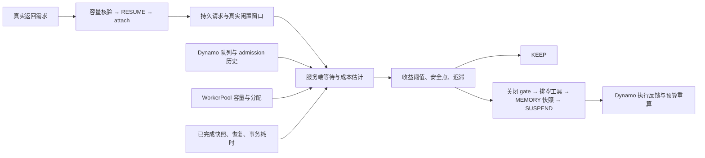

# 自主生命周期调度

AgentCloud 从持久请求、Dynamo 实际准入队列、WorkerPool 可分配容量及已经完成的快照／恢复操作估计等待收益，自动执行 KEEP、SUSPEND 和 RESUME。每个决策保留观测来源、成本、epoch、原因与生命周期回执。

## 服务端闭环

在配置 Substrate 与 Dynamo 的协调器启动参数中加入：

```text
--enable-autonomous-scheduler
--scheduler-interval 250ms
--scheduler-stable-for 500ms
```

调度器每次选择待模型、显式闲置或有返回需求的会话。同一会话的生命周期互斥，不同会话最多同时执行四个调度操作。正在运行的工具、未决副作用、陈旧观测和恢复冷却都会保留当前资源，并在诊断中记录原因。



等待估计使用同租户、同画像最近 32 个模型完成观测的 p75。对于协调器排队中的请求，结合前方请求数与模型并发上限计算等待；对于已经发出的请求，扣除实际已执行时间。Dynamo 存在排队时，原生 admission 历史和队列长度参与预测。所有输入带观测时间，超过五秒的上游观测会触发 KEEP。

闲置估计来自已经结束的 `idle_window_ms`，缺少显式窗口时使用实际工具间隔 `idle_until_tool_ms`。`--scheduler-idle-prior` 默认零；可配置冷启动先验，获得历史样本后由 p75 观测替代。真实模型请求和实际工具返回持续更新估计。

Worker 压力取 Actor 槽位占用率与内存预留占用率的较大值。恢复候选同时满足 ACTIVE、正注册 epoch、已发布 sandbox class 和默认运行时兼容版本，再逐 Worker 检查可分配空间，保留资源碎片信息。尚在初始化的 Worker 记录于 `unready_workers`，待运行时注册完成后参与容量判断。内存来自真实 assignment，包含运行时预留开销。

## 条件成本策略

`--scheduler-policy cost-aware` 使用有界的条件剩余等待估计与固定阶段期限；待恢复会话形成容量成本输入。默认策略为 `observed`。预测样本、生命周期安全条件、开销证据和实机对照协议见[条件等待与成本期限调度](COST_SCHEDULING.md)。

## Agent 接入

In-Actor 模型循环先持久登记逻辑请求，模型完成后调度器登记返回需求。Actor 恢复并 attach 后认领原请求；KEEP 路径可在同一 epoch 继续执行模型工具调用。

External Harness 用以下接口报告已经发生的事实：

```http
POST /v1/sessions/demo/idle-window
Authorization: Bearer <tenant-token>
Content-Type: application/json

{"operation_id":"think-8","expected_epoch":3,"phase":"START","ttl_ms":600000}
```

窗口结束时以原窗口 epoch 提交 `phase: END`。TTL 控制闲置观测有效期；等待长度由完成的历史窗口测得。用户或工具真正返回时提交：

```http
POST /v1/sessions/demo/return-demand
Authorization: Bearer <tenant-token>
Content-Type: application/json

{"operation_id":"return-8","expected_epoch":3}
```

返回回执从 PENDING 变为 COMPLETED，并携带 `result_epoch`。该请求可在挂起途中登记；生命周期完成后调度器根据实际容量恢复。相同操作 ID 与 epoch 重试返回持久回执。

## 收益阈值与迟滞

```text
break_even_ms = snapshot_cost_ms + resume_cost_ms + journal_cost_ms
pressure_factor = 1 - 0.75 × worker_pressure
effective_margin_ms = ceil(margin_ms × pressure_factor)
effective_min_residence_ms = ceil(min_residence_ms × pressure_factor)
threshold_ms = break_even_ms + effective_margin_ms
```

快照成本优先取 `checkpoint_total_ms` 的 p75，也可由挂起与持久化等待相加；恢复成本来自 `resume_ready_ms`，事务成本来自 `journal_commit_ms`。无观测时采用 500／500／50 毫秒的启动成本先验。默认安全余量 500 毫秒、最小驻留 1000 毫秒、恢复冷却 5000 毫秒。

预计等待超过阈值、驻留与冷却满足条件、工具安全点成立且候选状态稳定至少 500 毫秒后，执行 SUSPEND。实际生命周期耗时与估计分别保存，用于检查预测误差和恢复代价。

## 显式模型边界

`POST /v1/sessions/{id}/model-boundary` 支持手动触发。提交 `operation_id`、`expected_epoch`，省略或使用零 `expected_wait_ms` 时，服务端根据持久请求与 Dynamo 观测估计成本和等待。自主调度内部还传入实际 WorkerPool 观测；返回 `estimate_source: server_observed` 与 `server_evidence`。

显式非零等待估计用于可控回放与兼容客户端，回执标记 `estimate_source: caller_estimate`。可选的 `snapshot_cost_ms`、`resume_cost_ms`、`journal_cost_ms`、`min_residence_ms` 范围为 0～600000，`expected_wait_ms` 范围为 0～86400000，`worker_pressure` 范围为 0～1。

操作 ID 同时保护请求输入和生命周期预留。相同 ID 的不同输入返回 `409 payload_conflict`；处理结果未知时保持闭闸并进入 `RECOVERY_REQUIRED`。Substrate 在同一 lease 中检查 Actor UID/version，快照按 UUID/generation 等待 durable，恢复核验独立 Tag 与实际 MEMORY fidelity。

## 诊断与验收

```bash
bin/agentcloud status --url http://127.0.0.1:8090
bin/agentcloud trace workspace-id --json
```

CLI 使用 `AGENTCLOUD_TOKEN`。事件包含 `autonomous.keep`、`autonomous.SUSPEND`、`autonomous.RESUME`、决策原因和原始观测。Prometheus 与 OpenTelemetry 关联请求、模型 attempt、原生 admission、快照持久化和恢复阶段。

[自主闭环回归](../internal/control/autonomous_test.go)、[生命周期竞争回归](../internal/control/scheduling_test.go)、[WorkerPool 资源碎片回归](../internal/adapters/substrate/observability_test.go)与[真实规模实验](EXPERIMENTS.md)共同提供验收依据。
