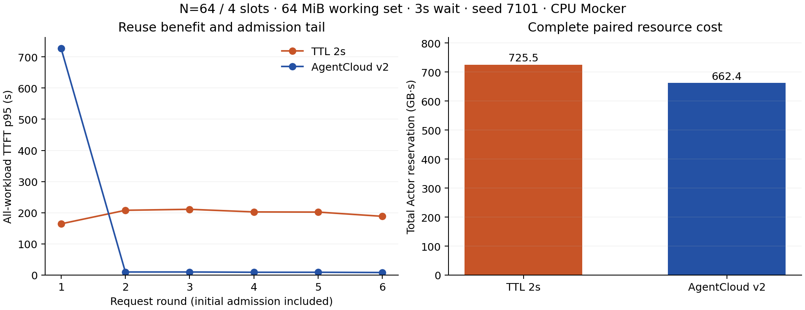

# AgentCloud v2：成本决策与配对验收

`agentcloud-v2` 在连续安全等待期间维护一个持久 episode，将实际模型登记、工具完成、返回需求和 Actor epoch 作为时间边界。未知等待使用固定两秒期限；已知等待通过条件剩余分布比较驻留与释放成本。默认策略为 `observed`，`cost-aware` 保留独立实现，作为同机基线。

## 决策与安全约束

模型等待转入闲置时沿用 episode 起点和未知期限。工具准入、实际返回需求、新 epoch 和已经结束的等待重置 episode；重启从 PostgreSQL 还原时间边界。首次采样延迟分别为 100 ms 和 1,900 ms 时，期限均由真实事件时间确定。[实现](../internal/control/scheduler_v2.go) · [时钟、重启和竞态测试](../internal/control/scheduler_v2_test.go)

在观测尾部具有充分支持时，候选释放时刻包括最早安全释放、两秒期限、实测盈亏平衡期限及其两倍；完整条件尾提供持续驻留的成本。成本由快照、durable、resume-ready 和 journal 观测生成，待恢复需求与 Worker 可用槽位决定驻留机会成本。条件期望成本为：

```text
b = (checkpoint_ms + resume_ms + journal_ms) / holding_rate
J(delay) = integral(P(remaining > u), u=0..delay)
           + b * P(remaining > delay)
```

持续驻留成本更低时选择 KEEP。未知或支持不足时采用 episode 的两秒期限。实际动作同时满足工具安全点、最小驻留、稳定确认和观测新鲜度要求；恢复冷却采用稳定确认窗口。模型边界在动作前重新估计，并再次核验期间到达的返回需求。[等待分布](../internal/control/waiting.go) · [动作与二次校验](../internal/control/scheduling.go)

每个会话保留最多 32 条诊断，分别记录计算动作、最终动作、观察耗时和决策耗时。工具与模型历史回执继续独立持久化。

## 同机对照与 Shadow

新实验全部使用 `symmetric-program-v1`：E 组、执行反馈开启、Program 跨轮持续，仅最后一轮发送 FINAL。相同 `(N, Seed, Scenario)` 的策略在同一个 Runner 随机顺序串行运行；每个 trial 使用独立数据库、Dynamo 进程、Actor 和 Tag。主机型号、CPU affinity、cgroup、策略顺序和配对 UUID 随结果保存。

`static-2-shadow` 启用旧 cost-aware 的观察和计算，动作由 TTL2 执行。它与 `static-2` 的配对差异用于估计观察与计算开销；它与旧 cost-aware 的差异用于观察动作策略的影响。Shadow 要求同时启用实验控制与自主调度。

```bash
bin/agentcloud serve --enable-experiment-controls \
  --enable-autonomous-scheduler --scheduler-policy cost-aware --scheduler-shadow
```

实验首先写入全部计划 trial 和请求占位。业务失败且清理成功时继续后续策略；清理失败时，后续 trial 保留为 `BLOCKED_CLEANUP`。监督者按本次 trial 标记回收跨进程组残留，并使用 pidfd 固定进程身份。Gate 1、Gate 2 和边界初筛的 trial 执行预算为 1,500 秒；边界确认对两种策略统一使用 2,400 秒，清理预算均为 300 秒。[Runner](../bench/scale.py) · [Actions](../.github/workflows/live-scale.yml)

## 两阶段规模与停止条件

| 阶段 | 配置 | 配对组 / trial | 策略 |
|---|---|---:|---|
| Gate 1 | N=32/64，7101～7103 | 6 / 24 | TTL2、旧 cost-aware、v2、TTL2-Shadow |
| 边界初筛 | N=64，7101，16/64/128 MiB × 1/3/6 s | 9 / 18 | TTL2、v2 |
| Gate 2 | N=32/64，7301～7305 | 10 / 50 | TTL15、TTL2、Observed、旧 cost-aware、v2 |
| 边界确认 | 16 MiB/1 s、64 MiB/3 s、128 MiB/3 s，7401～7403 | 9 / 18 | TTL2、v2 |

Gate 2 使用 Gate 1 确认有效后冻结的代码。边界确认覆盖短等待、资源与尾延迟取舍、高恢复成本三类坐标。128 MiB/3 s 初筛中，v2 完成 384/384 请求，TTL2 在原预算内完成 314/384；确认阶段统一延长观测预算，用于完整测量两种策略的交付率与资源、尾延迟。本轮仅包含一个主要 v2 方案及必要修正；最终结果按工作集、等待与恢复成本记录适用范围，保留资源和时延的实际取舍。

## 联合验收

主指标为 **总 Actor 预留 GB·s** 与 **交互 TTFT P95**。每个规模至少三个完整种子对，全部计划请求正确完成；v2 比较同时要求相同配对 UUID 和统一协议。对每个种子计算候选减基线的差值，两个指标的配对 95% bootstrap 区间上界均不大于零，至少一项严格小于零，才报告 `supported_joint_improvement`。

Stranded GB·s、Goodput、恢复次数、恢复耗时、控制面 CPU/RSS 和资源采样覆盖单独报告。主图显示各 trial 资源均值与合并请求的交互 P95；联合判定使用逐 seed 的 P95 配对差值。首个尝试独立于结果选入主统计，后续重跑保留完整身份与分母。[统计实现与图表](../bench/analysis/scale.py)

资源积分窗口从全部 Workspace 完成初始 MEMORY 快照、发出 `all_workspaces_ready` 起，到全部会话循环及 `final-release` 结束。该窗口包含首次容量准入、全部模型／工具轮次、等待、挂起和恢复。依赖部署、初始 Actor 准备与销毁清理由独立的 Job 时间和清理报告记录。[窗口定义](../bench/scale.py#L529) · [资源积分](../bench/scale.py#L458)

## Gate 1 实测

`a7e324a` 的独立 cohort 使用相同冻结调度器与三种子，运行身份为 [42800756685](https://github.com/lilong555/agentcloud/actions/runs/42800756685)。N32 的 **12/12 trial、2,304/2,304 请求**和全部清理通过；N64 三组仍在执行，完整矩阵保留 24 trial／6,912 请求分母。[当前统计](evidence/gate1-a7e324a-summary.json)

| N32 配对基线 | v2 总资源差 GB·s，95% CI | v2 交互 P95 差 s，95% CI | 判定 |
| --- | ---: | ---: | --- |
| 旧 cost-aware | −24.871 [−31.002, −21.006] | −34.756 [−45.966, −26.088] | 两项改善 |
| TTL2 | −1.724 [−6.038, +5.685] | +8.897 [+2.553, +13.776] | 资源区间跨零，P95 较高 |
| TTL2-Shadow | −13.804 [−18.123, −6.576] | −16.270 [−33.110, +5.176] | 资源改善，P95 区间跨零 |

相对 TTL2，v2 的平均恢复次数减少 0.667 次，累计恢复耗时增加 49.795 秒 [41.782, 54.180]；该观察与资源／尾延迟取舍一同保留。下面的早期 cohort 与独立重验按各自运行身份列出。

[原始运行](https://github.com/lilong555/agentcloud/actions/runs/42772928305)固定实验源码 `52af93d`、7101～7103，首轮完成 **23/24 trial、6,717/6,912 请求**。N32 的四策略均完成 576/576 请求；N64 的 v2/7101 发生 CI 访问令牌过期，完成 189/384，其余策略和种子全部完成。[完整首轮分母](evidence/gate1-summary.json)

N32 的差值采用每个种子 v2 减去基线，负数表示减少：

| 基线 | 总预留差 GB·s，配对 95% CI | 交互 P95 差秒，配对 95% CI | 联合判定 |
| --- | --- | --- | --- |
| 旧 cost-aware | −21.614 [−24.996, −16.042] | −27.066 [−41.105, −10.481] | 两项改善 |
| TTL2 | −8.660 [−22.365, +1.554] | −4.988 [−15.267, +0.914] | 均值改善，区间跨零 |
| TTL2-Shadow | −13.059 [−14.113, −11.451] | −13.431 [−20.229, −2.544] | 两项改善 |

### Shadow 开销

Shadow 与 TTL2 由相同 runner 端的两秒动作执行，只增加服务端旧成本策略的观测、计算与有界诊断；计算得到的生命周期动作由 Shadow gate 抑制。[实现](../internal/control/autonomous.go#L386)

| 并发 | 协调器平均 CPU，TTL2 / Shadow | Shadow−TTL2 总预留 GB·s，95% CI | Shadow−TTL2 交互 P95 秒，95% CI |
| --- | --- | --- | --- |
| 32 | 0.0942 / 0.1304 核 | +4.399 [−10.914, +15.667] | +8.444 [+1.934, +18.436] |
| 64 | 0.1263 / 0.1644 核 | +25.706 [+17.507, +34.200] | −18.267 [−24.676, −12.658] |

这组测量把观察与计算的 CPU 成本单独暴露出来，同时保留它对端到端排队时序的实际影响。N64 的资源与延迟变化方向相反；两项主指标和控制开销分别报告。[Shadow 完整统计](evidence/gate1-shadow-summary.json)

### 长时间配对运行的访问有效期

原始 CI 在集群准备时签发一小时的 Substrate service-account token。N64/7101 的第四个策略于 08:12:52 UTC 开始；08:22:17.033 UTC 起产生 **9,382 次 Unauthenticated Worker 观测**，四个挂起操作进入 `OUTCOME_UNKNOWN` 与 `RECOVERY_REQUIRED`，其余 60 个会话保持 SUSPENDED。该运行的 Router mTLS 证书有效至次日 07:15:19 UTC。[逐项来源与状态](evidence/gate1-credential-expiry.json)

CI 访问有效期覆盖整个配对 Job，保留四小时上限，并校验服务账号、audience 和实际签发有效期。每个 trial 保存不含令牌内容的有效期与工作流源码证明。`source_ref` 固定实验 checkout，工作流与实验源码身份分别记录；[完整四策略验证](https://github.com/lilong555/agentcloud/actions/runs/42785891260)使用相同 `52af93d`、N64/7101、随机顺序和资源参数。首轮失败持续保留在主统计与尝试审计中。[有效期检查](../scripts/ci_substrate_access.py)

### 最终释放与自主挂起

N64/7101 的独立验证完成 **1,536/1,536 请求、3/4 trial**，访问有效期与全部清理通过。v2 的 384 个请求和 64 个 Program FINAL 全部完成，一个会话的 `final-release` 收到 `lifecycle_busy`，该 trial 保留失败。[独立统计](evidence/gate1-revalidation-summary.json) · [工作流与清理](evidence/scale-run-42785891260.json)

| 策略 | 总预留 GB·s | 交互 P95 秒 | 请求完成／计划 | trial |
| --- | ---: | ---: | ---: | --- |
| TTL2 | 646.074 | 230.994 | 384/384 | 通过 |
| TTL2-Shadow | 670.665 | 249.642 | 384/384 | 通过 |
| 旧 cost-aware | 717.933 | 368.174 | 384/384 | 通过 |
| v2 | 674.646 | 229.169 | 384/384 | 最终释放竞争失败 |

原始轨迹中，10:22:18.608738676 UTC 自主挂起预留开始，10:22:18.636140 Runner 最终释放被拒收，10:22:21.561493511 自主操作完成。终态为 `SUSPENDED/CLOSED/epoch=7`、`MEMORY`、零活跃工具；`final-release` 的 LifecycleReceipt 尚未创建。[原始回执、时间与摘要](evidence/gate1-lifecycle-race.json)

Runner 对 HTTP 409 `lifecycle_busy` 使用最长 180 秒且受 trial 总预算约束的状态观察，等待已有 RUNNING 预留完成；重新提交时保留同一 operation ID 和 epoch。UNKNOWN、恢复待对账、epoch 变化及传输丢响应保留失败。成功释放验证 MEMORY、关闭的工具 gate 和零活跃工具，槽位只归还一次。[实现](../bench/scale.py#L305) · [十项容量与释放回归](../tests/tooling/test_scale_capacity.py)

## 工作集与等待边界

N64、四槽位、种子 7101 的初筛覆盖九个坐标。16/64 MiB 的六对全部完成；128 MiB 原始初始化同时分配随机字节与可写副本，六个 trial 在运行前退出。预分配并直接读取随机数据后，三个 128 MiB 坐标具有独立源码 `89a4706` 和尝试身份。[完整 24 次尝试](evidence/v2-boundary-summary.json)保留 **6,397/9,216 请求、9 个失败 trial**。

| 工作集／等待 | TTL2 总预留／交互 P95 | v2 总预留／交互 P95 | TTL2／v2 恢复次数 | 完成情况 |
| --- | --- | --- | --- | --- |
| 16 MiB／1 s | 363.440 GB·s／230.603 s | 399.860 GB·s／260.371 s | 71／64 | 两者 384/384 |
| 64 MiB／3 s | 725.459 GB·s／205.941 s | 662.354 GB·s／564.447 s | 384／141 | 两者 384/384 |
| 128 MiB／1 s | 499.786 GB·s／344.690 s | 530.617 GB·s／408.729 s | 72／71 | 两者 384/384 |
| 128 MiB／3 s | 1,500 秒执行预算到期 | 778.879 GB·s／640.355 s | 314／140 | TTL2 314/384；v2 384/384 |

64 MiB／3 s 下，v2 的 KEEP 复用减少 243 次恢复，总资源节省 8.7%。同一机制延长了首批 Actor 占据四个槽位的时间：v2 第一轮全部工作负载的 P95 为 726.994 秒，其后五轮约 8～10 秒；TTL2 的六轮约 164～211 秒。v2 首轮全部请求的槽位排队总时长占 TTFT 总时长 **98.82%**，后续五轮为零；TTL2 各轮约为 **94.82%～95.40%**。资源收益与首次容量准入尾延迟来自相同的驻留选择。[逐轮原始统计](evidence/v2-boundary-summary.json)同时记录 TTFT 和 FairSlots 等待，耗时占比使用逐请求总和。

首次准入遵循 [FairSlots FIFO](../bench/scale.py#L142)，Runner [先取得许可，再登记 ReturnDemand](../bench/scale.py#L317)。协调器的 [readyReturnCountLocked](../internal/control/idle_cost.go#L42)统计已经登记返回需求的挂起会话，并进入 [HoldingRate](../internal/control/scheduler_v2.go#L191)；尚在首次 FIFO 排队的请求由 Runner 持有。由此，这组边界展示了成本复用策略与前置准入队列的联合作用，首次容量公平性是高恢复成本下的主要时延约束。



128 MiB／6 s 的 TTL2 完成 323/384 后到期，逻辑 Program 清理未完成，后续 v2 标记 `BLOCKED_CLEANUP`；Runner 最终 Kind 清理通过。三组边界确认采用 7401～7403 与统一 2,400 秒执行预算，冻结短等待优势、资源／准入取舍和高恢复成本三个坐标。最终交付据完整配对与失败分母记录适用范围，保持现有调度方案。

## 复现

```bash
gh workflow run live-scale.yml -f scope=gate1 -f max_parallel=6 \
  -f native_run_id=42769316617 \
  -f source_ref=52af93d9389c1103af941ec72b885d50ad47e284

python3 -m bench.analysis.scale --candidate agentcloud-v2 \
  --source-commit 52af93d9389c1103af941ec72b885d50ad47e284 \
  --stage gate1 --scenario fixed --github-run-id 42772928305 \
  --matrix-config bench/configs/gate1.json \
  --output docs/evidence/gate1-summary.json

python3 -m bench.analysis.regime

python3 -m bench.analysis.frontier --input docs/evidence/gate1-summary.json \
  --output docs/evidence/gate1-frontier
```

`--github-run-id` 选择明确工作流的独立统计；省略时，最早尝试始终进入主统计，后续尝试进入审计。边界统计从冻结计划读取完整种子集合，缺失种子和未执行请求保留在分母。

[完整诊断](SCHEDULER_DIAGNOSIS.md)提供 v2 的量化依据：未知预测晚完成与工具区间资源占用是主导问题；B/E 配置混杂由本协议统一控制。GPU 事件与物理 KV 测量使用[独立实验入口](GPU_VALIDATION.md)，其环境准备和结果归档独立于本阶段验收。
